## CICD – Introduction

We have learned how to:
 - Create AWS resources, manually (fundamentals)
 - Interact with AWS programmatically (AWS CLI)
 - Deploy code to AWS using Elastic Beanstalk

All these manual steps make it very likely for us to do mistakes!

We would like our code “in a repository” and have it deployed onto AWS
 - Automatically
 - The right way
 - Making sure it’s tested before being deployed
 - With possibility to go into different stages (dev, test, staging, prod)
 - With manual approval where needed

To be a proper AWS developer… we need to learn AWS CICD

## Continuous Integration (CI)

• Developers push the code to a code repository often (e.g., GitHub, CodeCommit, Bitbucket…)

• A testing / build server checks the code as soon as it’s pushed (CodeBuild, Jenkins CI...)

• The developer gets feedback about the tests and checks that have passed / failed

• Find bugs early, then fix bugs

• Deliver faster as the code is tested

• Deploy often

• Happier developers, as they’re unblocked

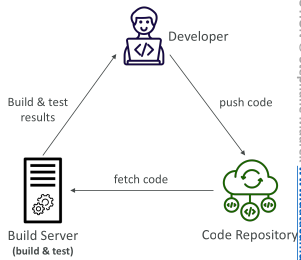

## Continuous Delivery (CD)

• Ensures that the software can be released reliably whenever needed

• Ensures deployments happen often and are quick

• Shift away from “one release every 3 months” to ”5 releases a day”

• That usually means automated deployment (e.g., CodeDeploy, Jenkins CD, Spinnaker...)

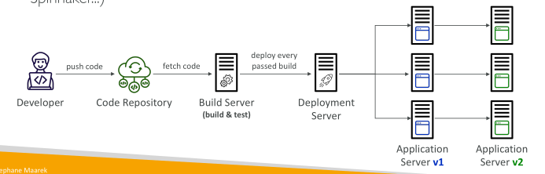

## Technology Stack for CICD

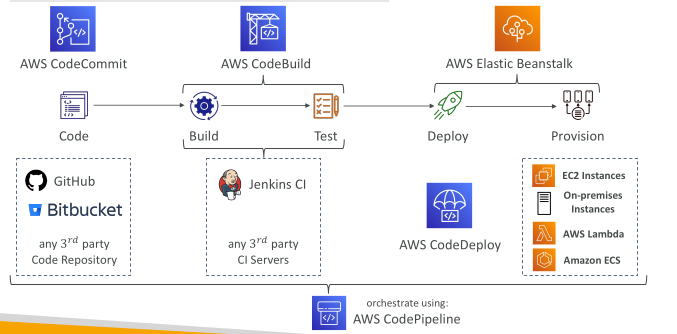

## AWS CodeCommit

• Version control is the ability to understand the various changes that happened to the code over time (and possibly roll back)

• All these are enabled by using a version control system such as Git

• A Git repository can be synchronized on your computer, but it usually is uploaded on a central online repository

Benefits are:
 - Collaborate with other developers
 - Make sure the code is backed-up somewhere
 - Make sure it’s fully viewable and auditable

## AWS CodeCommit

Git repositories can be expensive

The industry includes GitHub, GitLab, Bitbucket...

And AWS CodeCommit:
 - Private Git repositories
 - No size limit on repositories (scale seamlessly)
 - Fully managed, highly available
 - Code only in AWS Cloud account => increased security and compliance
 - Security (encrypted, access control...)
 - Integrated with Jenkins, AWS CodeBuild, and other CI tools

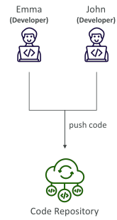

## CodeCommit – Security

Interactions are done using Git (standard)

Authentication
 - SSH Keys – AWS Users can configure SSH keys in their IAM Console
 - HTTPS – with AWS CLI Credential helper or Git Credentials for IAM user

Authorization
 - IAM policies to manage users/roles permissions to repositories

Encryption
 - Repositories are automatically encrypted at rest using AWS KMS
 - Encrypted in transit (can only use HTTPS or SSH – both secure)

Cross-account Access
 - Do NOT share your SSH keys or your AWS credentials
 - Use an IAM Role in your AWS account and use AWS STS (AssumeRole API)

## CodeCommit vs. GitHub

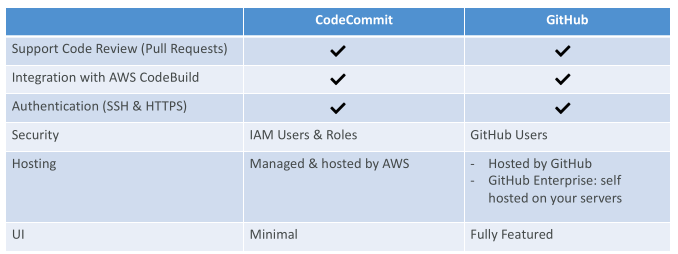

## CodeCommit – Monitoring with EventBridge

• You can monitor CodeCommit events in EventBridge (near real-time)

• pullRequestCreated, pullRequestStatusChanged, referenceCreated, commentOnCommitCreated...

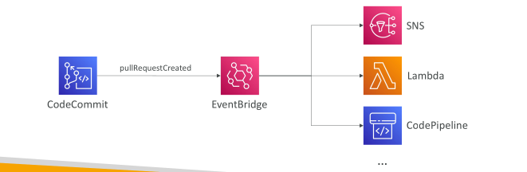

## Migrate Git Repository to CodeCommit

• You can migrate a project hosted on another Git repository (e.g., Github, GitLab...) to CodeCommit repository

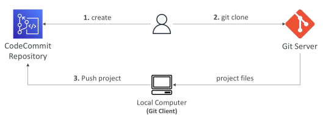

## CodeCommit – Cross-Region Replication

• Use case: achieve lower latency pulls for global developers, backups…

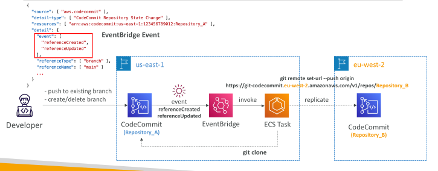

## CodeCommit – Branch Security

• By default, a user who has push permissions to a CodeCommit repository can contribute to any branch

• Use IAM policies to restrict users to push or merge code to a specific branch

• Example: only senior developers can push to production branch

• Note: Resource Policy is not supported yet

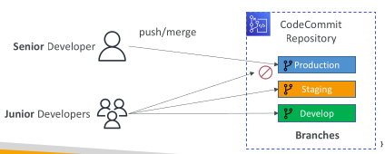

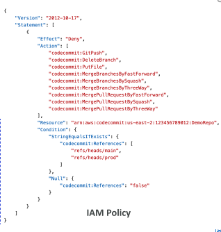

## CodeCommit – Pull Request Approval Rules

Helps ensure the quality of your code by requiring user(s) to approve the open PRs before the code can be merged

Specify a pool of users to approve and number of users who must approve the PR

Specify IAM Principal ARN (IAM users, federated users, IAM Roles, IAM Groups)

Approval Rule Templates
 - Automatically apply Approval Rules to PRs in specific repositories
 - Example: define different rules for dev and prod branches

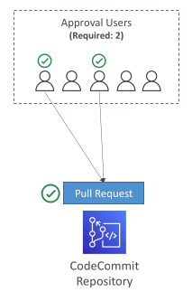

