## AWS CodePipeline

Visual Workflow to orchestrate your CICD

Source – CodeCommit, ECR, S3, Bitbucket, GitHub

Build – CodeBuild, Jenkins, CloudBees, TeamCity

Test – CodeBuild, AWS Device Farm, 3rd party tools...

Deploy – CodeDeploy, Elastic Beanstalk, CloudFormation, ECS, S3...

Invoke – Lambda, Step Functions

Consists of stages:
 - Each stage can have sequential actions and/or parallel actions
 - Example: Build è Test è Deploy è Load Testing è …
 - Manual approval can be defined at any stage

## Technology Stack for CICD

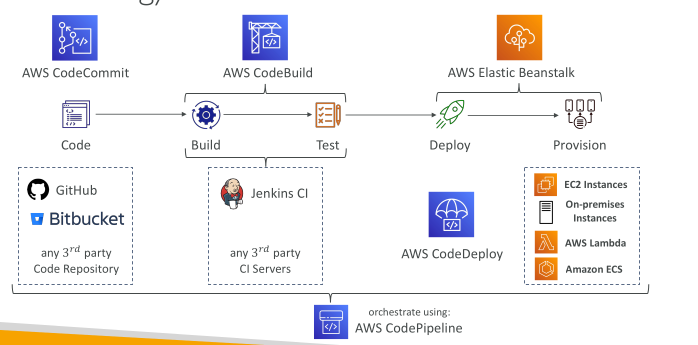

## CodePipeline – Artifacts

• Each pipeline stage can create artifacts
• Artifacts stored in an S3 bucket and passed on to the next stage

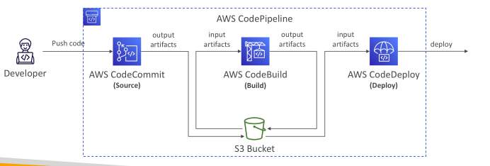

## CodePipeline – Troubleshooting

• For CodePipeline Pipeline/Action/Stage Execution State Changes

Use CloudWatch Events (Amazon EventBridge). Example:
 - You can create events for failed pipelines
 - You can create events for cancelled stages

• If CodePipeline fails a stage, your pipeline stops, and you can get information in the console

• If pipeline can’t perform an action, make sure the “IAM Service Role” attached does have enough IAM permissions (IAM Policy)

• AWS CloudTrail can be used to audit AWS API calls

## CodePipeline – Events vs. Webhooks vs. Polling

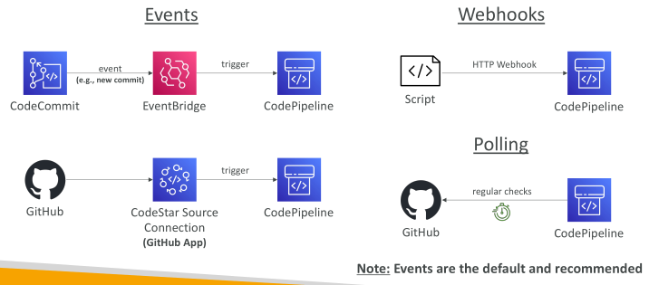

## CodePipeline – Action Types Constraints for Artifacts

Owner
 - AWS – for AWS services
 - 3rd Party – GitHub or Alexa Skills Kit
 - Custom – Jenkins

Action Type
 - Source – S3, ECR, GitHub...
 - Build – CodeBuild, Jenkins
 - Test – CodeBuild, Device Farm, Jenkins
 - Approval – Manual
 - Invoke – Lambda, Step Functions
 - Deploy – S3, CloudFormation, CodeDeploy, Elastic Beanstalk, ECS, Service Catalog...

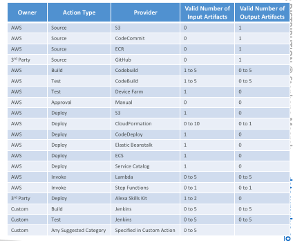

## CodePipeline – Manual Approval Stage

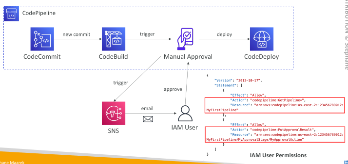

## CodePipeline – CloudFormation as a Target

• CloudFormation Deploy Action can be used to deploy AWS resources

• Example: deploy Lambda functions using CDK or SAM (alternative to CodeDeploy)

• Works with CloudFormation StackSets to deploy across multiple AWS accounts and AWS Regions

Configure different settings:
 - Stack name, Change Set name, template, parameters, IAM Role, Action Mode...

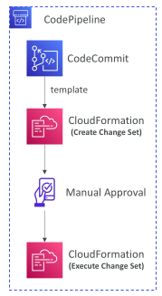

## CodePipeline – CloudFormation Integration

• CREATE_UPDATE – create or update an existing stack

• DELETE_ONLY – delete a stack if it exists

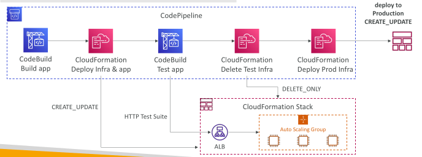

## CodePipeline – CloudFormation as a Target

Action Modes
 - Create or Replace a Change Set, Execute a Change Set
 - Create or Update a Stack, Delete a Stack, Replace a Failed Stack

Template Parameter Overrides
 - Specify a JSON object to override parameter values
 - Retrives the parameter value from CodePipeline Input Artifact
 - All parameter names must be present in the template
 - Static – use template configuration file (recommended)
 - Dynamic – use parameter overrides

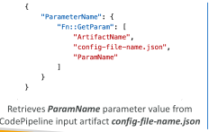

## CodePipeline – Best Practices

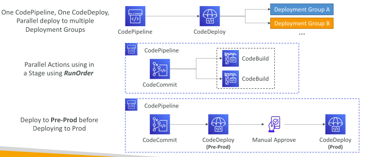

## CodePipeline & EventBridge

• EventBridge – detect and react to changes in execution states (e.g., intercept failures at certain stages)

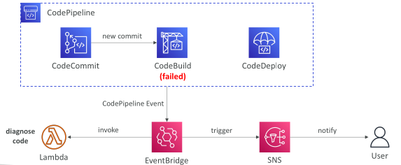

## CodePipeline – Invoke Action

• Lambda – invokes a Lambda function within a Pipeline

• Step Functions – starts a State Machine within a Pipeline

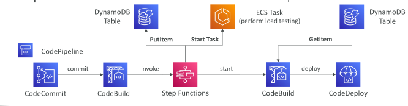

## CodePipeline – Multi Region

Actions in your pipeline can be in different regions
 - Example: deploy a Lambda function through CloudFormation into multiple regions

S3 Artifact Stores must be defined in each region where you have actions
 - CodePipeline must have read/write access into every artifact buckets
 - If you use the console default artifact buckets are configured, else you must create them

CodePipeline handles the copying of input artifacts from one AWS Region to the other Regions when performing cross-region actions
 - In your cross-region actions, only reference the name of the input artifacts

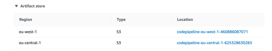

## CodePipeline – CloudFormation Multi Region

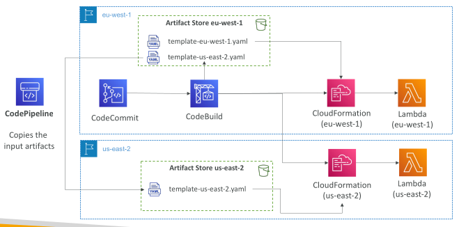