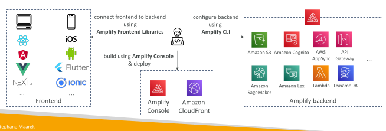
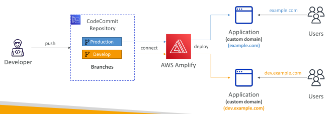

## AWS Amplify - web and mobile applications

• A set of tools and services that helps you develop and deploy scalable full stack web and mobile applications

• Authentication, Storage, API (REST, GraphQL), CI/CD, PubSub, Analytics, AI/ML Predictions, Monitoring...

• Connect your source code from GitHub, AWS CodeCommit, Bitbucket, GitLab, or upload directly

## AWS Amplify – Continuous Deployment

• Connect to CodeCommit and have one deployment per branch

• Connect your application to a custom domain (e.g., Route 53)

