## AWS CodeBuild

A fully managed continuous integration (CI) service

Continuous scaling (no servers to manage or provision – no build queue)

Compile source code, run tests, produce software packages...

Alternative to other build tools (e.g., Jenkins)

Charged per minute for compute resources (time it takes to complete the builds)

Leverages Docker under the hood for reproducible builds

Use prepackaged Docker images or create your own custom Docker image

Security:
 - Integration with KMS for encryption of build artifacts
 - IAM for CodeBuild permissions, and VPC for network security
 - AWS CloudTrail for API calls logging

## AWS CodeBuild

• Source – CodeCommit, S3, Bitbucket, GitHub
• Build instructions: Code file buildspec.yml or insert manually in Console
• Output logs can be stored in Amazon S3 & CloudWatch Logs
• Use CloudWatch Metrics to monitor build statistics
• Use EventBridge to detect failed builds and trigger notifications
• Use CloudWatch Alarms to notify if you need “thresholds” for failures
• Build Projects can be defined within CodePipeline or CodeBuild

## CodeBuild – Supported Environments

• Java
• Ruby
• Python
• Go
• Node.js
• Android
• .NET Core
• PHP
• Docker – extend any environment you like

## CodeBuild – How it Works

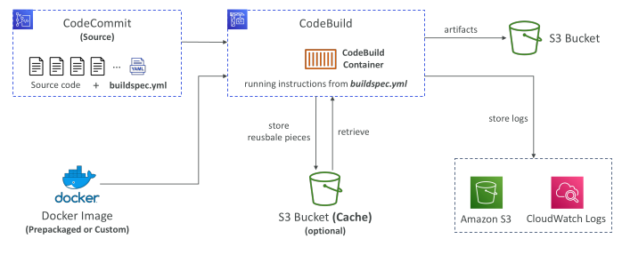

## CodeBuild – buildspec.yml

buildspec.yml file must be at the root of your code

env – define environment variables
 - variables – plaintext variables
 - parameter-store – variables stored in SSM Parameter Store
 - secrets-manager – variables stored in AWS Secrets Manager

phases – specify commands to run:
 - install – install dependencies you may need for your build
 - pre_build – final commands to execute before build
 - Build – actual build commands
 - post_build – finishing touches (e.g., zip output)

artifacts – what to upload to S3 (encrypted with KMS)

cache – files to cache (usually dependencies) to S3 for future build speedup

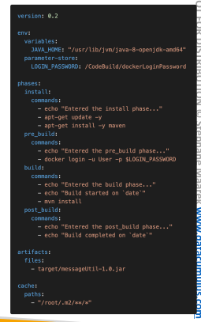

## CodeBuild – Local Build

• In case of need of deep troubleshooting beyond logs…
• You can run CodeBuild locally on your desktop (after installing Docker)
• For this, leverage the CodeBuild Agent
• https://docs.aws.amazon.com/codebuild/latest/userguide/use-codebuild-
agent.html

## CodeBuild – Inside VPC

By default, your CodeBuild containers are launched outside your VPC
 - It cannot access resources in a VPC

You can specify a VPC configuration:
 - VPC ID
 - Subnet IDs
 - Security Group IDs

Then your build can access resources in your VPC (e.g., RDS, ElastiCache, EC2, ALB...)

Use cases: integration tests, data query, internal load balancers...

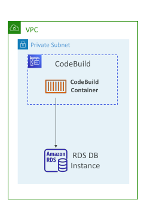

## CodeBuild – Environment Variables

Default Environment Variables
 - Defined and provided by AWS
 - AWS_DEFAULT_REGION, CODEBUILD_BUILD_ARN, CODEBUILD_BUILD_ID, CODEBUILD_BUILD_IMAGE...

Custom Environment Variables
 - Static – defined at build time (override using start-build API call)
 - Dynamic – using SSM Parameter Store and Secrets Manager

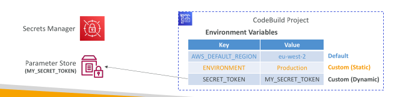

## CodeBuild – Security

• CodeBuild Service Role allows CodeBuild to access AWSresources on your behalf (assign the required permissions)

Use cases:
 - Download code from CodeCommit repository
 - Fetch parameters from SSM Parameter Store
 - Upload build artifacts to S3 bucket
 - Fetch secrets from Secrets Manager
 - Store logs in CloudWatch Logs

• In-transit and at-rest data encryption (cache, logs...)

• Build output artifact encryption (requires access to KMS)

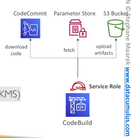

## CodeBuild – Build Badges

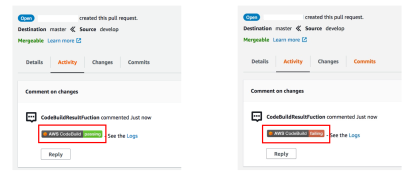

• Dynamically generated badge that displays the status of the latest build

• Can be accessed through a public URL for your CodeBuild project

• Supported for CodeCommit, GitHub, and BitBucket

• Note: Badges are available at the branch level

## CodeBuild – Triggers

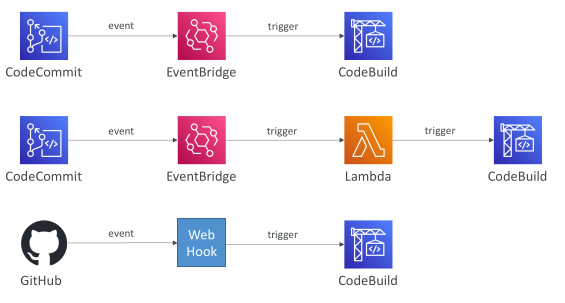

## CodeBuild – Validate Pull Requests

• Validate proposed code changes in PRs before they get merged

• Ensure high level of code quality and avoid code conflicts

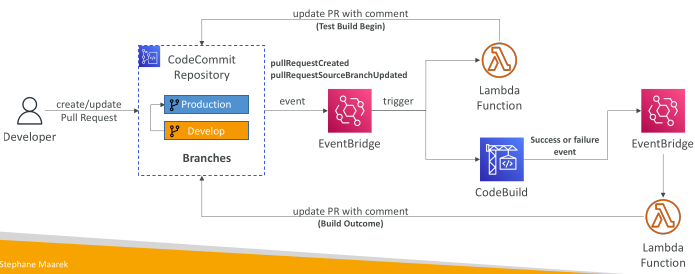

## CodeBuild – Validate Pull Requests

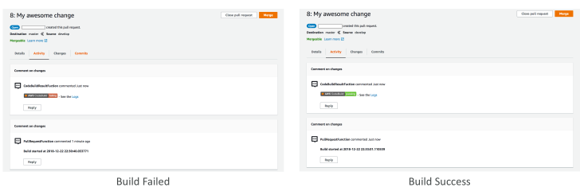

## CodeBuild – Test Reports

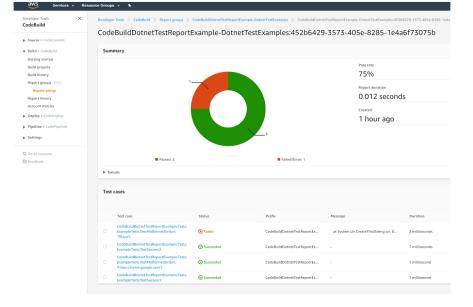

## CodeBuild – Test Reports

Contains details about tests that are run during builds

Unit tests, configuration tests, functional tests

Create your test cases with any test framework that can create report files in the following format:
 - JUnit XML, NUnit XML, NUnit3 XML
 - Cucumber JSON, TestNG XML, Visual Studio TRX

Create a test report and add a Report Group name in buildspec.yml file with information about your tests

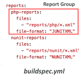

