## AWS CodeDeploy

Deployment service that automates application deployment

Deploy new applications versions to EC2 Instances, On-premises servers, Lambda functions, ECS Services

Automated Rollback capability in case of failed deployments, or trigger CloudWatch Alarm

Gradual deployment control

A file named appspec.yml defines how the deployment happens

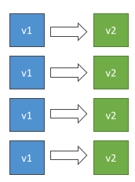

## CodeDeploy – EC2/On-premises Platform

Can deploy to EC2 Instances & on-premises servers

Perform in-place deployments or blue/green deployments

Must run the CodeDeploy Agent on the target instances

Define deployment speed
 - AllAtOnce: most downtime
 - HalfAtATime: reduced capacity by 50%
 - OneAtATime: slowest, lowest availability impact
 - Custom: define your %

## CodeDeploy – In-Place Deployment

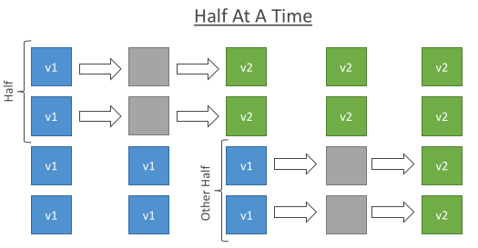

## CodeDeploy – Blue-Green Deployment

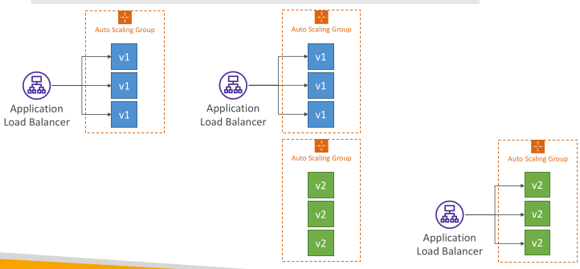

## CodeDeploy Agent

• The CodeDeploy Agent must be running on the EC2 instances as a pre-requisites

• It can be installed and updated automatically if you’re using Systems Manager

• The EC2 Instances must have sufficient permissions to access Amazon S3 to get deployment bundles

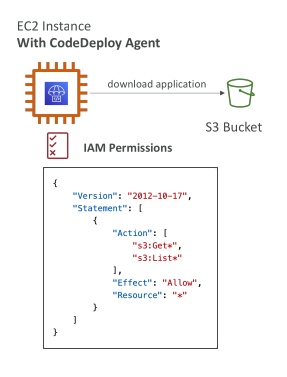

## CodeDeploy – Lambda Platform

CodeDeploy can help you automate traffic shift for Lambda aliases

Feature is integrated within the SAM framework

Linear: grow traffic every N minutes until 100%
 - LambdaLinear10PercentEvery3Minutes
 - LambdaLinear10PercentEvery10Minutes

Canary: try X percent then 100%
 - LambdaCanary10Percent5Minutes
 - LambdaCanary10Percent30Minutes

AllAtOnce: immediate

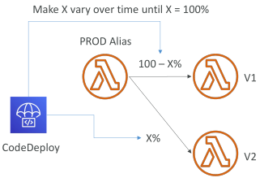

## CodeDeploy – ECS Platform

CodeDeploy can help you automate the deployment of a new ECS Task Definition

Only Blue/Green Deployments

Linear: grow traffic every N minutes until 100%
 - ECSLinear10PercentEvery3Minutes
 - ECSLinear10PercentEvery10Minutes

Canary: try X percent then 100%
 - ECSCanary10Percent5Minutes
 - ECSCanary10Percent30Minutes

AllAtOnce: immediate

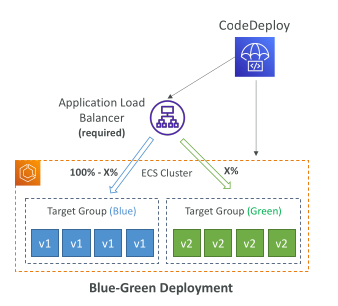

## CodeDeploy – In-place Deployments

• Use EC2 Tags or ASG to identify instances you want to deploy to
• With a Load Balancer: traffic is stopped before instance is updated, and started again after the instance is updated

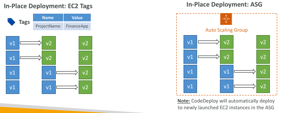

## CodeDeploy – In-place Deployment Hooks

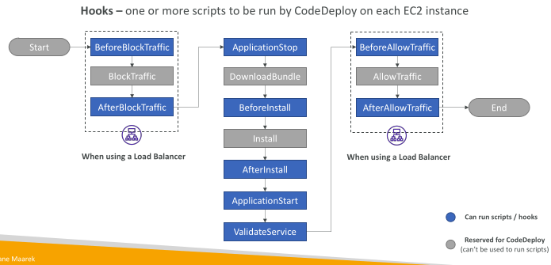

## CodeDeploy – EC2 Deployment Hooks

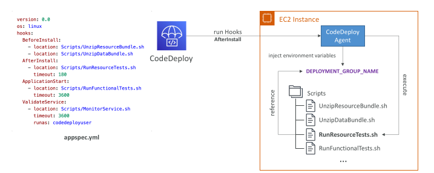

## CodeDeploy – Deployment Hooks Examples

• BeforeInstall – used for preinstall tasks, such as decrypting files and creating a backup of the current version

• AfterInstall – used for tasks such as configuring your application or changing file permissions

• ApplicationStart – used to start services that stopped during ApplicationStop

• ValidateService – used to verify the deployment was completed successfully

• BeforeAllowTraffic – run tasks on EC2 instances before registered to the load balancer

• Example: perform health checks on the application and fail the deployment if the health checks are not successful

## CodeDeploy – Blue/Green Deployments

• Manually mode: provision EC2 Instances for Blue and Green and identify by Tags

• Automatic mode: new ASG is provisioned by CodeDeploy (settings are copied)

• Using a Load Balancer is necessary for Blue/Green

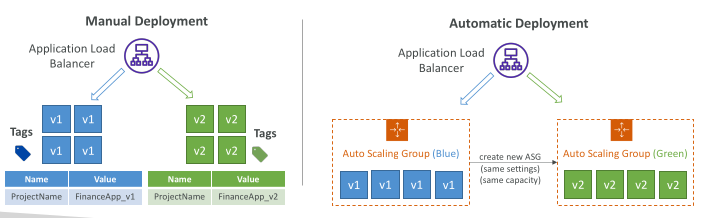

## CodeDeploy – Blue-Green Instance Termination

• BlueInstanceTerminationOption – specify whether to terminate the original (Blue) EC2 instances after a successfully Blue-Green deployment
• Action Terminate - Specify Wait Time, default 1 hour, max 2 days
• Action Keep Alive - Instances are kept running but deregistered from ELB and deployment group

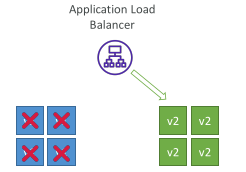

## CodeDeploy – Blue/Green Deployment Hooks

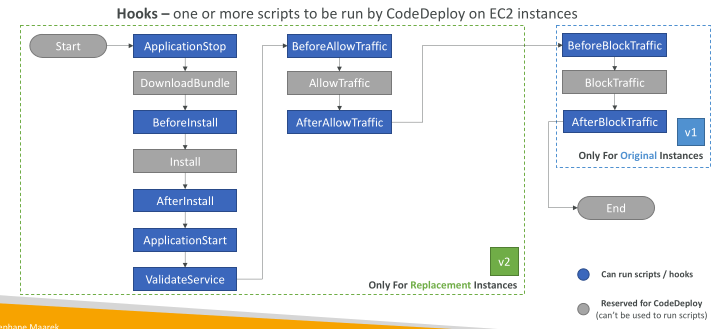

## CodeDeploy – Deployment Configurations

• Specifies the number of instances that must remain available at any time during the deployment

Use Pre-defined Deployment Configurations

 - CodeDeployDefault.AllAtOnce – deploy to as many instances as possible at once

 - CodeDeployDefault.HalfAtATime – deploy to up to half of the instances at a time

 - CodeDeployDefault.OneAtATime – deploy to only one instance at a time

Can create your own custom Deployment Configurations

## CodeDeploy – Triggers

• Publish Deployment or EC2 instance events to SNS topic

• Examples: DeploymentSuccess, Deployment Failure, InstanceFailure

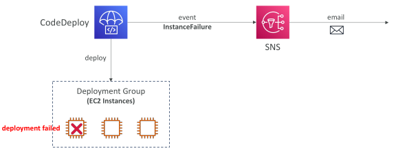

## CodeDeploy – Deployment to ECS

• Automatically handles a deployment of a new ECS Task Definition to an ECS Service

• Only supports Blue/Green and the service must be connected to a Load Balancer

• The ECS Task Definition and new Container Images must be already created

• A reference to the new ECS Task Revision (TaskDefinition) and load balancer information (LoadBalancerInfo) are specified in the appspec.yml file

• CodeDeploy Agent is NOT required

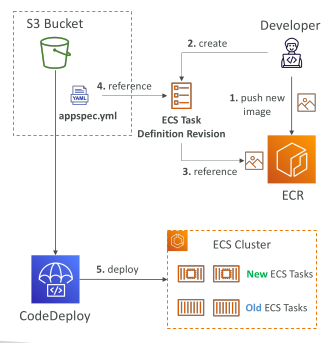

## CodeDeploy – Deployment to ECS

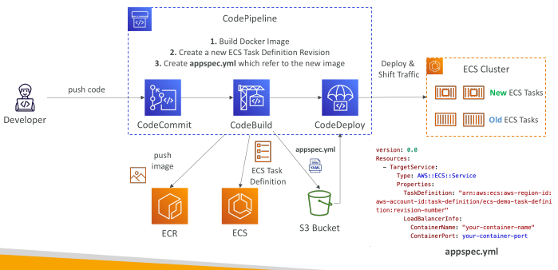

## CodeDeploy – Deployment to ECS

You can shift traffic to the new Task Set using Canary, Linear, or All At Once

- ECSLinear10PercentEvery1Minutes

- ECSLinear10PercentEvery3Minutes

- ECSCanary10Percent5Minutes

- ECSCanary10Percent15Minutes

- ECSAllAtOnce

Can define a second ELB Test Listener to test the Replacement (Green) version before traffic is rebalanced

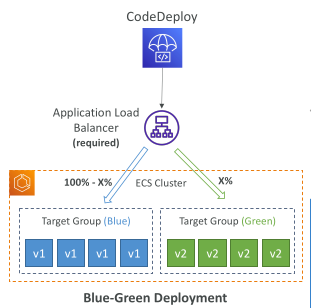

## CodeDeploy – ECS Deployment Hooks

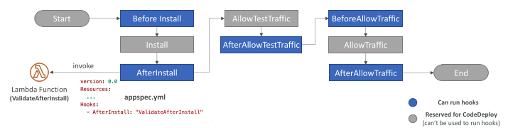

• Hooks – a Lambda function to be executed on once per deployment

AfterAllowTestTraffic – run AWS Lambda function after the test ELB Listener serves traffic to the Replacement ECS Task Set
 - Example: perform health checks on the application and trigger a rollback if the health checks are not successful

## CodeDeploy – Deployment to Lambda

• You create a new Lambda function Version and want to deploy it

• Specify the Version info in the appspec.yml file

• CodeDeploy Updates a Lambda function with the new Lambda function Version

• CodeDeploy Agent is NOT required

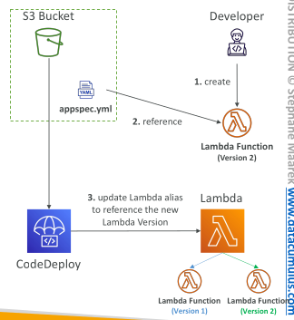

## Lambda & CodeDeploy – AppSpec.yml 

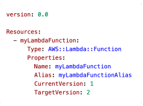

• Name (required) – the name of the Lambda function to deploy

• Alias (required) – the name of the alias to the Lambda function

• CurrentVersion (required) – the version of the Lambda function traffic currently points to

• TargetVersion (required) – the version of the Lambda function traffic is shifted to

## CodeDeploy – Deployment to Lambda

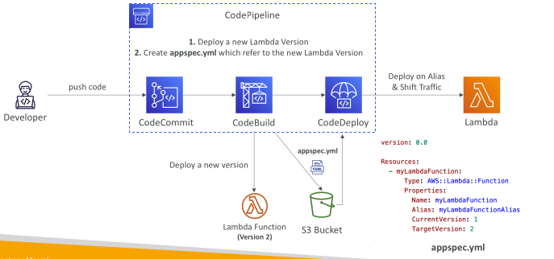

## CodeDeploy – Deployment to Lambda

Only Blue-Green Deployment supported
You can shift traffic to the new Task Set using Canary, Linear, or All At Once

 - LambdaLinear10PercentEvery1Minute

 - LambdaLinear10PercentEvery(2,3,10)Minutes

 - LambdaCanary10Percent(5,10,15,30)Minutes

 - LambdaAllAtOnce

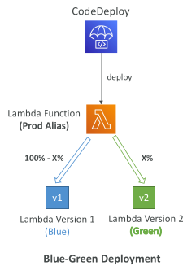

## CodeDeploy – Lambda Deployment Hooks (Blue-Green)

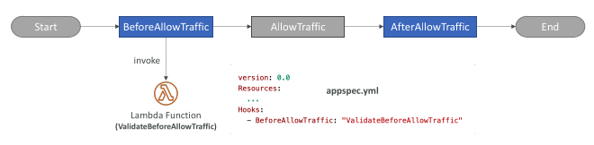

• Hooks – a Lambda function to be executed on once per deployment
• BeforeAllowTraffic and AfterAllowTraffic hooks can be used to check the health of the Lambda function

## CodeDeploy – Redeploy & Rollbacks

Rollback = redeploy a previously deployed revision of your application

Deployments can be rolled back:
 - Automatically – rollback when a deployment fails or rollback when a CloudWatch Alarm thresholds are met
 - Manually

Disable Rollbacks — do not perform rollbacks for this deployment

If a roll back happens, CodeDeploy redeploys the last known good revision as a new deployment (not a restored version)

## CodeDeploy – Troubleshooting

Deployment Error: “InvalidSignatureException – Signature expired: [time] is now earlier than [time]”
 - For CodeDeploy to perform its operations, it requires accurate time references
 
 - If the date and time on your EC2 instance are not set correctly, they might not match the signature date of your deployment request, which CodeDeploy rejects

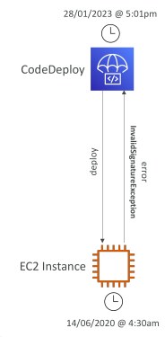

## CodeDeploy – Troubleshooting

When the Deployment or all Lifecycle Events are skipped (EC2/On-Premises), you get one of the following errors:
 - “The overall deployment failed because too many individual instances failed deployment”

 - “Too few healthy instances are available for deployment”

 - “Some instances in your deployment group are experiencing problems. (Error code: HEALTH_CONSTRAINTS)”

Reasons:
 - CodeDeploy Agent might not be installed, running, or it can’t reach CodeDeploy

 - CodeDeploy Service Role or IAM instance profile might not have the required permissions

 - You’re using an HTTP Proxy, configure CodeDeploy Agent with :proxy_uri: parameter

 - Date and Time mismatch between CodeDeploy and Agent

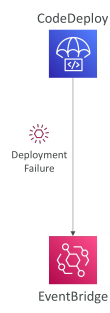

## CodeDeploy – Troubleshooting

• If a CodeDeploy deployment to ASG is underway and a scale-out event occurs, the new instances will be updated with the application revision that was most recently deployed (not the application revision that is currently being deployed)

• ASG will have EC2 instances hosting different versions of the application

• By default, CodeDeploy automatically starts a follow-on deployment to update any outdated EC2 instances

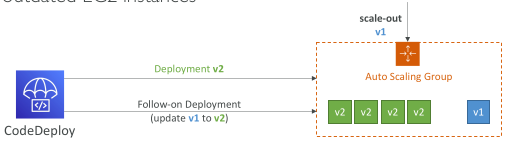

## CodeDeploy – Troubleshooting

Issue: failed AllowTraffic lifecycle event in Blue/Green Deployments with no error reported in the Deployment Logs

 - Reason: incorrectly configured health checks in ELB

 - Resolution: review and correct any errors in ELB health checks configuration

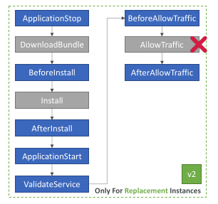