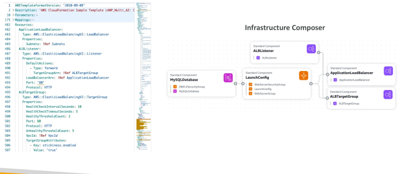
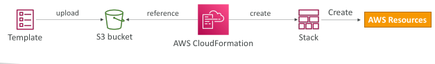
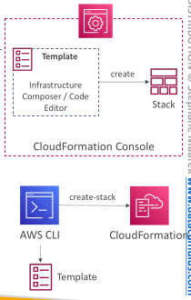
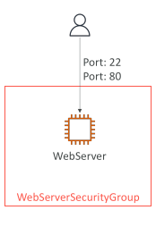
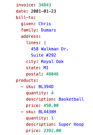
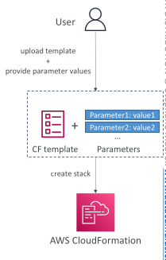
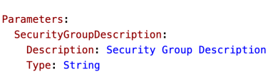
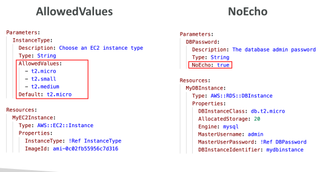
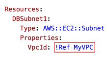
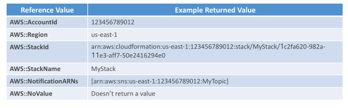

## AWS CloudFormation

• CloudFormation is a declarative way of outlining your AWSInfrastructure, for any resources (most of them are supported)

For example, within a CloudFormation template, you say:

 - I want a security group

 - I want two EC2 instances using this security group

 - I want two Elastic IPs for these EC2 instances

 - I want an S3 bucket

 - I want a load balancer (ELB) in front of these EC2 instances

• Then CloudFormation creates those for you, in the right order, with the exact configuration that you specify

## CloudFormation – Template Example

## Benefits of AWS CloudFormation (1/2)

Infrastructure as code

No resources are manually created, which is excellent for control

The code can be version controlled for example using Git

Changes to the infrastructure are reviewed through code

Cost

 - Each resources within the stack is tagged with an identifier so you can easily see how much a stack costs you

 - You can estimate the costs of your resources using the CloudFormation template

 - Savings strategy: In Dev, you could automation deletion of templates at 5 PM and recreated at 8 AM, safely

 ## Benefits of AWS CloudFormation (2/2)

Productivity

 - Ability to destroy and re-create an infrastructure on the cloud on the fly

 - Automated generation of Diagram for your templates!

 - Declarative programming (no need to figure out ordering and orchestration)

Separation of concern: create many stacks for many apps, and many layers. Ex:

 - VPC stacks

 - Network stacks

 - App stacks

Don’t re-invent the wheel

 - Leverage existing templates on the web!

 - Leverage the documentation

## How CloudFormation Works

Templates must be uploaded in S3 and then referenced in CloudFormation

To update a template, we can’t edit previous ones. We have to re- upload a new version of the template to AWS

Stacks are identified by a name

Deleting a stack deletes every single artifact that was created by CloudFormation.

## Deploying CloudFormation Templates

Manual way
 
 - Editing templates in Infrastructure Composer or code editor
 
 - Using the console to input parameters, etc…
 
 - We’ll mostly do this way in the course for learning purposes

Automated way
 
 - Editing templates in a YAML file
 
 - Using the AWS CLI (Command Line Interface) to deploy the templates, or using a Continuous Delivery (CD) tool
 
 - Recommended way when you fully want to automate your flow

 

## CloudFormation – Building Blocks

Template’s Components
 
 - AWSTemplateFormatVersion – identifies the capabilities of the template “2010-09-09”
 
 - Description – comments about the template
 
 - Resources (MANDATORY) – your AWS resources declared in the template
 
 - Parameters – the dynamic inputs for your template
 
 - Mappings – the static variables for your template
 
 - Outputs – references to what has been created
 
 - Conditionals – list of conditions to perform resource creation

Template’s Helpers
 
 - References
 
 - Functions

## Introductory Example

• We’re going to create a simple EC2 instance

• And we’re going to add security group to it

• For now, forget about the code syntax

• We’ll look at the structure of the files later

• We’ll see how in no-time, we are able to get started with CloudFormation!

## YAML Crash Course

• YAML and JSON are the languages you canuse for CloudFormation

• JSON is horrible for CF

• YAML is great in so many ways

• Let’s learn a bit about it!

• Key value Pairs

• Nested objects

• Support Arrays

• Multi line strings

• Can include comments!

## CloudFormation – Resources

• Resources are the core of your CloudFormation template (MANDATORY)

• They represent the different AWS Components that will be created and configured

• Resources are declared and can reference each other

• AWS figures out creation, updates and deletes of resources for us

• There are over 700 types of resources (!)

Resource types identifiers are of the form:
 - service-provider::service-name::data-type-name

## How do I find Resources documentation?

• I can’t teach you all the 700+ resources, but I can teach you how to learn how to use them

• All the resources can be found here: https://docs.aws.amazon.com/AWSCloudFormation/latest/UserGuide/a ws-template-resource-type-ref.html

• Then, we just read the docs J

• Example here (for an EC2 instance): https://docs.aws.amazon.com/AWSCloudFormation/latest/UserGuide/aws-resource-ec2-instance.html

## Analysis of CloudFormation Template

• Going back to the example of the introductory lecture, let’s learn why it was written this way.

Relevant documentation can be found here:
 - https://docs.aws.amazon.com/AWSCloudFormation/latest/UserGuide/aws- resource-ec2-instance.html
 
 - https://docs.aws.amazon.com/AWSCloudFormation/latest/UserGuide/aws- resource-ec2-securitygroup.html
 
 - http://docs.aws.amazon.com/AWSCloudFormation/latest/UserGuide/aws-resource-ec2-eip.html

## CloudFormation – Resources FAQ

Can I create a dynamic number of resources?
 - Yes, you can by using CloudFormation Macros and Transform

 - It is not in the scope of this course

Is every AWS Service supported?
 - Almost. Only a select few niches are not there yet

 - You can work around that using CloudFormation Custom Resources

## CloudFormation – Parameters

• Parameters are a way to provide inputs to your AWS CloudFormation template

They’re important to know about if:
 - You want to reuse your templates across the company
 - Some inputs can not be determined ahead of time

• Parameters are extremely powerful, controlled, and can prevent errors from happening in your templates, thanks to types

## When should you use a Parameter?

Ask yourself this:
 - Is this CloudFormation resource configuration likely to change in the future?
 - If so, make it a parameter

You won’t have to re-upload a template to change its content 

## CloudFormation – Parameters Settings

• Parameters can be controlled by all these settings:

Type:
 - String
 - Number
 - CommaDelimitedList
 - List<Number>
 - AWS-Specific Parameter (to help catch invalid values – match against existing values in the AWS account)
 - List<AWS-Specific Parameter>
 - SSM Parameter (get parameter value from SSM Parameter store)

• Description

• ConstraintDescription (String)

• Min/MaxLength

• Min/MaxValue

• Default

• AllowedValues (array)

• AllowedPattern (regex)

• NoEcho (Boolean)

## CloudFormation – Parameters Example

## How to Reference a Parameter?

## CloudFormation – Pseudo Parameters

• AWS offers us Pseudo Parameters in any CloudFormation template

• These can be used at any time and are enabled by default

• Important pseudo parameters:

