## Typical architecture: Web App 3-tier

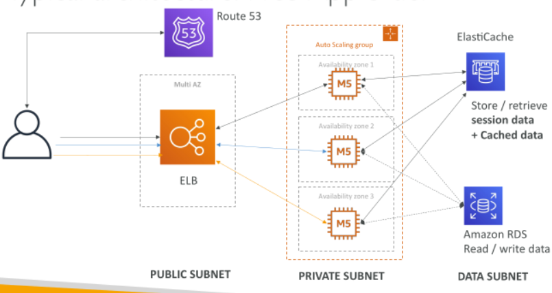

## Developer problems on AWS

• Managing infrastructure

• Deploying Code

• Configuring all the databases, load balancers, etc

• Scaling concerns

• Most web apps have the same architecture (ALB + ASG)

• All the developers want is for their code to run!

• Possibly, consistently across different applications and environments

## Elastic Beanstalk – Overview

• Elastic Beanstalk is a developer centric view of deploying an application on AWS

• It uses all the component’s we’ve seen before: EC2, ASG, ELB, RDS...

Managed service
 - Automatically handles capacity provisioning, load balancing, scaling, application health monitoring, instance configuration...

 - Just the application code is the responsibility of the developer

• We still have full control over the configuration

• Beanstalk is free but you pay for the underlying instances

## Elastic Beanstalk – Components

Application: collection of Elastic Beanstalk components (environments, versions, configurations...)

Application Version: an iteration of your application code

Environment
 - Collection of AWS resources running an application version (only one application version at a time)
 
 - Tiers: Web Server Environment Tier & Worker Environment Tier
 
 - You can create multiple environments (dev, test, prod...)

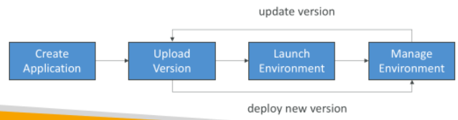

## Elastic Beanstalk – Supported Platforms

• Go

• Java SE

• Java with Tomcat

• .NET Core on Linux

• .NET on Windows Server

• Node.js

• PHP

• Python

• Ruby

• Packer Builder

• Single Container Docker

• Multi-container Docker

• Preconfigured Docker

## Web Server Tier vs. Worker Tier

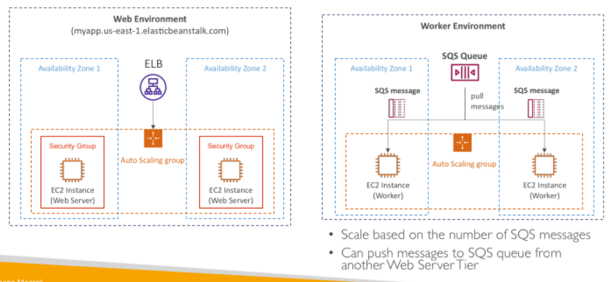

## Elastic Beanstalk Deployment Modes

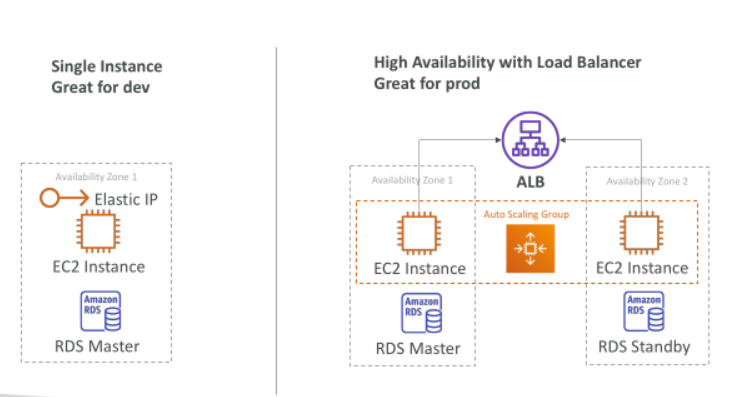

## Beanstalk Deployment Options for Updates

• All at once (deploy all in one go) – fastest, but instances aren’t available to serve traffic for a bit (downtime)

• Rolling: update a few instances at a time (bucket), and then move onto the next bucket once the first bucket is healthy

• Rolling with additional batches: like rolling, but spins up new instances to move the batch (so that the old application is still available)

• Immutable: spins up new instances in a new ASG, deploys version to these instances, and then swaps all the instances when everything is healthy

• Blue Green: create a new environment and switch over when ready

• Traffic Splitting: canary testing – send a small % of traffic to new deployment

## Elastic Beanstalk Deployment All at once

• Fastest deployment

• Application has downtime

• Great for quick iterations in development environment

• No additional cost

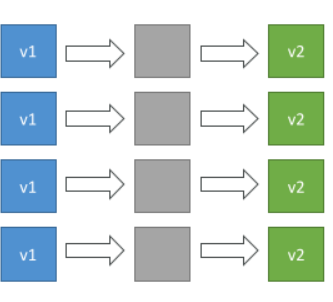

## Elastic Beanstalk Deployment Rolling

• Application is running below capacity

• Can set the bucket size

• Application is running both versions simultaneously

• No additional cost

• Long deployment

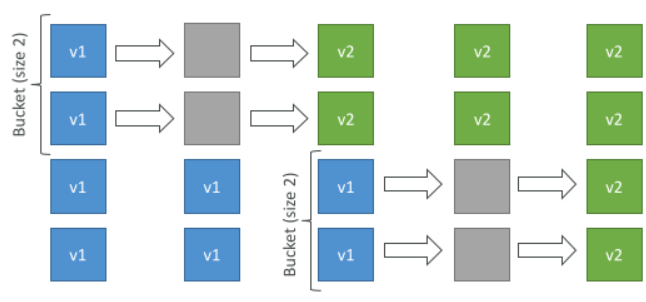

## Elastic Beanstalk Deployment Rolling with additional batches

• Application is running at capacity

• Can set the bucket size

• Application is running both versions simultaneously

• Small additional cost

• Additional batch is removed at the end of the deployment

• Longer deployment

• Good for prod

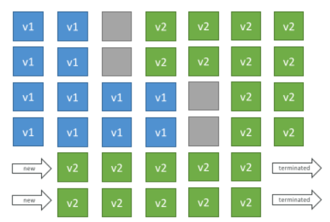

## Elastic Beanstalk Deployment Immutable

• Zero downtime

• New Code is deployed to new instances on a temporary ASG

• High cost, double capacity

• Longest deployment

• Quick rollback in case of failures (just terminate new ASG)

• Great for prod

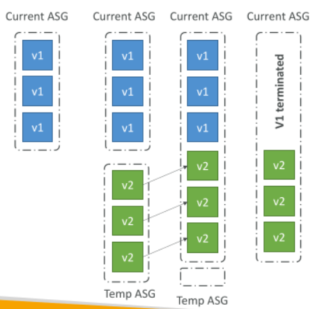

## Elastic Beanstalk Deployment Blue / Green

• Not a “direct feature” of Elastic Beanstalk

• Zero downtime and release facility

• Create a new “stage” environment and deploy v2 there

• The new environment (green) can be validated independently and roll back if issues

• Route 53 can be setup using weighted policies to redirect a little bit of traffic to the stage environment

• Using Beanstalk, “swap URLs” when done with the environment test

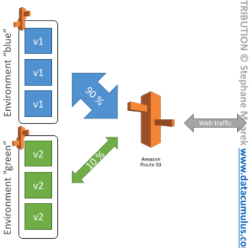

## Elastic Beanstalk - Traffic Splitting

• Canary Testing

• New application version is deployed to a temporary ASG with the same capacity

• A small % of traffic is sent to the temporary ASG for a configurable amount of time

• Deployment health is monitored

• If there’s a deployment failure, this triggers an automated rollback (very quick)

• No application downtime

• New instances are migrated from the temporary to the original ASG

• Old application version is then terminated

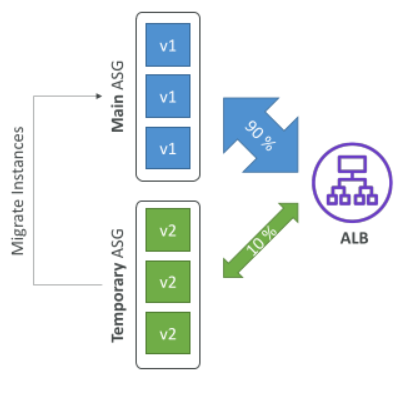

## Elastic Beanstalk Deployment Summary from AWS Doc

• https://docs.aws.amazon.com/elasticbeanstalk/latest/dg/using-features.deploy-existing-version.html

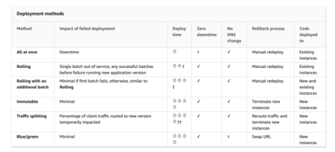

## Web Server vs Worker Environment

• If your application performs tasks that are long to complete, offload these tasks to a dedicated worker environment

• Decoupling your application into two tiers is common

• Example: processing a video, generating a zip file, etc

• You can define periodic tasks in a file cron.yaml

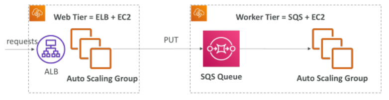

## Elastic Beanstalk – Notifications

Create Rules in EventBridge to act to the following events:

 - Environment Operations Status – create, update, terminate (start, success, fail)

 - Other Resources Status – ASG, ELB, EC2 Instance (created, deleted)

 - Managed Updates Status – started, failed

 - Environment Health Status

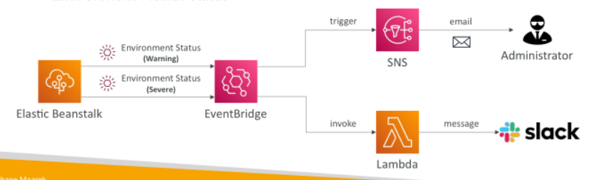

