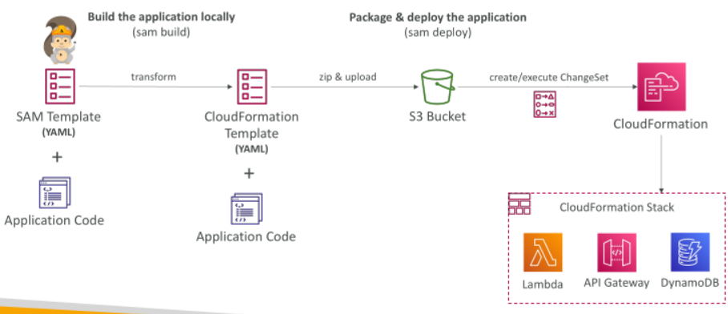
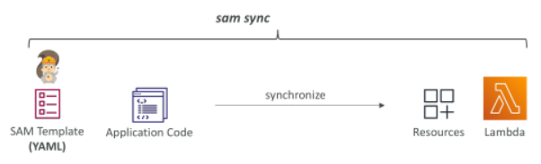
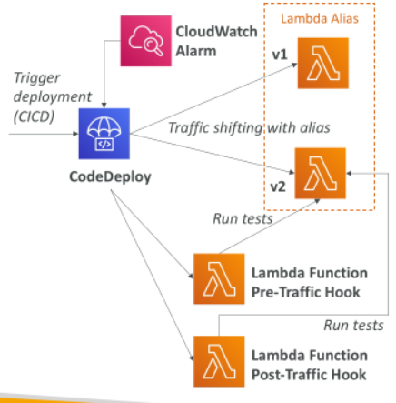
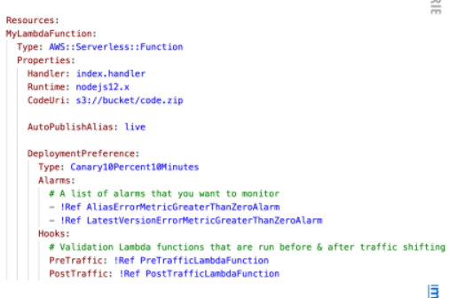
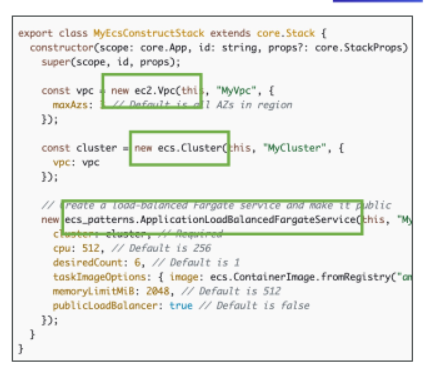
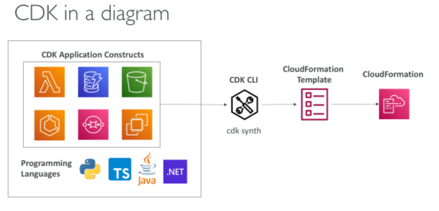
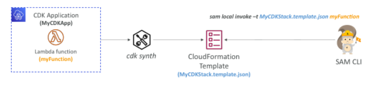
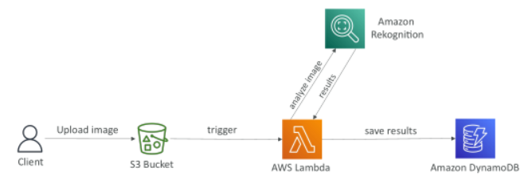

## AWS SAM

- SAM = Serverless Application Model

- Framework for developing and deploying serverless applications

- All the configuration is YAML code

- Generate complex CloudFormation from simple SAM YAML file

- Supports anything from CloudFormation: Outputs, Mappings, Parameters, Resources…

- SAM can use CodeDeploy to deploy Lambda functions

- SAM can help you to run Lambda, API Gateway, DynamoDB locally

## AWS SAM – Recipe

Transform Header indicates it’s SAM template:
 - Transform: 'AWS::Serverless-2016-10-31'
Write Code
 - AWS::Serverless::Function
 - AWS::Serverless::Api
 - AWS::Serverless::SimpleTable

• Package & Deploy: sam deploy (optionally preceded by “sam package”)

• Quickly sync local changes to AWS Lambda (SAM Accelerate): sam sync --watch

## Deep Dive into SAM Deployment

## SAM Accelerate (sam sync)

• SAM Accelerate is a set of features to reduce latency while deploying resources to AWS
sam sync
 - Synchronizes your project declared in SAM templates to AWS

 - Synchronizes code changes to AWS without updating infrastructure (uses service APIs & bypass CloudFormation)

## SAM Accelerate (sam sync) – Examples

sam sync (no options)
 - Synchronize code and infrastructure

sam sync --code
 - Synchronize code changes without updating infrastructure (bypass CloudFormation, update in seconds)

sam sync --code --resource AWS::Serverless::Function
 - Synchronize only all Lambda functions and their dependencies

sam sync --code --resource-id HelloWorldLambdaFunction
 - Synchronize only a specific resource by its ID

sam sync --watch
 - Monitor for file changes and automatically synchronize when changes are detected
 - If changes include configuration, it uses sam sync
 - If changes are code only, it uses sam sync --code

## SAM and CodeDeploy

• SAM framework natively uses CodeDeploy to update Lambda functions

• Traffic Shifting feature

• Pre and Post traffic hooks features to validate deployment (before the traffic shift starts and after it ends)

• Easy & automated rollback using CloudWatch Alarms

## SAM and CodeDeploy

AutoPublishAlias
 - Detects when new code is being deployed
 - Creates and publishes an updated version of that function with the latest code
 - Points the alias to the updated version of the Lambda function

DeploymentPreference
 - Canary, Linear, AllAtOnce

Alarms
 - Alarms that can trigger a rollback

Hooks
 - Pre and post traffic shifting Lambda functions to test your deployment

## AWS Cloud Development Kit (CDK)

Define your cloud infrastructure using a familiar language:
 - JavaScript/TypeScript, Python, Java, and .NET

Contains high level components called constructs

The code is “compiled” into a CloudFormation template (JSON/YAML)

You can therefore deploy infrastructure and application runtime code together
 - Great for Lambda functions
 - Great for Docker containers in ECS / EKS

## CDK in a diagram

## CDK vs SAM

SAM:
 
 - Serverless focused
 
 - Write your template declaratively in JSON or YAML
 
 - Great for quickly getting started with Lambda
 
 - Leverages CloudFormation

CDK:
 
 - All AWS services
 
 - Write infra in a programming language JavaScript/TypeScript, Python, Java, and .NET
 
 - Leverages CloudFormation

## CDK + SAM

• You can use SAM CLI to locally test your CDK apps

• You must first run cdk synth

## CDK Hands-On

