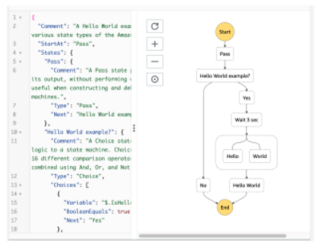
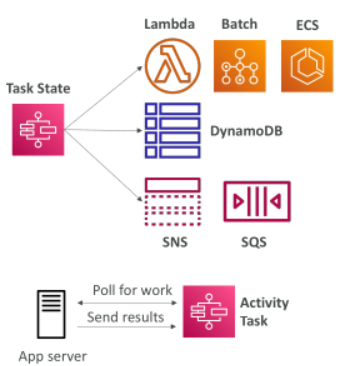
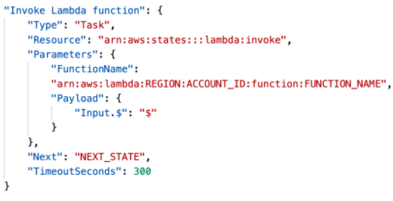
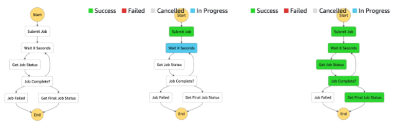
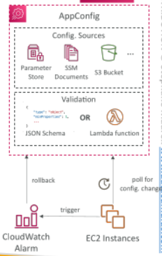

## AWS Step Functions

Model your workflows as state machines (one per workflow)
 - Order fulfillment, Data processing
 - Web applications, Any workflow

Written in JSON

Visualization of the workflow and the execution of the workflow, as well as history

Start workflow with SDK call, API Gateway, Event Bridge (CloudWatch Event)

## Step Function – Task States

Do some work in your state machine 

Invoke one AWS service
 - Can invoke a Lambda function
 - Run an AWS Batch job
 - Run an ECS task and wait for it to complete
 - Insert an item from DynamoDB
 - Publish message to SNS, SQS
 - Launch another Step Function workflow…

Run an one Activity
 - EC2, Amazon ECS, on-premises
 - Activities poll the Step functions for work
 - Activities send results back to Step Functions

## Example – Invoke Lambda Function

## Step Function - States

• Choice State - Test for a condition to send to a branch (or default branch)

• Fail or Succeed State - Stop execution with failure or success

• Pass State - Simply pass its input to its output or inject some fixed data, without performing work.

• Wait State - Provide a delay for a certain amount of time or until a specified time/date.

• Map State - Dynamically iterate steps.’

• Parallel State - Begin parallel branches of execution.

## Visual workflow in Step Functions

## AWS AppConfig

Configure, validate, and deploy dynamic configurations

Deploy dynamic configuration changes to your applications independently of any code deployments

You don’t need to restart the application

Feature flags, application tuning, allow/block listing…

Use with apps on EC2 instances, Lambda, ECS, EKS…

Gradually deploy the configuration changes and rollback if issues occur

Validate configuration changes before deployment using:
 - JSON Schema (syntactic check) or
 - Lambda Function – run code to perform validation (semantic check)

