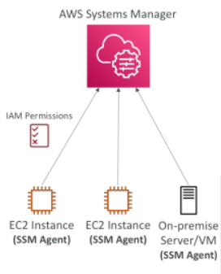
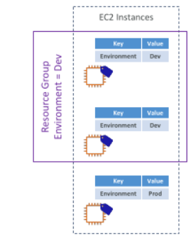
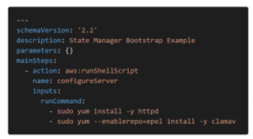
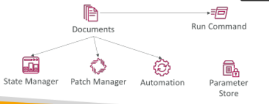
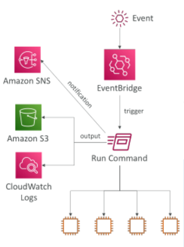

## AWS Systems Manager Overview

• Helps you manage your EC2 and On-Premises systems at scale

• Get operational insights about the state of your infrastructure

• Easily detect problems

• Patching automation for enhanced compliance

• Works for both Windows and Linux OS

• Integrated with CloudWatch metrics / dashboards

• Integrated with AWS Config

• Free service

## AWS Systems Manager Features

Node Tools
 
 - Fleet Manager
 
 - Compliance
 
 - Inventory
 
 - Hybrid Activations
 
 - Session Manager
 
 - Run Command
 
 - State Manager
 
 - Patch Manager
 
 - Distributer

Change Management

 - Automation

 - Change Calendar

 - Maintenance Windows

 - Documents

 - Quick Setup

Application Tools
 - Application Manager
 - AppConfig
 - Parameter Store
 - Resource Groups

Operations Tools
 
 - Explorer
 
 - OpsCenter
 
 - CloudWatch Dashboard

## How Systems Manager works

• We need to install the SSM agent onto the systems we control

• Installed by default on Amazon Linux 2 AMI & some Ubuntu AMI

• If an instance can’t be controlled with SSM, it’s probably an issue with the SSM agent!

• Make sure the EC2 instances have a proper IAM role to allow SSM actions

## AWS Tags

You can add text key-value pairs called Tags to many AWS resources

Commonly used in EC2

Free naming, common tags are Name, Environment, Team …

They’re used for
 - Resource grouping
 - Automation
 - Cost allocation

Better to have too many tags than too few!

## Resource Groups

Create, view or manage logical group of resources thanks to tags

Allows creation of logical groups of resources such as
 - Applications
 - Different layers of an application stack
 - Production versus development environments

• Regional service

• Works with EC2, S3, DynamoDB, Lambda, etc…

## SSM – Documents

• Documents can be in JSON or YAML

• You define parameters

• You define actions

• Many documents already exist in AWS

## SSM – Run Command

• Execute a document (= script) or just run a command

• Run command across multiple instances (using resource groups)

• Rate Control / Error Control

• Integrated with IAM & CloudTrail

• No need for SSH

• Command Output can be shown in the Console, sent to S3 bucket or CloudWatch Logs

• Send notifications to SNS about command statues (In progress, Success, Failed...)

• Can be invoked using EventBridge

