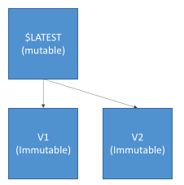
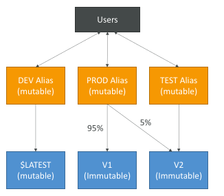
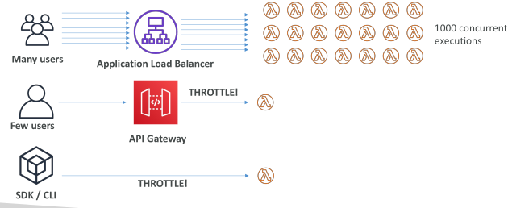
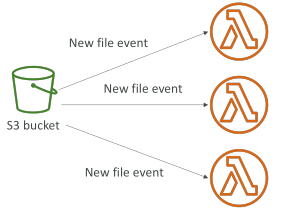
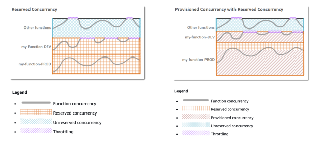
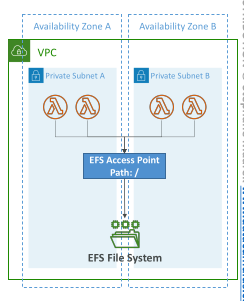
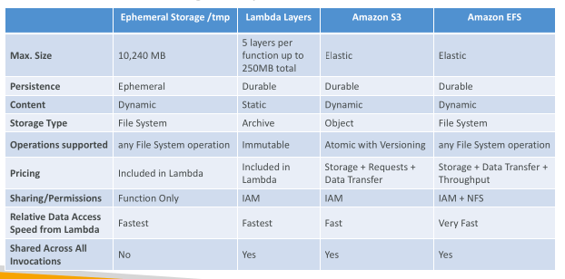
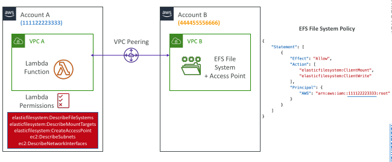
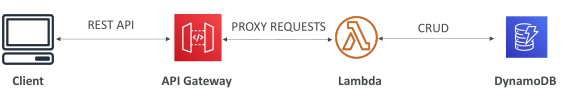

## AWS Lambda Versions

• When you work on a Lambda function, we work on $LATEST

• When we’re ready to publish a Lambda function, we create a version

• Versions are immutable

• Versions have increasing version numbers

• Versions get their own ARN (Amazon Resource Name)

• Version = code + configuration (nothing can be changed - immutable)

• Each version of the lambda function can be accessed

## AWS Lambda Aliases

• Aliases are ”pointers” to Lambda function versions

• We can define a “dev”, ”test”, “prod” aliases and have them point at different lambda versions

• Aliases are mutable

• Aliases enable Canary deployment by assigning weights to lambda functions

• Aliases enable stable configuration of our event triggers/ destinations

• Aliases have their own ARNs

• Aliases cannot reference aliases

## Lambda Environment Variables

• Environment variable = key / value pair in “String” form

• Adjust the function behavior without updating code

• The environment variables are available to your code

• Lambda Service adds its own system environment variables as well

• Helpful to store secrets (encrypted by KMS)

• Secrets can be encrypted by the Lambda service key, or your own CMK

## Lambda Concurrency and Throttling

• Concurrency limit: up to 1000 concurrent executions

Can set a “reserved concurrency” at the function level (=limit)

Each invocation over the concurrency limit will trigger a“Throttle”

Throttle behavior:
 - If synchronous invocation => return ThrottleError - 429
 - If asynchronous invocation => retry automatically and then go to DLQ

If you need a higher limit, open a support ticket

## Lambda Concurrency Issue

• If you don’t reserve (=limit) concurrency, the following can happen:

## Concurrency and Asynchronous Invocations

• If the function doesn't have enough concurrency available to process all events, additional requests are throttled.

• For throttling errors (429) and system errors (500-series), Lambda returns the event to the queue and attempts to run the function again for up to 6 hours.

• The retry interval increases exponentially from 1 second after the first attempt to a maximum of 5 minutes.

## Cold Starts & Provisioned Concurrency

Cold Start:
 - New instance => code is loaded and code outside the handler run (init)
 - If the init is large (code, dependencies, SDK…) this process can take some time.
 - First request served by new instances has higher latency than the rest

Provisioned Concurrency:
 - Concurrency is allocated before the function is invoked (in advance)
 - So the cold start never happens and all invocations have low latency
 - Application Auto Scaling can manage concurrency (schedule or target utilization)

Note:
 - Note: cold starts in VPC have been dramatically reduced in Oct & Nov 2019
 - https://aws.amazon.com/blogs/compute announcing-improved-vpc-networking-for-aws-lambda-functions/

## Reserved and Provisioned Concurrency

## Lambda – File Systems Mounting

• Lambda functions can access EFS file systems if they are running in a VPC

• Configure Lambda to mount EFS file systems to local directory during initialization

• Must leverage EFS Access Points

• Limitations: watch out for the EFS connection limits (one function instance = one
connection) and connection burst limits

## Lambda – Storage Options

## Lambda – Cross-Account EFS Mounting

## Example: Building a Serverless API

