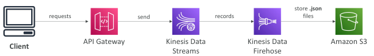
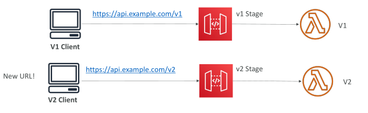
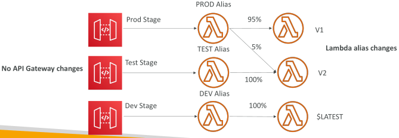
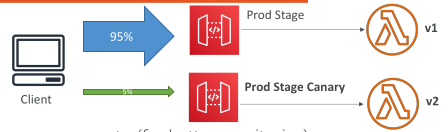
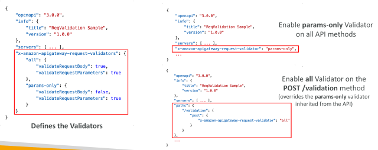
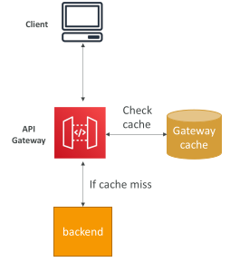
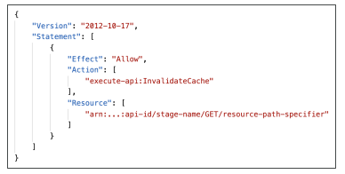
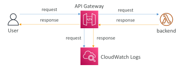

## AWS API Gateway

• AWS Lambda + API Gateway: No infrastructure to manage

• Support for the WebSocket Protocol

• Handle API versioning (v1, v2…)

• Handle different environments (dev, test, prod…)

• Handle security (Authentication and Authorization)

• Create API keys, handle request throttling

• Swagger / Open API import to quickly define APIs

• Transform and validate requests and responses

• Generate SDK and API specifications

• Cache API responses

## API Gateway – Integrations High Level

Lambda Function
 
 - Invoke Lambda function
 
 - Easy way to expose REST API backed by AWS Lambda

HTTP
 
 - Expose HTTP endpoints in the backend
 
 - Example: internal HTTP API on premise, Application Load Balancer…
 
 - Why? Add rate limiting, caching, user authentications, API keys, etc…

AWS Service
 
 - Expose any AWS API through the API Gateway
 
 - Example: start an AWS Step Function workflow, post a message to SQS
 
 - Why? Add authentication, deploy publicly, rate control…

## API Gateway – AWS Service Integration Kinesis Data Streams example

## API Gateway - Endpoint Types

Edge-Optimized (default): For global clients
 
 - Requests are routed through the CloudFront Edge locations (improves latency)
 
 - The API Gateway still lives in only one region

Regional:
 
 - For clients within the same region
 
 - Could manually combine with CloudFront (more control over the caching strategies and the distribution)

Private:
 
 - Can only be accessed from your VPC using an interface VPC endpoint (ENI)
 
 - Use a resource policy to define access

## API Gateway – Security

User Authentication through
 
 - IAM Roles (useful for internal applications)
 
 - Cognito (identity for external users – example mobile users)
 
 - Custom Authorizer (your own logic)

Custom Domain Name HTTPS security through integration with AWS Certificate Manage (ACM)
 
 - If using Edge-Optimized endpoint, then the certificate must be in us-east-1
 
 - If using Regional endpoint, the certificate must be in the API Gateway region
 
 - Must setup CNAME or A-alias record in Route 53

## API Gateway – Deployment Stages

• Making changes in the API Gateway does not mean they’re effective

• You need to make a “deployment” for them to be in effect

• It’s a common source of confusion

• Changes are deployed to “Stages” (as many as you want)

• Use the naming you like for stages (dev, test, prod)

• Each stage has its own configuration parameters

• Stages can be rolled back as a history of deployments is kept

## API Gateway – Stages v1 and v2 API breaking change

## API Gateway – Stage Variables

Stage variables are like environment variables for API Gateway

Use them to change often changing configuration values
They can be used in:
 - Lambda function ARN
 - HTTP Endpoint
 - Parameter mapping templates

Use cases:
 - Configure HTTP endpoints your stages talk to (dev, test, prod…)
 - Pass configuration parameters to AWS Lambda through mapping templates

• Stage variables are passed to the ”context” object in AWS Lambda

• Format: ${stageVariables.variableName}

## API Gateway Stage Variables & Lambda Aliases

• We create a stage variable to indicate the corresponding Lambda alias

• Our API gateway will automatically invoke the right Lambda function!

## API Gateway – Canary Deployment

• Possibility to enable canary deployments for any stage (usually prod)

• Choose the % of traffic the canary channel receives

## API Gateway - Open API spec

Common way of defining REST APIs, using API definition as code

Import existing OpenAPI 3.0 spec to API Gateway
 - Method
 - Method Request
 - Integration Request
 - Method Response
 - + AWS extensions for API gateway and setup every single option

Can export current API as OpenAPI spec

OpenAPI specs can be written in YAML or JSON

Using OpenAPI we can generate SDK for our applications

## REST API – Request Validation

• You can configure API Gateway to perform basic validation of an API request before proceeding with the integration request

When the validation fails, API Gateway immediately fails the request
 - Returns a 400-error response to the caller

This reduces unnecessary calls to the backend

Checks:
 - The required request parameters in the URI, query string, and headers of an incoming request are included and non-blank
 
 - The applicable request payload adheres to the configured JSON Schema request model of the method

## REST API – RequestValidation – OpenAPI

• Setup request validation by importing OpenAPI definitions file

## Caching API responses

• Caching reduces the number of calls made to the backend

• Default TTL (time to live) is 300 seconds (min: 0s, max: 3600s)

• Caches are defined per stage

• Possible to override cache settings per method

• Cache encryption option

• Cache capacity between 0.5GB to 237GB

• Cache is expensive, makes sense in production, may not make sense in dev / test

## API Gateway Cache Invalidation

• Able to flush the entire cache (invalidate it) immediately

• Clients can invalidate the cache with header: Cache-Control: max-age=0 (with proper IAM authorization)

• If you don't impose an InvalidateCache policy (or choose the Require authorization check box in the console), any client can invalidate the API cache

## API Gateway – Logging & Tracing

CloudWatch Logs
 - Log contains information about request/response body
 - Enable CloudWatch logging at the Stage level (with Log Level - ERROR, DEBUG, INFO)
 - Can override settings on a per API basis

X-Ray
 - Enable tracing to get extra information about requests in API Gateway
 - X-Ray API Gateway + AWS Lambda gives you the full picture

## API Gateway – CloudWatch Metrics

• Metrics are by stage, Possibility to enable detailed metrics

• CacheHitCount & CacheMissCount: efficiency of the cache

• Count: The total number API requests in a given period.

• IntegrationLatency: The time between when API Gateway relays a request to the backend and when it receives a response from the backend.

• Latency: The time between when API Gateway receives a request from a client and when it returns a response to the client. The latency includes the integration latency and other API Gateway overhead.

• 4XXError (client-side) & 5XXError (server-side)

## API Gateway Throttling

Account Limit
 - API Gateway throttles requests at10000 rps across all API
 - Soft limit that can be increased upon request

In case of throttling => 429 Too Many Requests (retriable error)

Can set Stage limit & Method limits to improve performance

Or you can define Usage Plans to throttle per customer

Just like Lambda Concurrency, one API that is overloaded, if not limited, can cause the other APIs to be throttled

## API Gateway - Errors

4xx means Client errors
 - 400: Bad Request
 - 403: Access Denied, WAF filtered
 - 429: Quota exceeded, Throttle

5xx means Server errors
 - 502: Bad Gateway Exception, usually for an incompatible output returned from a Lambda proxy integration backend and occasionally for out-of-order invocations due to heavy loads.
 
 - 503: Service Unavailable Exception
 
 - 504: Integration Failure – ex Endpoint Request Timed-out Exception API Gateway requests time out after 29 second maximum

