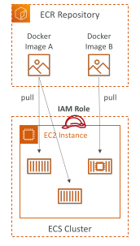
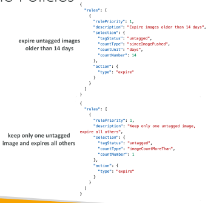
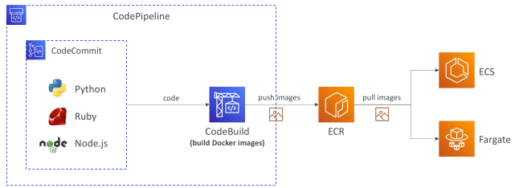

## Amazon ECR.

• ECR = Elastic Container Registry

• Store and manage Docker images on AWS

• Private and Public repository (Amazon ECR Public Gallery https://gallery.ecr.aws)

• Fully integrated with ECS, backed by Amazon S3

• Access is controlled through IAM (permission errors => policy)

• Supports image vulnerability scanning, versioning, image tags, image lifecycle...

## Amazon ECR – Lifecycle Policies

• Automatically remove old or unused images based on age or count

• Each Lifecycle Policy contains one or more rules

• All rules are evaluated at the same time, then applied based on priority

• Images are expired within 24 hours after they meet the criteria

• Helps you reduce unnecessary storage costs

## Amazon ECR – Uniform Pipeline

