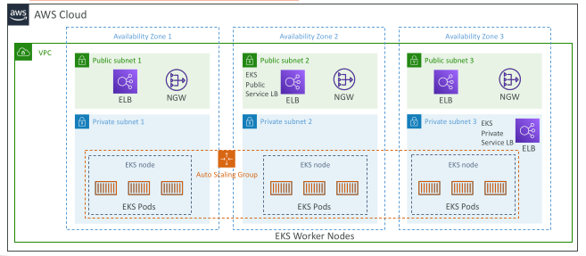
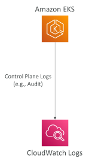
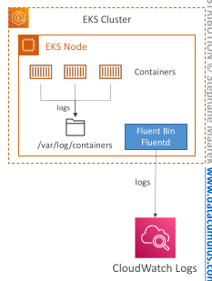

## Amazon EKS Overview

• Amazon EKS = Amazon Elastic Kubernetes Service

• It is a way to launch managed Kubernetes clusters on AWS

• Kubernetes is an open-source system for automatic deployment, scaling and management of containerized (usually Docker) application

• It’s an alternative to ECS, similar goal but different API

• EKS supports EC2 if you want to deploy worker nodes or Fargate to deploy serverless containers

• Use case: if your company is already using Kubernetes on-premises or in another cloud, and wants to migrate to AWS using Kubernetes

• Kubernetes is cloud-agnostic (can be used in any cloud – Azure, GCP…)

• For multiple regions, deploy one EKS cluster per region

• Collect logs and metrics using CloudWatch Container Insights

## Amazon EKS - Diagram

## Amazon EKS – Node Types

Managed Node Groups
 
 - Creates and manages Nodes (EC2 instances) for you
 
 - Nodes are part of an ASG managed by EKS
 
 - Supports On-Demand or Spot Instances

Self-Managed Nodes
 
 - Nodes created by you and registered to the EKS cluster and managed by an ASG
 
 - You can use prebuilt AMI - Amazon EKS Optimized AMI
 
 - Supports On-Demand or Spot Instances

AWS Fargate
 
 - No maintenance required; no nodes managed

## Amazon EKS – Data Volumes

• Need to specify StorageClass manifest on your EKS cluster

• Leverages a Container Storage Interface (CSI) compliant driver

Support for…
 
 - Amazon EBS
 
 - Amazon EFS (works with Fargate)
 
 - Amazon FSx for Lustre
 
 - Amazon FSx for NetApp ONTAP

 ## Amazon EKS – Control Plane Logging

Send EKS Control Plane audit and diagnostic logs to CloudWatch Logs

EKS Control Plane Log Types
 
 - API Server (api)
 
 - Audit (audit)
 
 - Authenticator (authenticator)
 
 - Controller Manager (controllerManager)
 
 - Scheduler (scheduler)

Ability to select the exact log types to send to CloudWatch Logs

## Amazon EKS – Nodes & Containers Logging

• You can capture node, pod, and containers logs and send them to CloudWatch Logs

• Use CloudWatch Agent to send metrics to CloudWatch

• Use the Fluent Bit, or Fluentd log drivers to send logs to CloudWatch Logs

• Container logs are stored on a Node directory /var/log/containers

• Use CloudWatch Container Insights to get a dashboarding monitoring solution for nodes, pods, tasks, and services

