## Routing Policies – Latency-based

• Redirect to the resource that has the least latency close to us

• Super helpful when latency for users is a priority

• Latency is based on traffic between users and AWS Regions

• Germany users may be directed to the US (if that’s the lowest latency)

• Can be associated with Health Checks (has a failover capability)

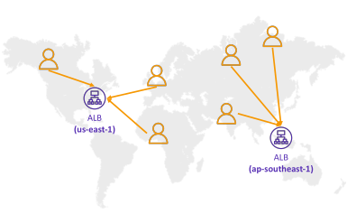

## Routing Policies – Failover (Active-Passive)

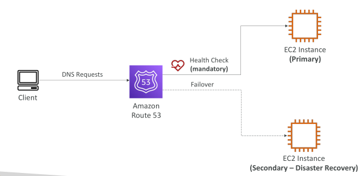

## RDS Read Replicas for read scalability

• Up to 15 Read Replicas

• Within AZ, Cross AZ or Cross Region

• Replication is ASYNC, so reads are eventually consistent

• Replicas can be promoted to their own DB

• Applications must update the connection string to leverage read replicas

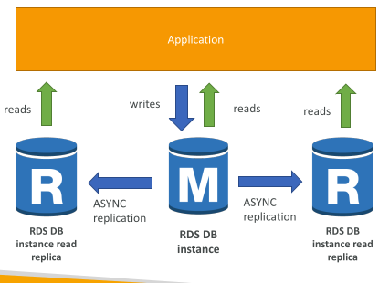

## RDS Read Replicas – Use Cases

• You have a production database that is taking on normal load

• You want to run a reporting application to run some analytics

• You create a Read Replica to run the new workload there

• The production application is unaffected

• Read replicas are used for SELECT (=read) only kind of statements (not INSERT, UPDATE, DELETE)

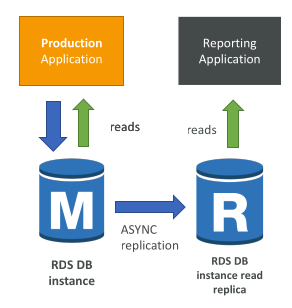

## RDS Read Replicas – Network Cost

• In AWS there’s a network cost when data goes from one AZ to another

• For RDS Read Replicas within the same region, you don’t pay that fee

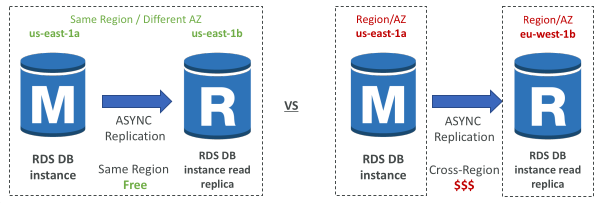

## RDS Multi AZ (Disaster Recovery)

• SYNC replication

• One DNS name – automatic app failover to standby

• Increase availability

• Failover in case of loss of AZ, loss of network, instance or storage failure

• No manual intervention in apps

• Not used for scaling

• Note: The Read Replicas be setup as Multi AZ for Disaster Recovery (DR)

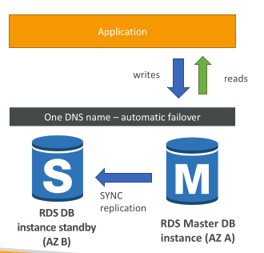

## RDS – From Single-AZ to Multi-AZ

• Zero downtime operation (no need to stop the DB)

• Just click on “modify” for the database

• The following happens internally:
 
 - A snapshot is taken
 
 - A new DB is restored from the snapshot in a new AZ
 
 - Synchronization is established between the two databases

## Aurora Replicas - Auto Scaling

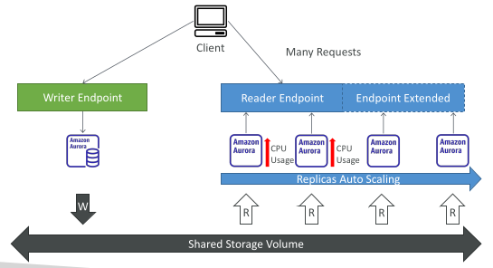

## Global Aurora

Aurora Cross Region Read Replicas:
 
 - Useful for disaster recovery
 
 - Simple to put in place

Aurora Global Database (recommended):
 
 - 1 Primary Region (read / write)
 
 - Up to 10 secondary (read-only) regions, replication lag is less than 1 second
 
 - Up to 16 Read Replicas per secondary region
 
 - Helps for decreasing latency
 
 - Promoting another region (for disaster recovery) has an RTO of < 1 minute
 
 - Typical cross-region replication takes less than 1 second

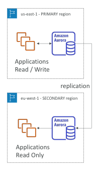

## Amazon Aurora – Unplanned Failover

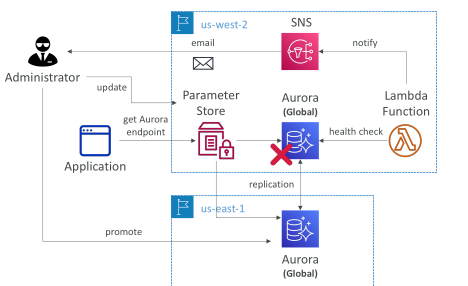

## Amazon Aurora – Global Application

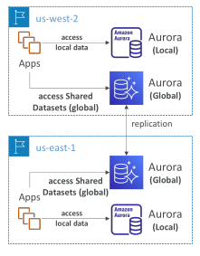

## Amazon ElastiCache Overview

• The same way RDS is to get managed Relational Databases…

• ElastiCache is to get managed Redis or Memcached

• Caches are in-memory databases with really high performance, low latency

• Helps reduce load off of databases for read intensive workloads

• Helps make your application stateless

• AWS takes care of OS maintenance / patching, optimizations, setup, configuration, monitoring, failure recovery and backups

• Using ElastiCache involves heavy application code changes

## ElastiCache Solution Architecture - DB Cache

• Applications queries ElastiCache, if not available, get from RDS and store in ElastiCache.

• Helps relieve load in RDS

• Cache must have an invalidation strategy to make sure only the most current data is used in there.

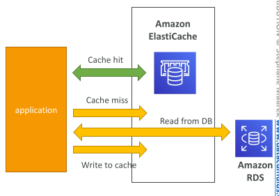

## ElastiCache Solution Architecture – User Session Store

• User logs into any of the application

• The application writes the session data into ElastiCache

• The user hits another instance of our application

• The instance retrieves the data and the user is already logged in

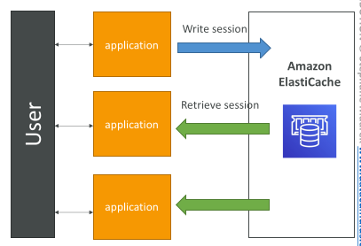

## ElastiCache – Redis vs Memcached

Redis 
 - Multi AZ with Auto-Failover
 - Read Replicas to scale reads and have high availability
 - Data Durability using AOF persistence
 - Backup and restore features
 - Supports Sets and Sorted Sets

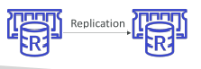

MEMCACHED
 - Multi-node for partitioning of data (sharding)
 - No high availability (replication)
 - Non persistent
 - Backup and restore (Serverless)
 - Multi-threaded architecture

## ElastiCache Replication: Cluster Mode Disabled

• One primary node, up to 5 replicas

• Asynchronous Replication

• The primary node is used for read/write

• The other nodes are read-only

• One shard, all nodes have all the data

• Guard against data loss if node failure

• Multi-AZ enabled by default for failover

• Helpful to scale read performance

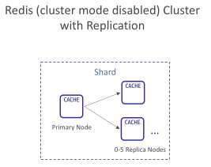

## Redis Scaling – Cluster Mode Disabled

Horizontal:
 - Scale out/in by adding/removing read replicas (max. 5 replicas)

Vertical:
 - Scale up/down to larger/smaller node type
 - ElastiCache will internally create a new node group, then data replication and DNS update

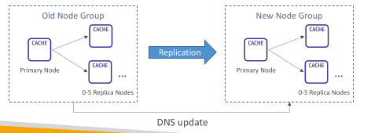

## ElastiCache Replication: Cluster Mode Enabled

• Data is partitioned across shards (helpful to scale writes)

• Each shard has a primary and up to 5 replica nodes (same concept as before)

• Multi-AZ capability

Up to 500 nodes per cluster:
 - 500 shards with single master
 - 250 shards with 1 master and 1 replica
 - …
 - 83 shards with one master and 5 replicas

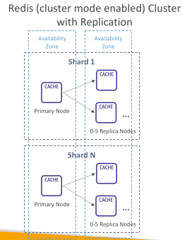

## ElastiCache for Redis – Auto Scaling

• Automatically increase/decrease the desired shards or replicas

• Supports both Target Tracking and Scheduled Scaling Policies

• Works only for Redis with Cluster Mode Enabled

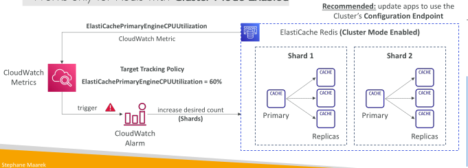

## ElastiCache – Redis Connection Endpoints

Standalone Node
 - One endpoint for read and write operations

Cluster Mode Disabled Cluster
 - Primary Endpoint – for all write operations
 - Reader Endpoint – evenly split read operations across all read replicas
 - Node Endpoint – for read operations

Cluster Mode Enabled Cluster
 - Configuration Endpoint – for all read/write operations that support Cluster Mode Enabled commands
 - Node Endpoint – for read operations

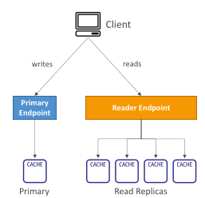

## Amazon DynamoDB
• Fully managed, highly available with replication across multiple AZs

• NoSQL database - not a relational database - with transaction support

• Scales to massive workloads, distributed database

• Millions of requests per seconds, trillions of row, 100s of TB of storage

• Fast and consistent in performance (single-digit millisecond)

• Integrated with IAM for security, authorization and administration

• Low cost and auto-scaling capabilities

• No maintenance or patching, always available

• Standard & Infrequent Access (IA) Table Class

## DynamoDB - Basics

DynamoDB is made of Tables

Each table has a Primary Key (must be decided at creation time)

Each table can have an infinite number of items (= rows)

Each item has attributes (can be added over time – can be null)

Maximum size of an item is 400KB

Data types supported are:
 
 - Scalar Types – String, Number, Binary, Boolean, Null
 
 - Document Types – List, Map
 
 - Set Types – String Set, Number Set, Binary Set
 
Therefore, in DynamoDB you can rapidly evolve schemas

## DynamoDB – Table example

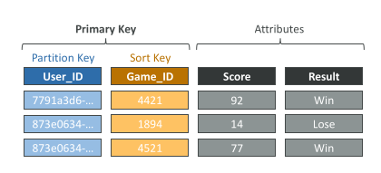

## DynamoDB – Read/Write Capacity Modes

• Control how you manage your table’s capacity (read/write throughput)

Provisioned Mode (default)
 
 - You specify the number of reads/writes per second
 
 - You need to plan capacity beforehand
 
 - Pay for provisioned Read Capacity Units (RCU) & Write Capacity Units (WCU)
 
 - Possibility to add auto-scaling mode for RCU & WCU

On-Demand Mode
 
 - Read/writes automatically scale up/down with your workloads
 
 - No capacity planning needed
 
 - Pay for what you use, more expensive ($$$)
 
 - Great for unpredictable workloads, steep sudden spikes

## DynamoDB Accelerator (DAX)

• Fully-managed, highly available, seamless in- memory cache for DynamoDB

• Help solve read congestion by caching

• Microseconds latency for cached data

• Doesn’t require application logic modification (compatible with existing DynamoDB APIs)

• 5 minutes TTL for cache (default)

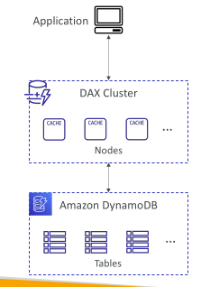

## DynamoDB Accelerator (DAX) vs. ElastiCache

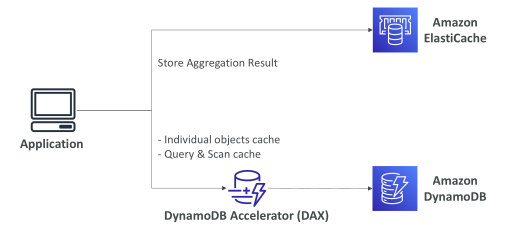

## DynamoDB – Stream Processing

• Ordered stream of item-level modifications (create/update delete) in a table
Use cases:
 
 - React to changes in real-time (welcome email to users)
 
 - Real-time usage analytics
 
 - Insert into derivative tables
 
 - Implement cross-region replication
 
 - Invoke AWS Lambda on changes to your DynamoDB table

## DynamoDB Streams

• 24 hours retention

• Limited # of consumers

• Process using AWS Lambda Triggers, or DynamoDB Stream Kinesis adapter

## Kinesis Data Streams (newer)
• 1 year retention

• High # of consumers

• Process using AWS Lambda, Kinesis Data Analytics, Kineis Data Firehose, AWS Glue Streaming ETL…

## DynamoDB Streams

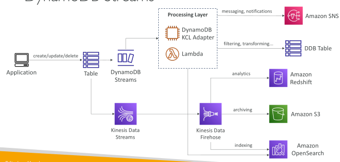

## DynamoDB Global Tables

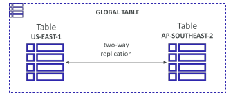

• Make a DynamoDB table accessible with low latency in multiple-regions

• Active-Active replication

• Applications can READ and WRITE to the table in any region

• Must enable DynamoDB Streams as a pre-requisite

## DynamoDB – Time To Live (TTL)

• Automatically delete items after an expiry timestamp

• Use cases: reduce stored data by keeping only current items, adhere to regulatory obligations, web session handling…

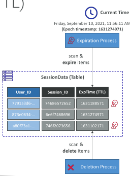

## DynamoDB – Backups for disaster recovery

Continuous backups using point-in-time recovery (PITR)
 
 - Optionally enabled for the last 35 days
 
 - Point-in-time recovery to any time within the backup window
 
 - The recovery process creates a new table

On-demand backups
 
 - Full backups for long-term retention, until explicitely deleted
 
 - Doesn’t affect performance or latency
 
 - Can be configured and managed in AWS Backup (enables cross-region copy)
 
 - The recovery process creates a new table

## DynamoDB – Integration with Amazon S3

Export to S3 (must enable PITR)
 
 - Works for any point of time in the last 35 days
 
 - Doesn’t affect the read capacity of your table
 
 - Perform data analysis on top of DynamoDB
 
 - Retain snapshots for auditing
 
 - ETL on top of S3 data before importing back into DynamoDB
 
 - Export in DynamoDB JSON or ION format

Import from S3
 
 - Import CSV, DynamoDB JSON or ION format
 
 - Doesn’t consume any write capacity
 
 - Creates a new table
 
 - Import errors are logged in CloudWatch Logs

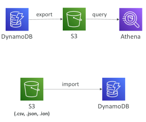

## DMS – Database Migration Service

• Quickly and securely migrate databases to AWS, resilient, self healing

• The source database remains available during the migration

Supports:
 - Homogeneous migrations: ex Oracle to Oracle
 - Heterogeneous migrations: ex Microsoft SQL Server to Aurora

• Continuous Data Replication using CDC

• You must create an EC2 instance to perform the replication tasks

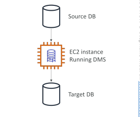

## DMS Sources and Targets

SOURCES:

• On-Premises and EC2 instances databases: Oracle, MS SQL Server, MySQL, MariaDB, PostgreSQL, MongoDB, SAP, DB2

• Azure: Azure SQL Database

• Amazon RDS: all including Aurora

• Amazon S3

• DocumentDB

TARGETS:

• On-Premises and EC2 instances databases: Oracle, MS SQL Server, MySQL, MariaDB, PostgreSQL, SAP

• Amazon RDS

• Redshift, DynamoDB, S3

• OpenSearch Service

• Kinesis Data Streams

• Apache Kafka

• DocumentDB & Amazon Neptune

• Redis & Babelfish

## AWS Schema Conversion Tool (SCT)

• Convert your Database’s Schema from one engine to another

• Example OLTP: (SQL Server or Oracle) to MySQL, PostgreSQL, Aurora

• Example OLAP: (Teradata or Oracle) to Amazon Redshift

• Prefer compute-intensive instances to optimize data conversions

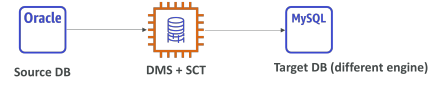

You do not need to use SCT if you are migrating the same DB engine
 - Ex: On-Premise PostgreSQL => RDS PostgreSQL
 - The DB engine is still PostgreSQL (RDS is the platform)

## DMS - Continuous Replication

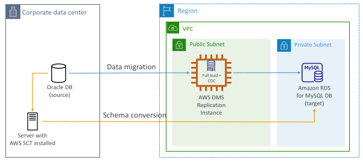

## AWS DMS – Multi-AZ Deployment

• When Multi-AZ Enabled, DMS provisions and maintains a synchronously stand replica in a different AZ

Advantages:
 - Provides Data Redundancy
 - Eliminates I/O freezes
 - Minimizes latency spikes

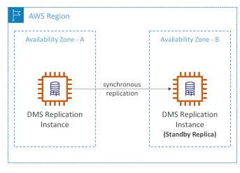