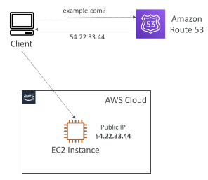
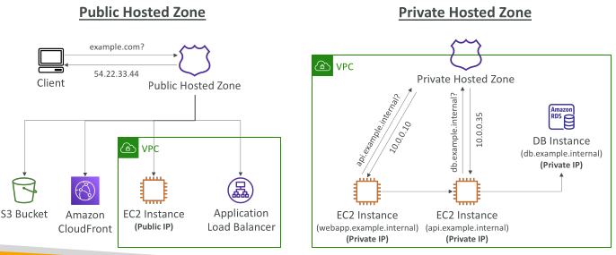
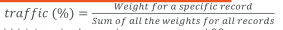
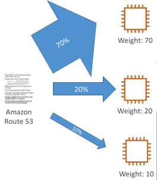

## Amazon Route 53

A highly available, scalable, fully managed and Authoritative DNS
 - Authoritative = the customer (you) can update the DNS records

• Route 53 is also a Domain Registrar

• Ability to check the health of your resources

• The only AWS service which provides 100% availability SLA

• Why Route 53? 53 is a reference to the traditional DNS port

## Route 53 – Records

How you want to route traffic for a domain

Each record contains:
 - Domain/subdomain Name – e.g., example.com
 - Record Type – e.g., A or AAAA
 - Value – e.g., 12.34.56.78
 - Routing Policy – how Route 53 responds to queries
 - TTL – amount of time the record cached at DNS Resolvers

Route 53 supports the following DNS record types:
 - (must know) A / AAAA / CNAME / NS
 - (advanced) CAA / DS / MX / NAPTR / PTR / SOA / TXT / SPF / SRV

A – maps a hostname to IPv4

AAAA – maps a hostname to IPv6

CNAME – maps a hostname to another hostname
 - The target is a domain name which must have an A or AAAA record
 - Can’t create a CNAME record for the top node of a DNS namespace (Zone Apex)
 - Example: you can’t create for example.com, but you can create for www.example.com
 
NS – Name Servers for the Hosted Zone
 - Control how traffic is routed for a domain

## Route 53 – Hosted Zones

• A container for records that define how to route traffic to a domain and its subdomains

• Public Hosted Zones – contains records that specify how to route traffic on the Internet (public domain names) application1.mypublicdomain.com

• Private Hosted Zones – contain records that specify how you route traffic within one or more VPCs (private domain names) application1.company.internal

• You pay $0.50 per month per hosted zone

## Route 53 – Public vs. Private Hosted Zones

## Routing Policies – Weighted

• Control the % of the requests that go to each specific resource

• Assign each record a relative weight:

• DNS records must have the same name and type

• Can be associated with Health Checks

• Use cases: load balancing between regions, testing new application versions…

• Assign a weight of 0 to a record to stop sending traffic to a resource

• If all records have weight of 0, then all records will be returned equally

