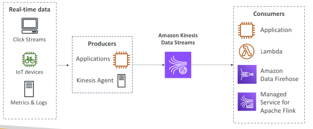
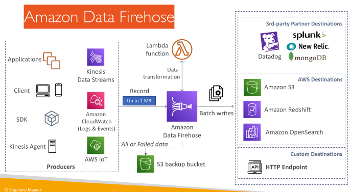
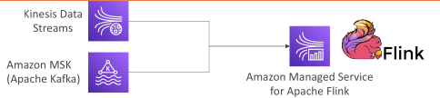

## Amazon Kinesis Data Streams

• Collect and store streaming data in real-time

## Kinesis Data Streams

• Retention between up to 365 days

• Ability to reprocess (replay) data by consumers

• Data can’t be deleted from Kinesis (until it expires)

• Data up to 10MiB (typical use case is lot of “small” real-time data)

• Data ordering guarantee for data with the same “Partition ID”

• At-rest KMS encryption, in-flight HTTPS encryption

• Kinesis Producer Library (KPL) to write an optimized producer application

• Kinesis Client Library (KCL) to write an optimized consumer application

## Kinesis Data Streams – Capacity Modes

Provisioned mode:
 
 - Choose number of shards
 
 - Each shard gets 1MB/s in (or 1000 records per second)
 
 - Each shard gets 2MB/s out
 
 - Scale manually to increase or decrease the number of shards
 
 - You pay per shard provisioned per hour

On-demand mode:
 
 - No need to provision or manage the capacity
 
 - Default capacity provisioned (4 MB/s in or 4000 records per second)
 
 - Scales automatically based on observed throughput peak during the last 30 days
 
 - Pay per stream per hour & data in/out per GB

## Amazon Data Firehose

Note: used to be called “Kinesis Data Firehose”

Fully Managed Service
 - Amazon Redshift / Amazon S3 / Amazon OpenSearch Service
 - 3rd party: Splunk / MongoDB / Datadog / NewRelic / …
 - Custom HTTP Endpoint

Automatic scaling, serverless, pay for what you use

Near Real-Time with buffering capability based on size / time

Supports CSV, JSON, Parquet, Avro, Raw Text, Binary data

Conversions to Parquet / ORC, compressions with gzip / snappy

Custom data transformations using AWS Lambda (ex: CSV to JSON)

## Kinesis Data Streams vs Amazon Data Firehose

Kinesis Data Streams
 
 - Streaming data collection
 
 - Producer & Consumer code
 
 - Real-time
 
 - Provisioned / On-Demand mode
 
 - Data storage up to 365 days
 
 - Replay Capability

Amazon Data Firehose
 
 - Load streaming data into S3 / Redshift / OpenSearch / 3rd party / custom HTTP
 
 - Fully managed
 
 - Near real-time
 
 - Automatic scaling
 
 - No data storage
 
 - Doesn’t support replay capability

## Amazon Managed Service for Apache Flink

• Previously named: Kinesis Data Analytics for Apache Flink

• Flink (Java, Scala or SQL) is a framework for processing data streams

Run any Apache Flink application on a managed cluster on AWS
 
 - Provisioned compute resources, parallel computation, automatic scaling
 
 - Application backups (implemented as checkpoints and snapshots)
 
 - Use any Apache Flink programming features to transform data
 
 - Important: Flink does not read from Amazon Data Firehose