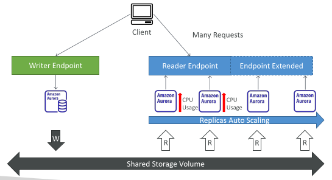
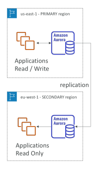
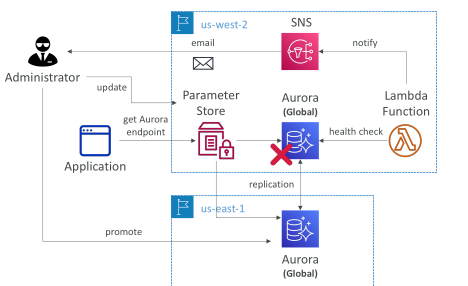
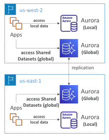

## Aurora Replicas - Auto Scaling

## Global Aurora

Aurora Cross Region Read Replicas:
 
 - Useful for disaster recovery
 
 - Simple to put in place

Aurora Global Database (recommended):
 
 - 1 Primary Region (read / write)
 
 - Up to 10 secondary (read-only) regions, replication lag is less than 1 second
 
 - Up to 16 Read Replicas per secondary region
 
 - Helps for decreasing latency
 
 - Promoting another region (for disaster recovery) has an RTO of < 1 minute
 
 - Typical cross-region replication takes less than 1 second

## Amazon Aurora – Unplanned Failover

## Amazon Aurora – Global Application

