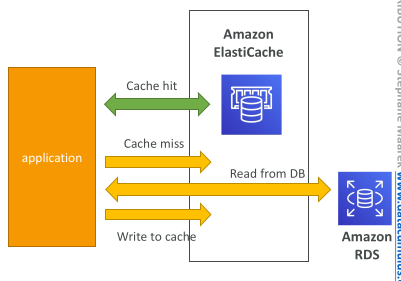
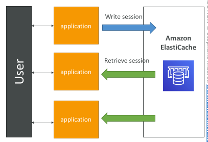
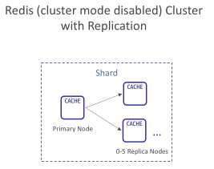
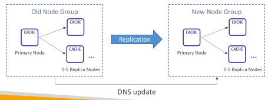
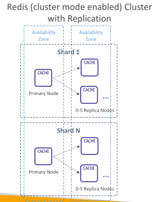
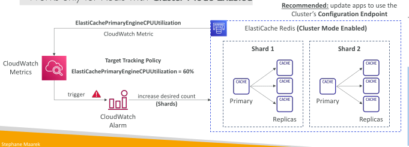
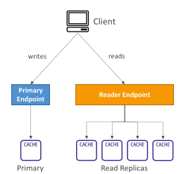

## Amazon ElastiCache Overview

• The same way RDS is to get managed Relational Databases…

• ElastiCache is to get managed Redis or Memcached

• Caches are in-memory databases with really high performance, low latency

• Helps reduce load off of databases for read intensive workloads

• Helps make your application stateless

• AWS takes care of OS maintenance / patching, optimizations, setup, configuration, monitoring, failure recovery and backups

• Using ElastiCache involves heavy application code changes

## ElastiCache Solution Architecture - DB Cache

• Applications queries ElastiCache, if not available, get from RDS and store in ElastiCache.

• Helps relieve load in RDS

• Cache must have an invalidation strategy to make sure only the most current data is used in there.

## ElastiCache Solution Architecture – User Session Store

• User logs into any of the application

• The application writes the session data into ElastiCache

• The user hits another instance of our application

• The instance retrieves the data and the user is already logged in

## ElastiCache – Redis vs Memcached

Redis 
 - Multi AZ with Auto-Failover
 - Read Replicas to scale reads and have high availability
 - Data Durability using AOF persistence
 - Backup and restore features
 - Supports Sets and Sorted Sets

MEMCACHED
 - Multi-node for partitioning of data (sharding)
 - No high availability (replication)
 - Non persistent
 - Backup and restore (Serverless)
 - Multi-threaded architecture

## ElastiCache Replication: Cluster Mode Disabled

• One primary node, up to 5 replicas

• Asynchronous Replication

• The primary node is used for read/write

• The other nodes are read-only

• One shard, all nodes have all the data

• Guard against data loss if node failure

• Multi-AZ enabled by default for failover

• Helpful to scale read performance

## Redis Scaling – Cluster Mode Disabled

Horizontal:
 - Scale out/in by adding/removing read replicas (max. 5 replicas)

Vertical:
 - Scale up/down to larger/smaller node type
 - ElastiCache will internally create a new node group, then data replication and DNS update

## ElastiCache Replication: Cluster Mode Enabled

• Data is partitioned across shards (helpful to scale writes)

• Each shard has a primary and up to 5 replica nodes (same concept as before)

• Multi-AZ capability

Up to 500 nodes per cluster:
 - 500 shards with single master
 - 250 shards with 1 master and 1 replica
 - …
 - 83 shards with one master and 5 replicas

## ElastiCache for Redis – Auto Scaling

• Automatically increase/decrease the desired shards or replicas

• Supports both Target Tracking and Scheduled Scaling Policies

• Works only for Redis with Cluster Mode Enabled

## ElastiCache – Redis Connection Endpoints

Standalone Node
 - One endpoint for read and write operations

Cluster Mode Disabled Cluster
 - Primary Endpoint – for all write operations
 - Reader Endpoint – evenly split read operations across all read replicas
 - Node Endpoint – for read operations

Cluster Mode Enabled Cluster
 - Configuration Endpoint – for all read/write operations that support Cluster Mode Enabled commands
 - Node Endpoint – for read operations

