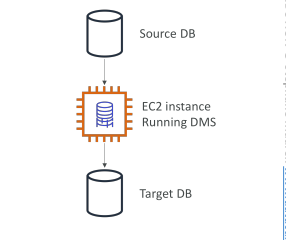
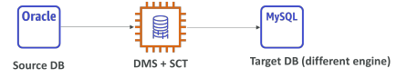
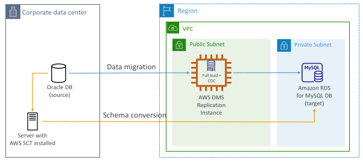
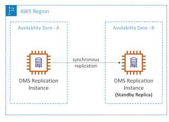

## DMS – Database Migration Service

• Quickly and securely migrate databases to AWS, resilient, self healing

• The source database remains available during the migration

Supports:
 - Homogeneous migrations: ex Oracle to Oracle
 - Heterogeneous migrations: ex Microsoft SQL Server to Aurora

• Continuous Data Replication using CDC

• You must create an EC2 instance to perform the replication tasks

## DMS Sources and Targets

SOURCES:

• On-Premises and EC2 instances databases: Oracle, MS SQL Server, MySQL, MariaDB, PostgreSQL, MongoDB, SAP, DB2

• Azure: Azure SQL Database

• Amazon RDS: all including Aurora

• Amazon S3

• DocumentDB

TARGETS:

• On-Premises and EC2 instances databases: Oracle, MS SQL Server, MySQL, MariaDB, PostgreSQL, SAP

• Amazon RDS

• Redshift, DynamoDB, S3

• OpenSearch Service

• Kinesis Data Streams

• Apache Kafka

• DocumentDB & Amazon Neptune

• Redis & Babelfish

## AWS Schema Conversion Tool (SCT)

• Convert your Database’s Schema from one engine to another

• Example OLTP: (SQL Server or Oracle) to MySQL, PostgreSQL, Aurora

• Example OLAP: (Teradata or Oracle) to Amazon Redshift

• Prefer compute-intensive instances to optimize data conversions

You do not need to use SCT if you are migrating the same DB engine
 - Ex: On-Premise PostgreSQL => RDS PostgreSQL
 - The DB engine is still PostgreSQL (RDS is the platform)

## DMS - Continuous Replication

## AWS DMS – Multi-AZ Deployment

• When Multi-AZ Enabled, DMS provisions and maintains a synchronously stand replica in a different AZ

Advantages:
 - Provides Data Redundancy
 - Eliminates I/O freezes
 - Minimizes latency spikes

