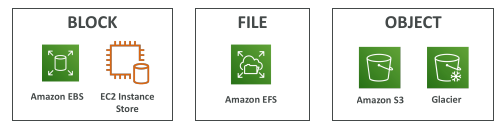
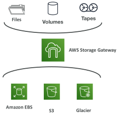
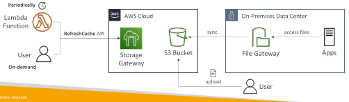
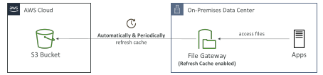

## Hybrid Cloud for Storage

AWS is pushing for ”hybrid cloud”
 - Part of your infrastructure is on-premises
 - Part of your infrastructure is on the cloud

This can be due to
 - Long cloud migrations
 - Security requirements
 - Compliance requirements
 - IT strategy

• S3 is a proprietary storage technology (unlike EFS / NFS), so how do you expose the S3 data on-premise?

• AWS Storage Gateway!

## AWS Storage Cloud Native Options

## AWS Storage Gateway

• Bridge between on-premise data and cloud data in S3

• Hybrid storage service to allow on-premises to seamlessly use the AWS Cloud

• Use cases: disaster recovery, backup & restore, tiered storage

Types of Storage Gateway:
 - File Gateway
 - Volume Gateway
 - Tape Gateway

No need to know the types at the exam

## File Gateway – RefreshCache API

• Storage Gateway updates the File Share Cache automatically when you write files to the File Gateway

• When you upload files directly to the S3 bucket, users connected to the File Gateway may not see the files on the File Share (accessing stale data)

• You need to invoke the RefreshCache API

## File Gateway – Automating Cache Refresh

• Automated Cache Refresh – a File Gateway feature that enables you to automatically refresh File Gateway cache to stay up to date with the changes in their S3 buckets

• Ensure that users are not accessing stale data on their file shares

• No need to manually and periodically invoke the RefreshCache API

