## Auto Scaling Groups – Scaling Policies

Dynamic Scaling
 - Target Tracking Scaling
   - Simple to set-up
   - Example: I want the average ASG CPU to stay at around 40%
 - Simple / Step Scaling
   - When a CloudWatch alarm is triggered (example CPU > 70%), then add 2 units
   - When a CloudWatch alarm is triggered (example CPU < 30%), then remove 1
   
Scheduled Scaling
 - Anticipate a scaling based on known usage patterns
 - Example: increase the min capacity to 10 at 5 pm on Fridays

## Auto Scaling Groups – Scaling Policies

• Predictive scaling: continuously forecast load and schedule scaling ahead

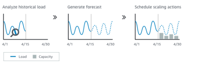

## Good metrics to scale on

• CPUUtilization: Average CPU utilization across your instances

• RequestCountPerTarget: to make sure the number of requests per EC2 instances is stable

• Average Network In / Out (if you’re application is network bound)

• Any custom metric (that you push using CloudWatch)

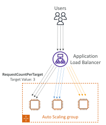

## Auto Scaling Groups - Scaling Cooldowns

• After a scaling activity happens, you are in the cooldown period (default 300 seconds)

• During the cooldown period, the ASG will not launch or terminate additional instances (to allow for metrics to stabilize)

• Advice: Use a ready-to-use AMI to reduce configuration time in order to be serving request fasters and reduce the cooldown period

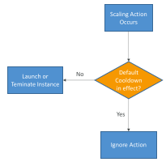

## ASG – Lifecycle Hooks

• By default, as soon as an instance is launched in an ASG it’s in service

• You can perform extra steps before the instance goes in service (Pending state)

• Define a script to run on the instances as they start

• You can perform some actions before the instance is terminated (Terminating state)

• Pause the instances before they’re terminated for troubleshooting

• Use cases: cleanup, log extraction, special health checks

• Integration with EventBridge, SNS, and SQS

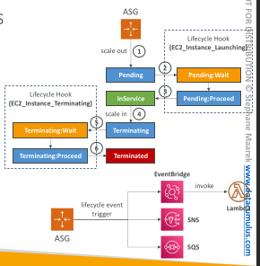

## ASG – Lifecycle Hooks

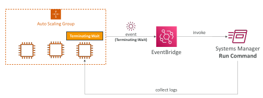

## ASG – SNS Notifications

ASG supports sending SNS notifications for the following events:
 -  autoscaling:EC2_INSTANCE_LAUNCH
 -  autoscaling:EC2_INSTANCE_LAUNCH_ERROR
 -  autoscaling:EC2_INSTANCE_TERMINATE
 -  autoscaling:EC2_INSTANCE_TERMINATE_ERROR

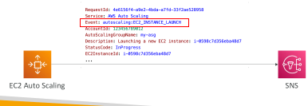

## ASG – EventBridge Events

You can create Rules that match the following ASG events:
 - EC2 Instance Launching, EC2 Instance Launch Successful/Unsuccessful
 - EC2 Instance Terminating, EC2 Instance Terminate Successful/Unsuccessful
 - EC2 Auto Scaling Instance Refresh Checkpoint Reached
 - EC2 Auto Scaling Instance Refresh Started, Succeeded, Failed, Cancelled

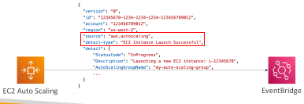

## ASG – Termination Policies

• Determine which instances to terminates first during scale-in events, Instance Refresh, and AZ Rebalancing

Default Termination Policy
 
 - Select AZ with more instances
 
 - Terminate instance with oldest Launch Template or Launch Configuration
 
 - If instances were launched using the same Launch Template, terminate the instance that is closest to the next billing hour

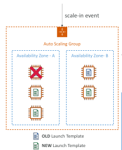

## ASG – Different Termination Policies

• Default – terminates instances according to Default Termination Policy

• AllocationStrategy – terminates instances to align the remaining instances to the Allocation Strategy (e.g., lowest-price for Spot Instances, or lower priority On-Demand Instances)

• OldestLaunchTemplate – terminates instances that have the oldest Launch Template

• OldestLaunchConfiguration – terminates instances that have the oldest Launch Configuration

• ClosestToNextInstanceHour – terminates instances that are closest to the next billing hour

• NewestInstance – terminates the newest instance (testing new launch template)

• OldestInstance – terminates the oldest instance (upgrading instance size, not launch template)

• Note: you can use one or more policies and specify the evaluation order

• Note: can define Custom Termination Policy backed by a Lambda function

## ASG – Scale-out Latency Problem

• When an ASG scales out, it tries to launch instances as fast as possible

• Some applications contain a lengthy unavoidable latency that exists at the application initialization/bootstrap layer (several minutes or more)

• Processes that can only happen at initial boot: applying updates, data or state hydration, running configuration scripts…

• Solution was to over-provision compute resources to absorb unexpected demand increases (increased cost) or use Golden Images to try to reduce boot time

• New solution: ASG Warm Pools !!

## ASG – Warm Pools

• Reduces scale-out latency by maintaining a pool of pre- initialized instances

• In a scale-out event, ASG uses the pre-initialized instances from the Warm Pool instead of launching new instances

Warm Pool Size Settings
 - Minimum warm pool size (always in the warm pool)
 - Max prepared capacity = Max capacity of ASG (default)
 - OR Max prepared capacity = Set number of instances

Warm Pool Instance State – what state to keep your Warm Pool instances in after initialization (Running, Stopped, Hibernated)

Warm Pools instances don’t contribute to ASG metrics that affect Scaling Policies

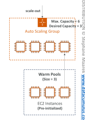

## ASG – Warm Pools Pricing: m5.large

• If we ”over provision an EC2 instance” in an ASG

• Running Cost = $0.096/hour * 24 hours/day * 30 days = $69.12 + EBS charges

• If the EC2 instance is stopped, we only pay for the attached EBS volume

• EBS Volume Cost = $0.10/GB-month * 10GB = $1.00

## ASG – Warm Pools – Instance States

## ASG – Warm Pools – Instance Reuse Policy

• By default, ASG terminates instances when ASG scales in, then it launches new instances into the Warm Pool

• Instance Reuse Policy allows you to return instances to the Warm Pool when a scale-in event happens

## ASG – Warm Pools – Lifecycle Hooks

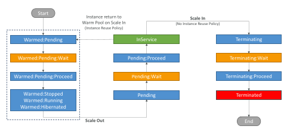

## ASG – Warm Pools – Lifecycle Hooks

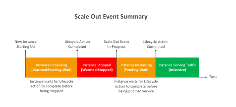

## AWS Application Auto Scaling

• Monitors your apps and automatically adjusts capacity to maintain steady predictable performance at lowest cost

• Setup scaling for multiple resouces across multiple services from a single plac (no need to navigate across different services)

• Point to your app and select the services and resources you want to scale (no need to setup alarms and scaling actions for each service)

• Search for resources/services using CloudFormation Stack, Tags, or EC2 ASG

• Build Scaling Plans to automatically add/remove capacity from your resources in real-time as demand changes

• Supports Target Tracking, Step, and Scheduled Scaling Policies

## AWS Application Auto Scaling

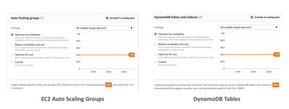

## AWS Application Auto Scaling – Integrated AWS Services

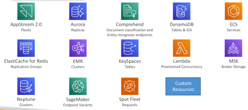

## ALB – Listener Rules

• Processed in order (with Default Rule)

• Supported Actions (forward, redirect, fixed-response)

Rule Conditions:
 - host-header
 - http-request-method
 - path-pattern
 - source-ip
 - http-header
 - query-string

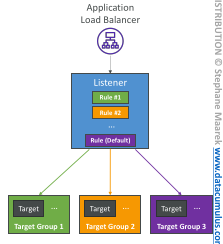

## Target Group Weighting

• Specify weight for each Target Group on a single Rule

• Example: multiple versions of your app, blue/green deployment

• Allows you to control the distribution of the traffic to your applications

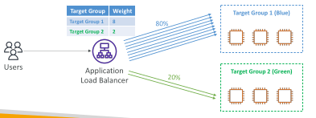

## ELB – DualStack Networking

• Allows clients communicate with the ELB using both IPv4 and IPv6

• Supports both ALB and NLB

• ALB and NLB can have mixed IPv4 and IPv6 targets in separate target groups.

ELB DualStack ensures compatibility between client and target IP versions
 - IPv4 clients communicate with IPv4 targets, and IPv6 clients communicate with IPv6 targets.
 - If you only have IPv4 targets, the ELB automatically converts requests from IPv6 to IPv4

• Note: AZ must be added/enabled for instances to receive traffic

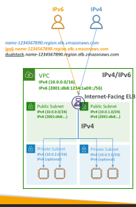

## NLB – PrivateLink Integration

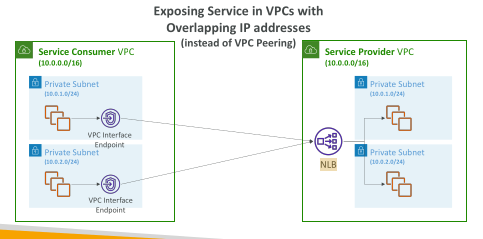