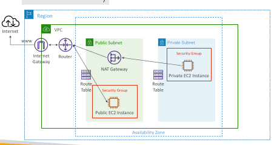
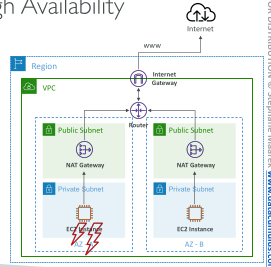
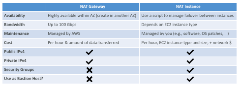

## NAT Gateway

• AWS-managed NAT, higher bandwidth, high availability, no administration
• Pay per hour for usage and bandwidth
• NATGW is created in a specific Availability Zone, uses an Elastic IP
• Can’t be used by EC2 instance in the same subnet (only from other subnets)
• Requires an IGW (Private Subnet => NATGW => IGW)
• 5 Gbps of bandwidth with automatic scaling up to 100 Gbps
• No Security Groups to manage / required

## NAT Gateway

## NAT Gateway with High Availability

• NAT Gateway is resilient within a single Availability Zone

• Must create multiple NAT Gateways in multiple AZs for fault-tolerance

• There is no cross-AZ failover needed because if an AZ goes down it doesn't need NAT

## NAT Gateway vs. NAT Instance

