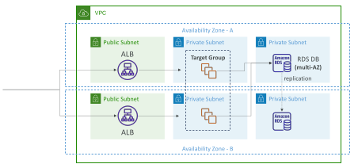
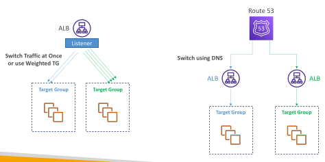
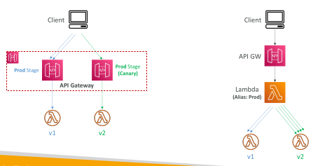
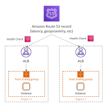
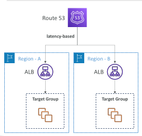
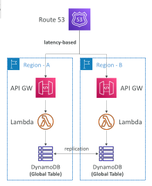
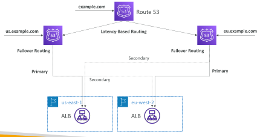

## Multi AZ in AWS

Services where Multi-AZ must be enabled manually:
 - EFS, ELB, ASG, Beanstalk: assign AZ
 - RDS, ElastiCache: multi-AZ (synchronous standby DB for failovers)
   - Aurora:
     - data is stored automatically across multi-AZ
     - Can have multi-AZ for the DB itself (same as RDS)
• OpenSearch (managed): multi master

• Jenkins (self deployed): multi master

Service where Multi-AZ is implicitly there:

• S3 (except OneZone-Infrequent Access)

• DynamoDB

• All of AWS’ proprietary, managed services

## Multi-AZ Architectures

## Blue-Green Architectures

## Blue-Green Architectures

## Multi Region Services

• DynamoDB Global Tables (multi-way replication, enabled by Streams)

• AWS Config Aggregators (multi region & multi account)

• RDS Cross Region Read Replicas (used for Read & DR)

• Aurora Global Database (one region is master, other is for Read & DR)

• EBS volumes snapshots, AMI, RDS snapshots can be copied to other regions

• VPC peering to allow private traffic between regions

• Route53 uses a global network of DNS servers

• S3 Cross Region Replication

• CloudFront for Global CDN at the Edge Locations

• Lambda@Edge for Global Lambda function at Edge Locations (A/B testing)

## Multi Region with Route 53

• Health Check => automated DNS failovers:

1. Health checks that monitor an endpoint (application, server, other AWS resource) Helpful to create a /health route

2. Health checks that monitor other health checks (calculated health checks)

3. Health checks that monitor CloudWatch alarms (full control !!) – e.g. throttles of DynamoDB, custom metrics, etc

Health Checks are integrated with CW metrics

## Multi-Region Architectures

## Multi-Region Architectures – Complex Routing

