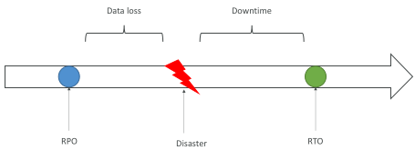
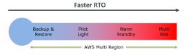
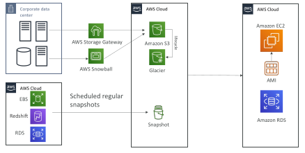
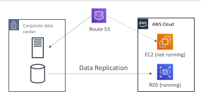
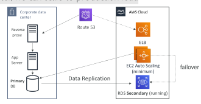
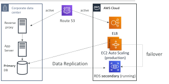
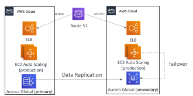

## Disaster Recovery Overview

• Any event that has a negative impact on a company’s business continuity or finances is a disaster

• Disaster recovery (DR) is about preparing for and recovering from a disaster

What kind of disaster recovery?
 - On-premise => On-premise: traditional DR, and very expensive
 - On-premise => AWS Cloud: hybrid recovery
 - AWS Cloud Region A => AWS Cloud Region B

Need to define two terms:
 - RPO: Recovery Point Objective
 - RTO: Recovery Time Objective

## RPO and RTO

## Disaster Recovery Strategies

• Backup and Restore

• Pilot Light

• Warm Standby

• Hot Site / Multi Site Approach

## Backup and Restore (High RPO)

## Disaster Recovery – Pilot Light

• A small version of the app is always running in the cloud

• Useful for the critical core (pilot light)

• Very similar to Backup and Restore

• Faster than Backup and Restore as critical systems are already up

## Warm Standby

• Full system is up and running, but at minimum size
• Upon disaster, we can scale to production load

## Multi Site / Hot Site Approach

• Very low RTO (minutes or seconds) – very expensive

• Full Production Scale is running AWS and On Premise

## All AWS Multi Region

## Disaster Recovery Tips

Backup
 - EBS Snapshots, RDS automated backups / Snapshots, etc…
 - Regular pushes to S3 / S3 IA / Glacier, Lifecycle Policy, Cross Region Replication
 - From On-Premise: Snowball or Storage Gateway

High Availability
 - Use Route53 to migrate DNS over from Region to Region
 - RDS Multi-AZ, ElastiCache Multi-AZ, EFS, S3
 - Site to Site VPN as a recovery from Direct Connect

Replication
 - RDS Replication (Cross Region), AWS Aurora + Global Databases
 - Database replication from on-premise to RDS
 - Storage Gateway
 
Automation
 - CloudFormation / Elastic Beanstalk to re-create a whole new environment
 - Recover / Reboot EC2 instances with CloudWatch if alarms fail
 - AWS Lambda functions for customized automations

Chaos
 - Netflix has a “simian-army” randomly terminating EC2