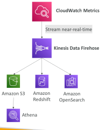
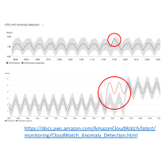
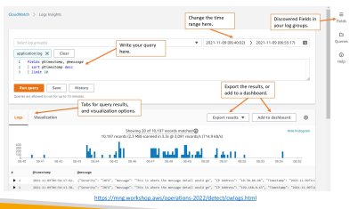
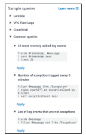
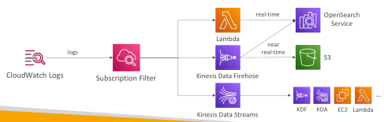
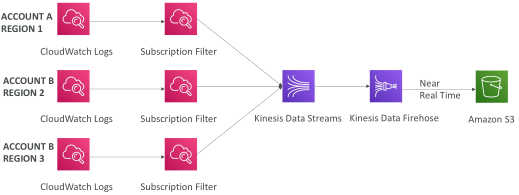
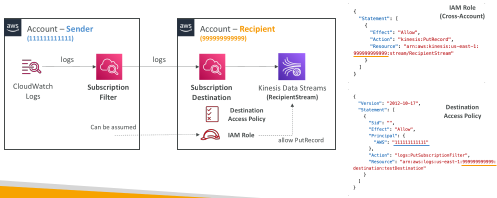
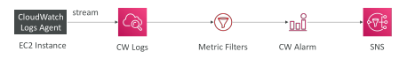

## Amazon CloudWatch Metrics

• CloudWatch provides metrics for every service in AWS

• Metric is a variable to monitor (CPUUtilization, NetworkIn…)

• Metrics belong to namespaces

• Dimension is an attribute of a metric (instance id, environment, etc…).

• Up to 30 dimensions per metric

• Metrics have timestamps

• Can create CloudWatch dashboards of metrics

• Can create CloudWatch Custom Metrics (for the RAM for example)

## CloudWatch Metric Streams

Continually stream CloudWatch metrics to a destination of your choice, with near-real-time delivery and low latency.
 - Amazon Kinesis Data Firehose (and then its destinations)
 - 3rd party service provider: Datadog, Dynatrace, New Relic, Splunk, Sumo Logic…

Option to filter metrics to only stream a subset of them

## CloudWatch Custom Metrics

• Possibility to define and send your own custom metrics to CloudWatch

• Example: memory (RAM) usage, disk space, number of logged in users …

• Use API call PutMetricData

Ability to use dimensions (attributes) to segment metrics
 - Instance.id
 - Environment.name

Metric resolution (StorageResolution API parameter – two possible value):
 - Standard: 1 minute (60 seconds)
 - High Resolution: 1/5/10/30 second(s) – Higher cost

• Important: Accepts metric data points two weeks in the past and two hours in the future (make sure to configure your EC2 instance time correctly)

## CloudWatch Anomaly Detection

• Continuously analyze metrics to determine normal baselines and surface anomalies using ML algorithms

• It creates a model of the metric’s expected values (based on metric’s past data)

• Shows you which values in the graph are out of the normal range

• Allows you to create Alarms based on metric’s expected value (instead of Static Threshold)

• Ability to exclude specified time periods or events from being trained

## CloudWatch Logs

• Log groups: arbitrary name, usually representing an application

• Log stream: instances within application / log files / containers

• Can define log expiration policies (never expire, 1 day to 10 years…)

CloudWatch Logs can send logs to:
 
 - Amazon S3 (exports)
 
 - Kinesis Data Streams
 
 - Kinesis Data Firehose
 
 - AWS Lambda
 
 - OpenSearch

• Logs are encrypted by default

• Can setup KMS-based encryption with your own keys

## CloudWatch Logs - Sources

• SDK, CloudWatch Logs Agent, CloudWatch Unified Agent

• Elastic Beanstalk: collection of logs from application

• ECS: collection from containers

• AWS Lambda: collection from function logs

• VPC Flow Logs: VPC specific logs

• API Gateway

• CloudTrail based on filter

• Route53: Log DNS queries

## CloudWatch Logs Insights

## CloudWatch Logs Insights

• Search and analyze log data stored in CloudWatch Logs

• Example: find a specific IP inside a log, count occurrences of “ERROR” in your logs…

Provides a purpose-built query language
 - Automatically discovers fields from AWS services and JSON log events
 - Fetch desired event fields, filter based on conditions, calculate aggregate statistics, sort events, limit number of events…
 - Can save queries and add them to CloudWatch Dashboards

• Can query multiple Log Groups in different AWS accounts

• It’s a query engine, not a real-time engine

## CloudWatch Logs – S3 Export

• Log data can take up to 12 hours to become available for export

• The API call is CreateExportTask

• Not near-real time or real-time… use Logs Subscriptions instead

## CloudWatch Logs Subscriptions

• Get a real-time log events from CloudWatch Logs for processing and analysis

• Send to Kinesis Data Streams, Kinesis Data Firehose, or Lambda

• Subscription Filter – filter which logs are events delivered to your destination

## CloudWatch Logs Aggregation Multi-Account & Multi Region

## CloudWatch Logs Subscriptions

• Cross-Account Subscription – send log events to resources in a different AWS account (KDS, KDF)

## CloudWatch Logs Metric Filter

CloudWatch Logs can use filter expressions
 
 - For example, find a specific IP inside of a log
 
 - Or count occurrences of “ERROR” in your logs
 
 - Metric filters can be used to trigger alarms

• Filters do not retroactively filter data. Filters only publish the metric data points for events that happen after the filter was created.

• Ability to specify up to 3 Dimensions for the Metric Filter (optional)

## All kind of Logs

Application Logs
 - Logs that are produced by your application code
 - Contains custom log messages, stack traces, and so on
 - Written to a local file on the filesystem
 - Usually streamed to CloudWatch Logs using a CloudWatch Agent on EC2
 - If using Lambda, direct integration with CloudWatch Logs
 - If using ECS or Fargate, direct integration with CloudWatch Logs
 - If using Elastic Beanstalk, direct integration with CloudWatch Logs

Operating System Logs (Event Logs, System Logs)
 - Logs that are generated by your operating system (EC2 or on-premise instance)
 - Informing you of system behavior (ex: /var/log/messages or /var/log/auth.log)
 - Usually streamed to CloudWatch Logs using a CloudWatch Agent

Access Logs
 - list of all the requests for individual files that people have requested from a website
 - Example for httpd: /var/log/apache/access.log
 - Usually for load balancers, proxies, web servers, etc…
 - AWS provides some access logs

## AWS Managed Logs

Load Balancer Access Logs (ALB, NLB, CLB) => to S3
 - Access logs for your Load Balancers

CloudTrail Logs => to S3 and CloudWatch Logs
 - Logs for API calls made within your account

VPC Flow Logs => to S3 and CloudWatch Logs
 - Information about IP traffic going to and from network interfaces in your VPC

Route 53 Access Logs => to CloudWatch Logs
 - Log information about the queries that Route 53 receives

S3 Access Logs => to S3
 - Server access logging provides detailed records for the requests that are made to a bucket

CloudFront Access Logs => to S3
 - Detailed information about every user request that CloudFront receives