## Amazon EventBridge (formerly CloudWatch Events)

• Schedule: Cron jobs (scheduled scripts)

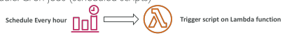

• Event Pattern: Event rules to react to a service doing something

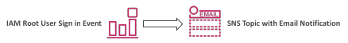

• Trigger Lambda functions, send SQS/SNS messages…

## Amazon EventBridge Rules

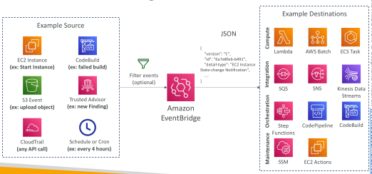

## Amazon EventBridge

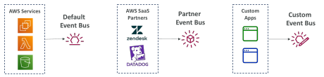

• Event buses can be accessed by other AWS accounts using Resource-based Policies

• You can archive events (all/filter) sent to an event bus (indefinitely or set period)

• Ability to replay archived events

## Amazon EventBridge – Schema Registry

• EventBridge can analyze the events in your bus and infer the schema

• The Schema Registry allows you to generate code for your application, that will know in advance how data is structured in the event bus

• Schema can be versioned

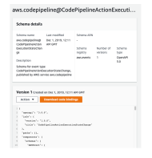

## Amazon EventBridge – Resource-based Policy

• Manage permissions for a specific Event Bus

• Example: allow/deny events from another AWS account or AWS region

• Use case: aggregate all events from your AWS Organization in a single AWS account or AWS region

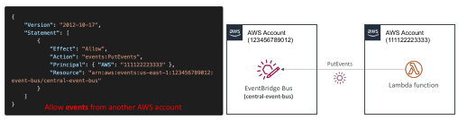

## S3 Event Notifications

• S3:ObjectCreated, S3:ObjectRemoved,
S3:ObjectRestore, S3:Replication…

• Object name filtering possible (*.jpg)

• Use case: generate thumbnails of images
uploaded to S3

• Can create as many “S3 events” as desired

• S3 event notifications typically deliver events in seconds but can sometimes take a minute or longer

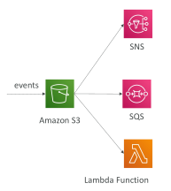

## S3 Event Notifications – IAM Permissions

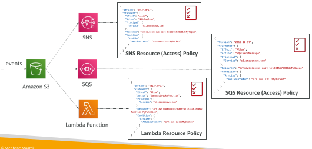

## S3 Event Notifications with Amazon EventBridge

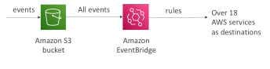

• Advanced filtering options with JSON rules (metadata, object size, name...)

• Multiple Destinations – ex Step Functions, Kinesis Streams / Firehose…

• EventBridge Capabilities – Archive, Replay Events, Reliable delivery

## Amazon S3 – Object Integrity

• S3 uses checksum to validate the integrity of uploaded objects

• Using MD5
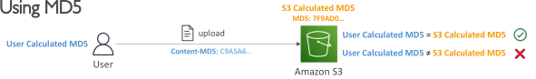

Using MD5 & Etag
 - ETag – represents a specific version of the object, ETag = MD5 (if SSE-S3)

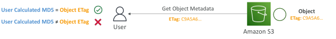

• Other supported checksums: SHA-1, SHA-256, CRC32, CRC32C

## AWS Health Dashboard - Service History

• Shows all regions, all services health

• Shows historical information for each day

• Has an RSS feed you can subscribe to

• Previously called AWS Service Health Dashboard

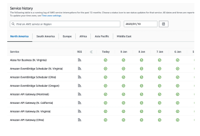

## AWS Health Dashboard – Your Account

• Previously called AWS Personal Health Dashboard (PHD)

• AWS Account Health Dashboard provides alerts and remediation
guidance when AWS is experiencing events that may impact you.

• While the Service Health Dashboard displays the general status of AWS services, Account Health Dashboard gives you a personalized view into the performance and availability of the AWS services underlying your AWS resources.

• The dashboard displays relevant and timely information to help you manage events in progress and provides proactive notification to help you plan for scheduled activities.

• Can aggregate data from an entire AWS Organization

## AWS Health Dashboard – Your Account

• Global service

• Shows how AWS outages directly impact you & your AWS resources

• Alert, remediation, proactive, scheduled activities

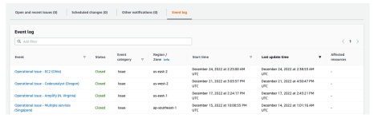

## Health Event Notifications

• Use EventBridge to react to changes for AWS Health events in your AWS account

• Example: receive email notifications when EC2 instances in your AWS account are scheduled for updates

• This is possible for Account events (resources that are affected in your account)and Public Events (Regional availability of a service)

• Use cases: send notifications, capture event information, take corrective action...

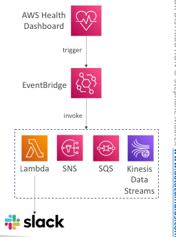

## AWS Health Dashboard – Examples

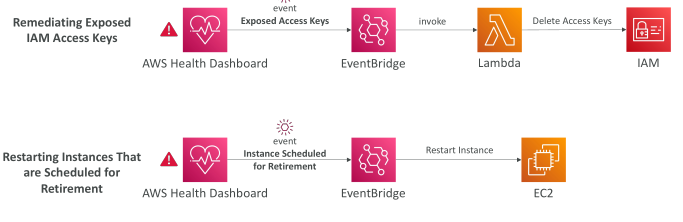

## Status Checks

• Automated checks to identify hardware and software issues

System Status Checks
 - Monitors problems with AWS systems (software/hardware issues on the physical host, loss of system power, …)

 - Check Personal Health Dashboard for any scheduled critical maintenance by AWS to your instance’s host

 - Resolution: stop and start the instance (instance migrated to a new host)

Instance Status Checks
 - Monitors software/network configuration of your instance (invalid network configuration, exhausted memory, …)
 
 - Resolution: reboot the instance or change instance configuration

Attached EBS Status Checks
 - Monitors EBS volumes attached to your instance (reachable & complete I/O Operations)
 
 - Resolution: reboot the instance or replace affected EBS volumes

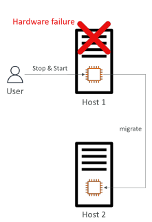

## Status Checks - CW Metrics & Recovery

CloudWatch Metrics (1 minute interval)
 - StatusCheckFailed_System
 - StatusCheckFailed_Instance
 - StatusCheckFailed_AttachedEBS
 - StatusCheckFailed (for any)

Option 1: CloudWatch Alarm
 - Recover EC2 instance with the same private/public IP, EIP, metadata, and Placement Group
 - Send notifications using SNS

Option 2: Auto Scaling Group
 - Set min/max/desired 1 to recover an instance but won't keep the same private and elastic IP

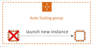

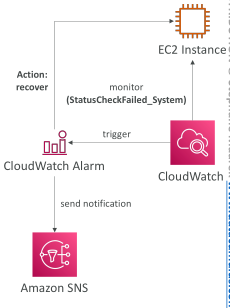