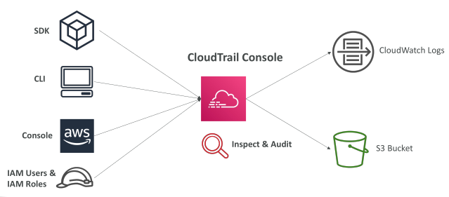
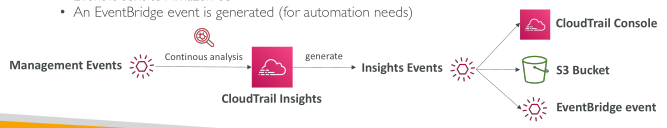
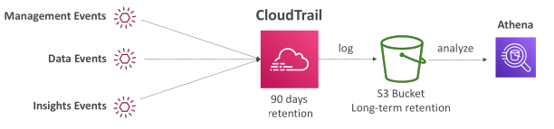
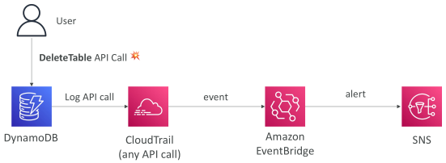
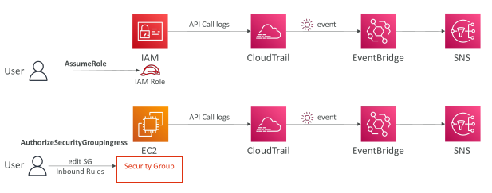
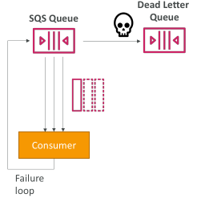
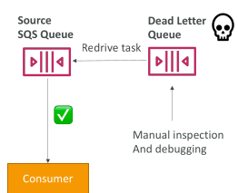
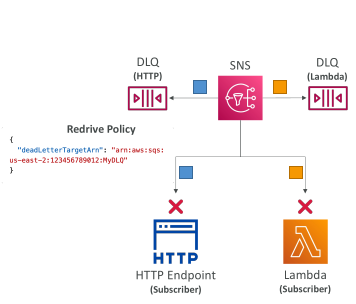

## AWS CLoudtrail

Provides governance, compliance and audit for your AWS Account

CloudTrail is enabled by default!

Get an history of events / API calls made within your AWS Account by:
 - Console

 - SDK
 
 - CLI
 
 - AWS Services

Can put logs from CloudTrail into CloudWatch Logs or S3

A trail can be applied to All Regions (default) or a single Region.

If a resource is deleted in AWS, investigate CloudTrail first!

## CloudTrail Events

Management Events:
 - Operations that are performed on resources in your AWS account
 
 - Examples:
   - Configuring security (IAM AttachRolePolicy)
   - Configuring rules for routing data (Amazon EC2 CreateSubnet)
   - Setting up logging (AWS CloudTrail CreateTrail)
 - By default, trails are configured to log management events.
 
 - Can separate Read Events (that don’t modify resources) from Write Events (that may modify resources)

Data Events:
 - By default, data events are not logged (because high volume operations)
 - Amazon S3 object-level activity (ex: GetObject, DeleteObject, PutObject): can separate Read and Write Events
 - AWS Lambda function execution activity (the Invoke API)

 ## CloudTrail Insights

Enable CloudTrail Insights to detect unusual activity in your account:
 
 - inaccurate resource provisioning
 
 - hitting service limits
 
 - Bursts of AWS IAM actions
 
 - Gaps in periodic maintenance activity

• CloudTrail Insights analyzes normal management events to create a baseline

And then continuously analyzes write events to detect unusual patterns
 
 - Anomalies appear in the CloudTrail console
 
 - Event is sent to Amazon S3
 
 - An EventBridge event is generated (for automation needs)

## CloudTrail Events Retention

• Events are stored for 90 days in CloudTrail

• To keep events beyond this period, log them to S3 and use Athena

## Amazon EventBridge – Intercept API Calls

## Amazon EventBridge + CloudTrail

## Amazon SQS – Dead Letter Queue (DLQ)

• If a consumer fails to process a message within the Visibility Timeout… the message goes back to the queue!

• We can set a threshold of how many times a message can go back to the queue

• After the MaximumReceives threshold is exceeded, the message goes into a Dead Letter Queue (DLQ)

• Useful for debugging!

• DLQ of a FIFO queue must also be a FIFO queue

• DLQ of a Standard queue must also be a Standard queue

Make sure to process the messages in the DLQ before they expire:
 - Good to set a retention of 14 days in the DLQ

## SQS DLQ – Redrive to Source

• Feature to help consume messages in the DLQ to understand what is wrong with them

• When our code is fixed, we can redrive the messages from the DLQ back into the source queue (or any other queue) in batches without writing custom code

## Amazon SNS – Dead Letter Queue (DLQ)

• After exhausting the delivery policy (delivery retries), messages that haven’t been delivered are discarded unless you set a DLQ (Dead Letter Queue)

• Redrive Policy – JSON object that refers to the ARN of the DLQ (SQS or SQS FIFO)

• DLQ is attached to SNS Subscription-level (rather than the SNS Topic)

