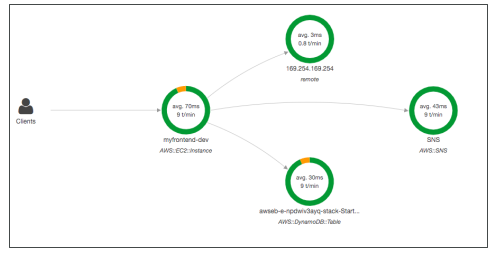
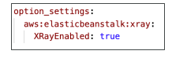
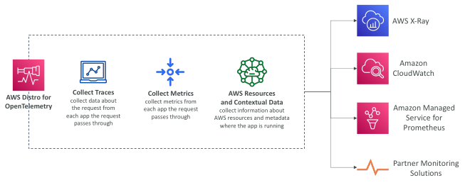

## AWS X-Ray Visual analysis of our applications

## X-Ray

Tracing requests across your microservices (distributed systems)

Integrations with:
 
 - EC2 – install the X-Ray agent
 
 - ECS – install the X-Ray agent or Docker container
 
 - Lambda
 
 - Beanstalk - agent is automatically installed
 
 - API Gateway – helpful to debug errors (such as 504)

The X-Ray agent or services need IAM permissions to X-Ray

## X-Ray with Elastic Beanstalk

• AWS Elastic Beanstalk platforms include the X-Ray daemon

• You can run the daemon by setting an option in the Elastic Beanstalk console or with a configuration file (in .ebextensions/xray-daemon.config)

• Make sure to give your instance profile the correct IAM permissions so that the X-Ray daemon can function correctly

• Then make sure your application code is instrumented with the X-Ray SDK

• Note: The X-Ray daemon is not provided for Multicontainer Docker

## AWS Distro for OpenTelemetry

• Secure, production-ready AWS-supported distribution of the open-source project OpenTelemetry project

• Provides a single set of APIs, libraries, agents, and collector services

• Collects distributed traces and metrics from your apps

• Collects metadata from your AWS resources and services

• Auto-instrumentation Agents to collect traces without changing your code

Send traces and metrics to multiple AWS services and partner solutions
 - X-Ray, CloudWatch, Prometheus…

• Instrument your apps running on AWS (e.g., EC2, ECS, EKS, Fargate, Lambda) as well as on-premises

• Migrate from X-Ray to AWS Distro for Temeletry if you want to standardize with open-source APIs from Telemetry or send traces to multiple destinations simultaneously

## AWS Distro for OpenTelemetry

