## AWS Config

Helps with auditing and recording compliance of your AWS resources

Helps record configurations and changes over time

Questions that can be solved by AWS Config:
 - Is there unrestricted SSH access to my security groups?
 - Do my buckets have any public access?
 - How has my ALB configuration changed over time?

You can receive alerts (SNS notifications) for any changes

AWS Config is a per-region service

Can be aggregated across regions and accounts

Possibility of storing the configuration data into S3 (analyzed by Athena)

## Config Rules

• Can use AWS managed config rules (over 75)

Can make custom config rules (must be defined in AWS Lambda)
 - Ex: evaluate if each EBS disk is of type gp2
 - Ex: evaluate if each EC2 instance is t2.micro

Rules can be evaluated / triggered:
 - For each config change
 - And / or: at regular time intervals

• AWS Config Rules does not prevent actions from happening (no deny)

• Pricing: no free tier, $0.003 per configuration item recorded per region, $0.001 per config rule evaluation per region

## AWS Config Resource

• View compliance of a resource over time

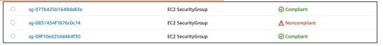

• View configuration of a resource over time

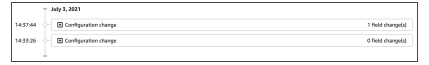

• View CloudTrail API calls of a resource over time

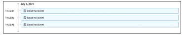

## Config Rules – Remediations

Automate remediation of non-compliant resources using SSM Automation Documents

Use AWS-Managed Automation Documents or create custom Automation Documents
 - Tip: you can create custom Automation Documents that invokes Lambda function

You can set Remediation Retries if the resource is still non-compliant after auto-remediation

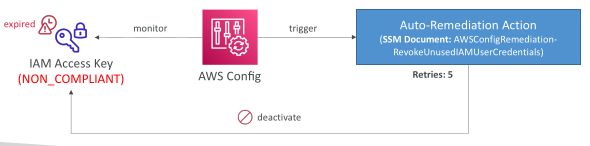

## Config Rules – Notifications

• Use EventBridge to trigger notifications when AWS resources are non-compliant

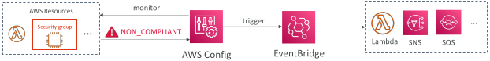

• Ability to send configuration changes and compliance state notifications to SNS (all events – use SNS Filtering or filter at client-side)

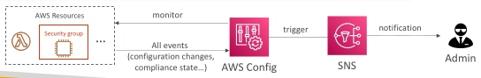

## AWS Config – Configuration Recorder

• Stores the configurations of your AWS resources as Configuration Items

• Configuration Item – a point-in-time view of the various attributes of an AWS resource. Created whenever AWS Config detects a change to the resource (e.g., attributes, relationships, config., events...)

• Custom Configuration Recorder to record only the resource types that you specify

• Must be created before AWS Config can track your resources (created automatically when you enable AWS Config using AWS CLI or AWS Console)

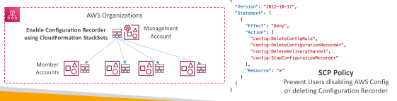

## AWS Config – Aggregators

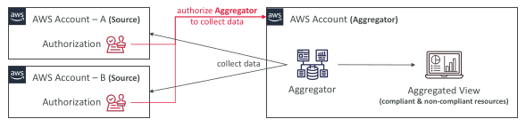

• The aggregator is created in one central aggregator account

• Aggregates rules, resources, etc… across multiple accounts & regions

• If using AWS Organizations, no need for individual Authorization

• Rules are created in each individual source AWS account

• Can deploy rules to multiple target accounts using CloudFormation StackSets

## AWS Config – Conformance Pack

• Collection of AWS Config Rules and Remediation actions

• Packs are created in YAML-formatted files (similar to CloudFormation)

• Deploy to an AWS account and regions or across an AWS Organization

• Pre-built sample Packs or create your own Custom Conformance Packs

• Can include custom Config Rules which are backed by Lambda functions to evaluate whether your resources are compliant with the Config Rules

• Can pass inputs via Parameters section to make it more flexible

• Can designate a Delegated Administrator to deploy Conformance Packs to your AWS Organization (can be Member account)

## AWS Config – Conformance Pack

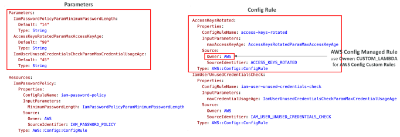

## AWS Config – Conformance Pack – CICD

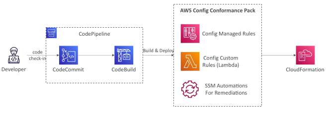

## AWS Config – Organizational Rules

• AWS Config Rule that you can manage across all accounts within an AWS Organization

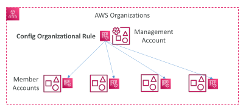

## AWS Config – Organizational Rules vs. Conformance Packs

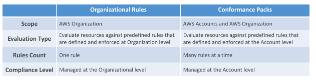