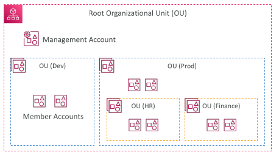
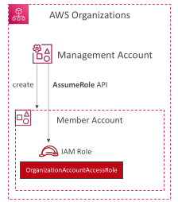
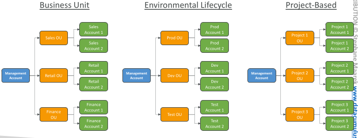
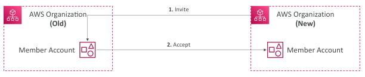
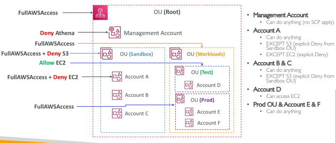
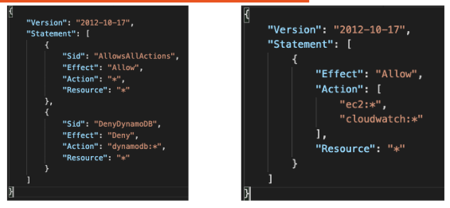

## AWS Organizations

## AWS Organizations - OrganizationAccountAccessRole

• IAM role which grants full administrator permissions in the Member account to the Management account

• Used to perform admin tasks in the Member accounts (e.g., creating IAM users)

• Could be assumed by IAM users in the Management account

• Automatically added to all new Member accounts created with AWS Organizations

• Must be created manually if you invite an existing Member account

## Multi Account Strategies

• Create accounts per department, per cost center, per dev / test / prod, based on regulatory restrictions (using SCP), for better resource isolation (ex: VPC), to have separate per-account service limits, isolated account for logging,

• Multi Account vs. One Account Multi VPC

• Use tagging standards for billing purposes

• Enable CloudTrail on all accounts, send logs to central S3 account

• Send CloudWatch Logs to central logging account

• Strategy to create an account for security

## Organizational Units (OU) - Examples

## AWS Organization - Feature Modes

Consolidated billing features:
 
 - Consolidated Billing across all accounts - single payment method
 
 - Pricing benefits from aggregated usage (volume discount for EC2, S3…)

All Features (Default):
 
 - Includes consolidated billing features, SCP
 
 - Invited accounts must approve enabling all features
 
 - Ability to apply an SCP to prevent member accounts from leaving the org
 
 - Can’t switch back to Consolidated Billing Features only

## AWS Organizations – Reserved Instances

• For billing purposes, the consolidated billing feature of AWS Organizations treats all the accounts in the organization as one account.

• This means that all accounts in the organization can receive the hourly cost benefit of Reserved Instances that are purchased by any other account.

• The payer account (Management account) of an organization can turn off Reserved Instance (RI) discount and Savings Plans discount sharing for any accounts in that organization, including the payer account

• This means that RIs and Savings Plans discounts aren't shared between any accounts that have sharing turned off.

• To share an RI or Savings Plans discount with an account, both accounts must have sharing turned on

## AWS Organizations – Moving Accounts

1. Send an invite to the member account from the AWS Organization

2. Accept the invite to the new Organization from the member account

## Service Control Policies (SCP)

• Define allowlist or blocklist IAM actions

• Applied at the OU or Account level

• Does not apply to the Management Account

• SCP is applied to all the Users and Roles in the account, including Root user

The SCP does not affect Service-linked roles
 - Service-linked roles enable other AWS services to integrate with AWS Organizations and can't be restricted by SCPs.
• SCP must have an explicit Allow from the root through each OU in the direct path to the target account (does not allow anything by default)

Use cases:
 - Restrict access to certain services (for example: can’t use EMR)
 - Enforce PCI compliance by explicitly disabling services

## SCP Hierarchy

## SCP Examples Blocklist and Allowlist strategies

