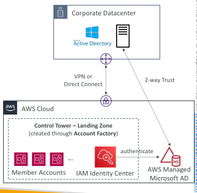
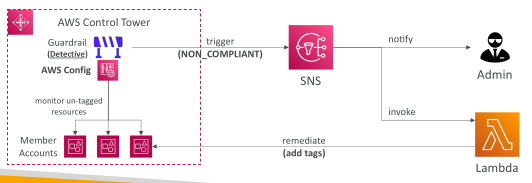
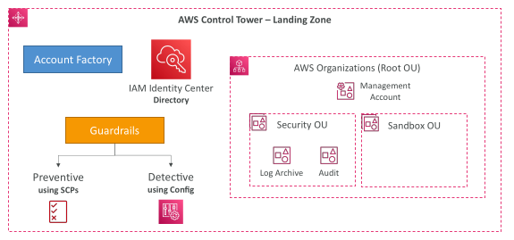
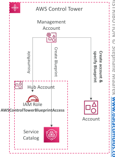
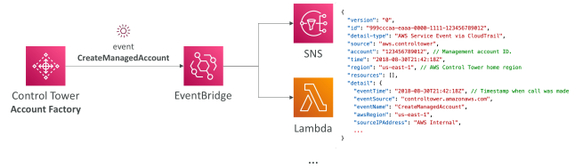
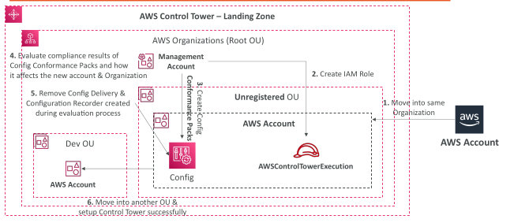
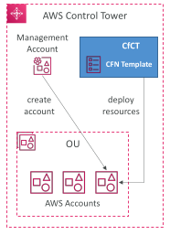
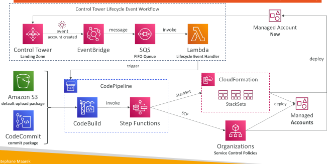
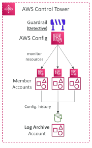
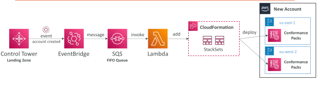

## AWS Control Tower

Easy way to set up and govern a secure and compliant multi-account AWS environment based on best practices

Benefits:
 - Automate the set up of your environment in a few clicks
 - Automate ongoing policy management using guardrails
 - Detect policy violations and remediate them
 - Monitor compliance through an interactive dashboard

AWS Control Tower runs on top of AWS Organizations:
 - It automatically sets up AWS Organizations to organize accounts and implement SCP (Service Control Policies)

## AWS Control Tower – Account Factory

• Automates account provisioning and deployments

• Enables you to create pre-approved baselines and configuration options for AWS accounts in your organization (e.g., VPC default configuration, subnets, region, …)

• Uses AWS Service Catalog to provision new AWS accounts

## AWS Control Tower – Detect and Remediate Policy Violations

Guardrail
 
 - Provides ongoing governance for your Control Tower environment (AWS Accounts)
 
 - Preventive – using SCPs (e.g., Disallow Creation of Access Keys for the Root User)
 
 - Detective – using AWS Config (e.g., Detect Whether MFA for the Root User is Enabled)
 
 - Example: identify non-compliant resources (e.g., untagged resources)

## AWS Control Tower – Guardrails Levels

Mandatory
 - Automatically enabled and enforced by AWS Control Tower
 - Example: Disallow public Read access to the Log Archive account

Strongly Recommended
 - Based on AWS best practices (optional)
 - Example: Enable encryption for EBS volumes attached to EC2 instances

Elective
 - Commonly used by enterprises (optional)
 - Example: Disallow delete actions without MFA in S3 buckets

## AWS Control Tower – Landing Zone

• Automatically provisioned, secure, and compliant multi-account environment based on AWS best practices

Landing Zone consists of:
 - AWS Organization – create and manage multi-account structure
 - Account Factory – easily configure new accounts to adhere to config. and policies
 - Organizational Units (OUs) – group and categorize accounts based on purpose
 - Service Control Policies (SCPs) – enforce fine-grained permissions and restrictions
 - IAM Identity Center – centrally manage user access to accounts and services
 - Guardrails – rules and policies to enforce security, compliance and best practices
 - AWS Config – to monitor and assess your resources’ compliance with Guardrails

## AWS Control Tower – Landing Zone

## AWS Control Tower – Account Factory Customization (AFC)

• Automatically customize resources in new and existing accounts created through Account Factory

Custom Blueprint
 - CloudFormation template that defines the resources and configurations you want to customize in the account
 - Defined in the form on a Service Catalog Product
 - Stored in a Hub Account, which stores all the Custom Blueprints (recommended: don’t use the Management account)
 - Also available pre-defined blueprints created by AWS Partners

 - Only one blueprint can be deployed to the account

## AWS Control Tower – Account Factory

## Migrate an AWS Account to Control Tower

## Customizations for AWS Control Tower (CfCT)

• GitOps-style customization framework created by AWS

• Helps you add customizations to your Landing Zone using your custom CloudFormation templates and SCPs

• Automatically deploy resources to new AWS accounts created using Account Factory

• Note: CfCT is different from AFC (Account Factory Customization ; blueprint)

## Customizations for AWS Control Tower (CfCT)

## AWS Control Tower – AWS Config Integration

• Control Tower uses AWS Config to implement Detective Guardrails

• Control Tower automatically enables AWS Config in enabled Regions

• AWS Config Configuration History and snapshots delivered to S3 bucket in a centralized Log Archive account

• Control Tower uses CloudFormation StackSets to create resources like Config Aggregator, CloudTrail, and centralized logging

## AWS Control Tower – AWS Config Conformance Packs

• Config Conformance Packs – enables you to create packages of Config Compliance Rules & Remediations for easy deployment at scale

• Deploy to individual AWS accounts or entire and AWS Organization

## AWS Control Tower – Account Factory for Terraform (AFT)

• Helps you provision and customize AWS accounts in Control Tower through Terraform using a deployment pipeline

• You create an account request Terraform file which triggers the AFT workflow for account provisioning

Offers built-in feature options (disabled by default)
 - AWS CloudTrail Data Events – creates a Trail & enables CloudTrail Data Events
 - AWS Enterprise Support Plan – turns on the Enterprise Support Plan
 - Delete The AWS Default VPC – deletes the default VPCs in all AWS Regions

• Terraform module maintained by AWS

• Works with Terraform Open-source, Terraform Enterprise, and Terraform Cloud

