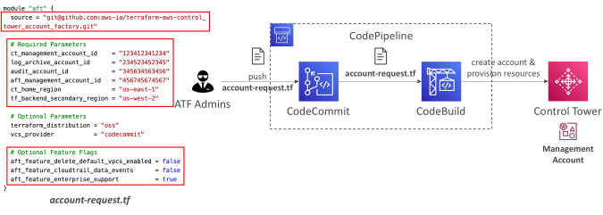
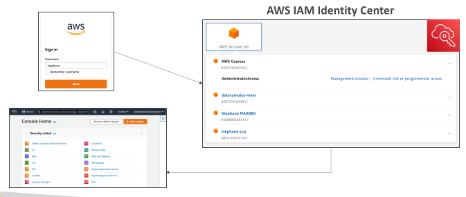
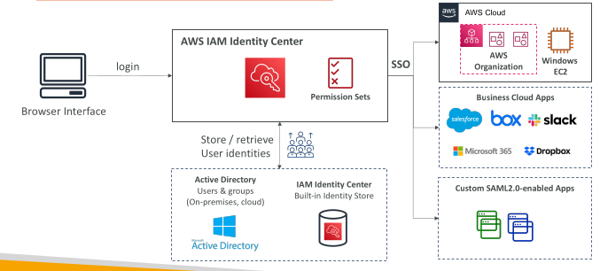
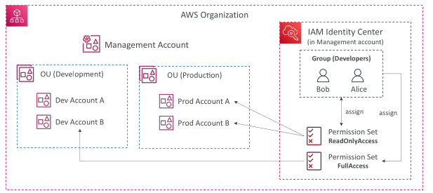
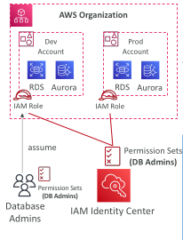
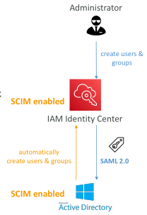
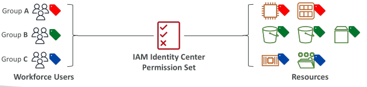
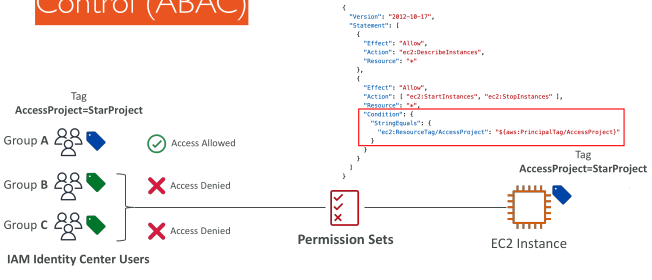
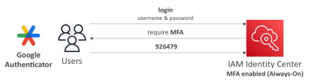

## AWS Control Tower – Account Factory for Terraform (AFT)

## AWS IAM Identity Center (successor to AWS Single Sign-On)

One login (single sign-on) for all your
 - AWS accounts in AWS Organizations
 - Business cloud applications (e.g., Salesforce, Box, Microsoft 365...)
 - SAML2.0-enabled applications
 - EC2 Windows Instances

Identity providers
 - Built-in identity store in IAM Identity Center
 - 3rd party: Active Directory (AD), OneLogin, Okta…

## AWS IAM Identity Center – Login Flow 

## AWS IAM Identity Center

## IAM Identity Center

## AWS IAM Identity Center Fine-grained Permissions and Assignments

Multi-Account Permissions
 
 - Manage access across AWS accounts in your AWS Organization
 
 - Permission Sets – a collection of one or more IAM Policies assigned to users and groups to define AWS access

Application Assignments
 
 - SSO access to many SAML 2.0 business applications (Salesforce, Box, Microsoft 365...)
 
 - Provide required URLs, certificates, and metadata

Attribute-Based Access Control (ABAC)
 
 - Fine-grained permissions based on users’ attributes stored in IAM Identity Center Identity Store
 
 - Example: cost center, title, locale...
 
 - Use case: Define permissions once, then modify AWS access by changing the attributes

## IAM Identity Center – External IdPs

SAML 2.0: authenticate identities from external IdP
 - Users sign into AWS access portal using their corporate identities
 - Supports Okta, Azure AD, OneLogin…
 - SAML 2.0 does NOT provide a way to query the IdP to learn
about users and groups
 - You must create users and groups in the IAM Identity Center that are identical to the users and groups in the External IdP

SCIM: automatic provisoning (synchronization) of user identities from an external IdP into IAM Identity Center
 - SCIM = System for Cross-domain Identity Management
 - Must be supported by the external IdP
 - Perfect complement to using SAML 2.0

## IAM Identity Center – Attribute-Based Access Control (ABAC)

• Fine-grained permissions based on users’ attributes stored in IAM Identity Center Identity Store
• User attributes can be used in IAM Identity Center Permission Sets and Resource-based Policies

• Example: cost center, title, locale...

• Use case: Define permissions once, then modify AWS access by changing the attributes

• User attributes are mapped from the IdP as key-value pairs

## IAM Identity Center – Attribute-Based Access Control (ABAC)

## IAM Identity Center – Multi-Factor Authentication (MFA)

Supports Multi-Factor Authentication (MFA) with authentication modes:
 - Every Time They Sign-in (Always-on)
 - Only When Their Sign-in Context Changes (Context-aware) – analyzes user behavior (e g., device, browser, location…)

