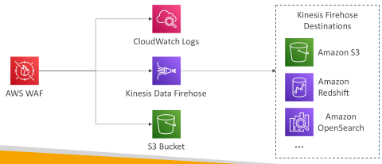
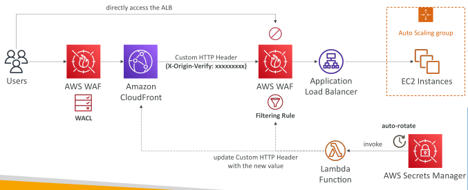

## AWS WAF – Web Application Firewall

• Protects your web applications from common web exploits (Layer 7)

• Deploy on Application Load Balancer (localized rules)

• Deploy on API Gateway (rules running at the regional or edge level)

Deploy on CloudFront (rules globally on edge locations)
 - Used to front other solutions: CLB, EC2 instances, custom origins, S3 websites

• Deploy on AppSync (protect your GraphQL APIs)

• WAF is not for DDoS protection

Define Web ACL (Web Access Control List):
 - Rules can include IP addresses, HTTP headers, HTTP body, or URI strings
 - Protects from common attack - SQL injection and Cross-Site Scripting (XSS)
 - Size constraints, Geo match
 - Rate-based rules (to count occurrences of events)

• Rule Actions: Count | Allow | Block | CAPTCHA | Challenge

## AWS WAF – Managed Rules

• Library of over 190 managed rules

• Ready-to-use rules that are managed by AWS and AWS Marketplace Sellers

Baseline Rule Groups – general protection from common threats
 - AWSManagedRulesCommonRuleSet, AWSManagedRulesAdminProtectionRuleSet...

Use-case Specific Rule Groups – protection for many AWS WAF use cases
 - AWSManagedRulesSQLiRuleSet, AWSManagedRulesWindowsRuleSet, AWSManagedRulesPHPRuleSet, AWSManagedRulesWordPressRuleSet...

IP Reputation Rule Groups – block requests based on source (e.g., malicious IPs)
 - AWSManagedRulesAmazonIpReputationList, AWSManagedRulesAnonymousIpList

Bot Control Managed Rule Group – block and manage requests from bots
 - AWSManagedRulesBotControlRuleSet

## WAF - Web ACL – Logging

You can send your logs to an:
 - Amazon CloudWatch Logs log group – 5 MB per second
 - Amazon Simple Storage Service (Amazon S3) bucket – 5 minutes interval
 - Amazon Kinesis Data Firehose – limited by Firehose quotas

## Solution Architecture – Enahnce CloudFront Origin Security with AWS WAF & AWS Secrets Manager

