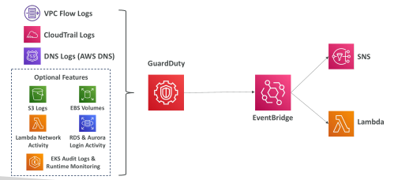
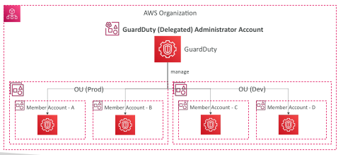
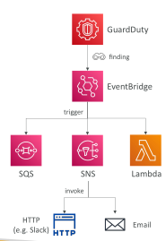
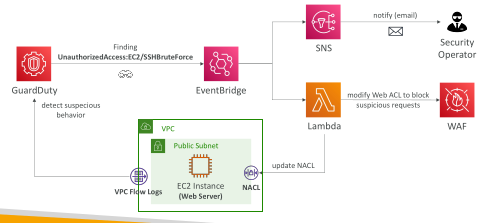
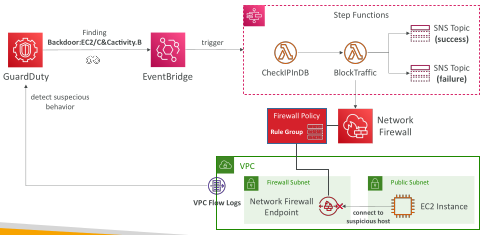
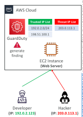
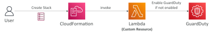

## Amazon GuardDuty

• Intelligent Threat discovery to protect your AWS Account

• Uses Machine Learning algorithms, anomaly detection, 3rd party data

• One click to enable (30 days trial), no need to install software

Input data includes:
 - CloudTrail Events Logs – unusual API calls, unauthorized deployments
   - CloudTrail Management Events – create VPC subnet, create trail, …
   - CloudTrail S3 Data Events – get object, list objects, delete object, …
 - VPC Flow Logs – unusual internal traffic, unusual IP address
 - DNS Logs – compromised EC2 instances sending encoded data within DNS queries
 - Optional Feature – EKS Audit Logs, RDS & Aurora, EBS, Lambda, S3 Data Events…

• Can setup EventBridge rules to be notified in case of findings

• EventBridge rules can target AWS Lambda or SNS

• Can protect against CryptoCurrency attacks (has a dedicated “finding” for it)

## Amazon GuardDuty

## Amazon GuardDuty – Multi-Account Strategy

You can manage multiple accounts in GuardDuty

Associate the Member accounts with the Administrator account
 - Through an AWS Organization
 - Sending invitation through GuardDuty

Administrator account can:
 - Add and remove member accounts
 - Manage GuardDuty within the associated member accounts
 - Manage findings, suppression rules, trusted IP lists, threat lists

In an AWS Organization, you can specify a member account as the Organization’s delegated administrator for GuardDuty

## Amazon GuardDuty – Multi-Account Strategy

## Amazon GuardDuty – Findings Automated Response

• Findings are potential security issue for malicious events happening in your AWS account

• Automate response to security issues revealed by GuardDuty Findings using EventBridge

• Send alerts to SNS (email, Lambda, Slack, Chime...)

• Events are published to both the administrator account and the member account that it is originated from

## Amazon GuardDuty – Findings

• GuardDuty pulls independent streams of data directly from CloudTrail logs (management events, data events), VPC Flow Logs or EKS logs

• Each finding has a severity value between 0.1 to 8+ (High, Medium, Low)
Finding naming convention
  ThreatPurpose:ResourceTypeAffected/ThreatFamilyName.DetectionMechanism!Artifact
   - ThreatPurpose – primary purpose of the threat (e.g., Backdoor, CryptoCurrency)
   - ResourceTypeAffected – which AWS resource is the target (e.g., EC2, S3)
   - ThreatFamilyName – describes the potential malicious activity (e.g., NetworkPortUnusual)
   - DetectionMechanism – method GuardDuty detecting the finding (e.g., Tcp, Udp)
   - Artifact – describes a resource that is used in the malicious activity (e.g., DNS)

You can generate sample findings in GuardDuty to test your automations

## Amazon GuardDuty – Findings Types

EC2 Finding Types
  - UnauthorizedAccess:EC2/SSHBruteForce, CryptoCurrency:EC2/BitcoinToo.B!DNS

IAM Finding Types
  - Stealth:IAMUser/CloudTrailLoggingDisabled, Policy:IAMUser/RootCredentialUsage

Kubernetes Audit Logs Finding Types
  - CredentialAccess:Kubernetes/MaliciousIPCaller

Malware Protection Finding Types
  - Execution:EC2/SuspiciousFile, Execution:ECS/ SuspiciousFile

RDS Protection Finding Types
  - CredentialAccess:RDS/AnomalousBehavior.SuccessfulLogin

S3 Finding Types
  - Policy:S3/AccountBlockPublicAccessDisabled, PenTest:S3/KaliLinux

## Amazon GuardDuty – Architectures

## Amazon GuardDuty – Architectures

## Amazon GuardDuty – Trusted and Threat IP Lists

Works only for public IP addresses

Trusted IP List
 - List of IP addresses and CIDR ranges that you trust
 - GuardDuty doesn’t generate findings for these trusted lists

Threat IP List
 - List of known malicious IP addresses and CIDR ranges
 - GuardDuty generates findings based on these threat lists
 - Can be supplied by 3rd party threat intelligence or created custom for you

• In a multi-account GuardDuty setup, only the GuardDuty administrator account can manage those lists

## Amazon GuardDuty – CloudFormation

• You can enable GuardDuty using a CloudFormation template

• If GuardDuty is already enabled, the CloudFormation Stack deployment fails

• Use CloudFormation Custom Resouce (Lambda) to conditionally enable GuardDuty if it is not already enabled

• Deploy across all the Organization using a Stack Set

## Amazon Detective

• GuardDuty, Macie, and Security Hub are used to identify potential security issues, or findings

• Sometimes security findings require deeper analysis to isolate the root cause and take action – it’s a complex process

• Amazon Detective analyzes, investigates, and quickly identifies the root cause of security issues or suspicious activities using ML and graphs

• Automatically collects and processes events from VPC Flow Logs, CloudTrail, and GuardDuty to create a unified view

• Produces visualizations with details and context to get to the root cause

