## Amazon Inspector

• Automated Security Assessments

For EC2 instances
 -  Leveraging the AWS System Manager (SSM) agent
 -  Analyze against unintended network accessibility
 -  Analyze the running OS against known vulnerabilities

For Container Images push to Amazon ECR
 -  Assessment of Container Images as they are pushed

For Lambda Functions
 -  Identifies software vulnerabilities in function code and package dependencies
 -  Assessment of functions as they are deployed

• Reporting & integration with AWS Security Hub

• Send findings to Amazon Event Bridge

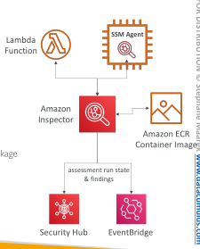

## What does Amazon Inspector evaluate?

• Remember: only for EC2 instances, Container Images & Lambda functions

• Continuous scanning of the infrastructure, only when needed

• Package vulnerabilities (EC2, ECR & Lambda) – database of CVE

• Network reachability (EC2)

• A risk score is associated with all vulnerabilities for prioritization

## Amazon Inspector – Systems Manager

EC2 instance setup in Inspector requires:
 - SSM Agent is running
 - Be an SSM Managed Instance (IAM Role or Default Host Management Config.)
 - Outbound 443 to Systems Manager endpoint

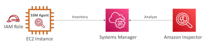

## EC2 Instance Migration between AZ

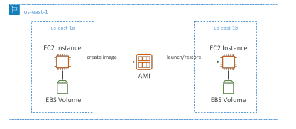

## Cross-Account AMI Sharing

• You can share an AMI with another AWS account

• Sharing an AMI does not affect the ownership of the AMI

• You can only share AMIs that have unencrypted volumes and volumes that are encrypted with a customer managed key

• If you share an AMI with encrypted volumes, you must also share any customer managed keys used to encrypt them.

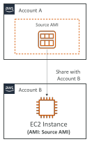

## AMI Sharing with KMS Encryption

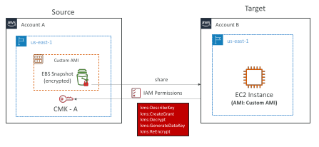

## Cross-Account AMI Copy

• If you copy an AMI that has been shared with your account, you are the owner of the target AMI in your account

• The owner of the source AMI must grant you read permissions for the storage that backs the AMI (EBS Snapshot)

• If the shared AMI has encrypted snapshots, the owner must share the key or keys with you as well

• Can encrypt the AMI with your own CMK while copying

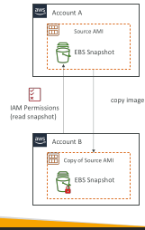

## AMI Copy with KMS Encryption

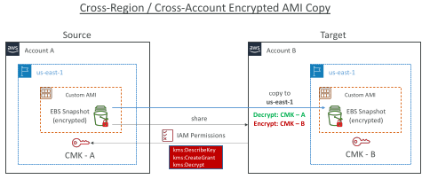

## Trusted Advisor

No need to install anything – high level AWS account assessment

Analyze your AWS accounts and provides recommendation on 6 categories:
 - Cost optimization
 - Performance
 - Security
 - Fault tolerance
 - Service limits
 - Operational Excellence

Business & Enterprise Support plan
 - Full Set of Checks
 - Programmatic Access using AWS Support API

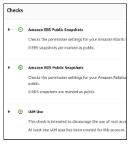

## Trusted Advisor – Monitoring

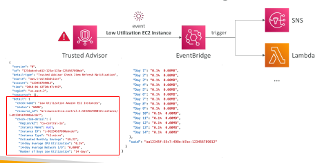

## Trusted Advisor – Service Quotas 50+ Service Quotas are supported

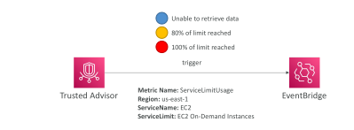

## AWS Secrets Manager

• Newer service, meant for storing secrets

• Capability to force rotation of secrets every X days

• Automate generation of secrets on rotation (uses Lambda)

• Integration with Amazon RDS (MySQL, PostgreSQL, Aurora)

• Secrets are encrypted using KMS

• Mostly meant for RDS integration

## AWS Secrets Manager – Multi-Region Secrets

• Replicate Secrets across multiple AWS Regions

• Secrets Manager keeps read replicas in sync with the primary Secret

• Ability to promote a read replica Secret to a standalone Secret

• Use cases: multi-region apps, disaster recovery strategies, multi-region DB…

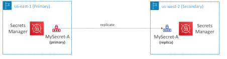