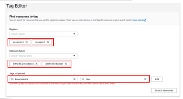
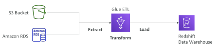
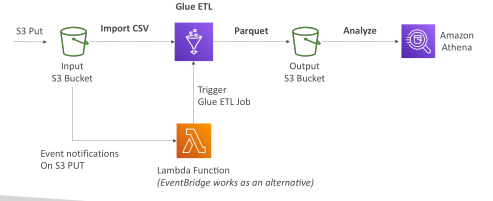
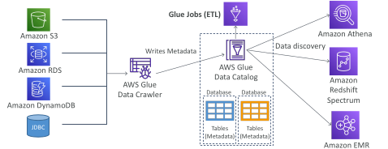

## AWS Tag Editor
• Allows you to manage tags of multiple resources at once

• You can add/update/delete tags

• Search tagged/untagged resources in all AWS Regions

## Amazon QuickSight

• Serverless machine learning-powered business intelligence service to create interactive dashboards

• Fast, automatically scalable, embeddable, with per-session pricing

Use cases:
 - Business analytics
 - Building visualizations
 - Perform ad-hoc analysis
 - Get business insights using data

Integrated with RDS, Aurora, Athena, Redshift, S3…

## AWS Glue

• Managed extract, transform, and load (ETL) service

• Useful to prepare and transform data for analytics

• Fully serverless service

## AWS Glue – Convert data into Parquet format

## Glue Data Catalog: catalog of datasets

## Glue – things to know at a high-level

• Glue Job Bookmarks: prevent re-processing old data

• Glue DataBrew: clean and normalize data using pre-built transformation

• Glue Studio: new GUI to create, run and monitor ETL jobs in Glue

• Glue Streaming ETL (built on Apache Spark Structured Streaming): compatible with Kinesis Data Streaming, Kafka, MSK (managed Kafka)

## Study

1. SDLC 1-4 Mon

2. SDLC 5-6, CM 1 Tue

3. CM 2-5 WED

4. RCS 1-6 Thur

5. RCS 7-11(2) Fri

6. RCS 12-17 Fri

7. Monitoring and Incident Sat

8. Security compliance and other Sat