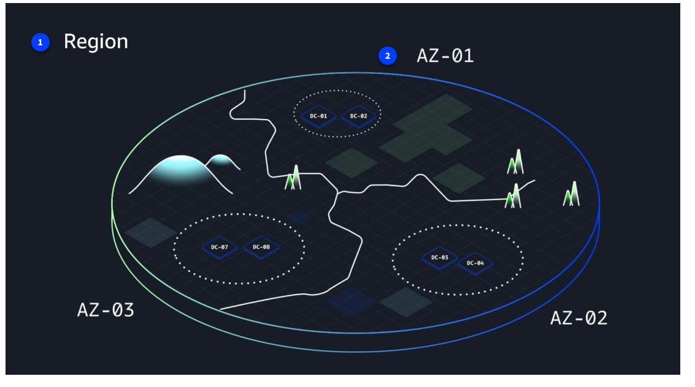

## What is Cloud Computing?

Cloud computing is essentially the on-demand delivery of IT resources over the internet with pay-as-you-go pricing.

On-demand delivery means that customers can access computing resources, such as storage or compute power, within seconds and as needed. Users can scale their resource usage up or down based on current requirements without lengthy provisioning processes.

The of IT resources aspect highlights the wide array of information technology assets in the cloud-computing space. These resources include servers, storage solutions, databases, networking components, artificial intelligence and machine learning (AI/ML) tools, and more. Customers can use these resources to build, deploy, and manage applications and services through the cloud infrastructure.

Pay as you go, Flexible pricing is a fundamental economic aspect of cloud computing. Users pay only for the resources they actually consume, rather than committing to fixed, long-term contracts. This usage-based pricing model offers cost efficiency and financial flexibility.

Example

Shall we break this down a bit? I think we shall. On demand means you use resources as needed. Let's say your business needs 2,000 TB of storage. Open an AWS account, throw some files into Amazon S3, and Bob’s your uncle. You're good to go. If you don't need to store those files anymore? Delete them, and stop paying immediately.

## Cloud deployment types

You can deploy cloud resources in multiple ways: cloud, on-premises, and hybrid. Each type offers unique benefits and considerations, and exploring these options can help you make informed decisions about your cloud strategy.

## Cloud
In a cloud-based deployment model, you have the flexibility to migrate your existing resources to the cloud, design and build new applications within the cloud environment, or use a combination of both.

For instance, a company might migrate data resources to the cloud, then develop an application comprised of virtual servers, databases, and networking components entirely hosted in the cloud.

## On-premises
Deploying resources on premises using virtualization and resource management tools does not provide many of the benefits of cloud computing. However, it is sometimes sought for its ability to provide dedicated resources and low latency.

In most cases this deployment model is the same as legacy IT infrastructure while using application management and virtualization technologies to try increasing resource utilization.

## Hybrid
In a hybrid deployment, cloud-based resources and on-premises infrastructure work together. This approach is ideal for situations where legacy applications must remain on premises due to maintenance preferences or regulatory requirements.

For instance, a company might choose to retain certain regulated legacy applications on-premises while using cloud services for advanced data processing and analytics.

Multi-cloud deployments can also be considered hybrid deployments.

## Key benefits of the cloud

1. Trade fixed expense for variable expense. By using the AWS Cloud, businesses can transition from fixed investments to variable costs. With variable costs, customer expenses are better aligned with actual usage, thus creating more financial flexibility.

2. Benefit from massive economies of scale. Like buying a product in bulk can result in lower prices per unit, the vast global infrastructure of AWS can result in lower costs for customers. This means that AWS can be used by many organizations, from small startups to major corporations. Businesses big and small can access advanced technologies that were previously only accessible to large enterprises.

3. Stop guessing capacity. Customers can dynamically scale AWS Cloud resources up or down based on real-time demand. This means businesses can achieve optimal performance without provisioning more or less infrastructure than they need.

4. Increase speed and agility. With the cloud, businesses can rapidly deploy applications and services, accelerating time to market and facilitating quicker responses to changing business needs and market conditions.

5. Stop spending money to run and maintain data centers. The AWS Cloud eliminates the need for businesses to invest in physical data centers. This means customers aren't required to spend time and money on utilities and ongoing maintenance. With AWS taking care of the physical infrastructure of the cloud, customer resources can be reallocated to more strategic initiatives.

6. Go global in minutes. Businesses don't need to set up their own infrastructure to expand internationally. AWS provides a robust global infrastructure that customers can use to deploy applications and services across multiple areas in minutes.

## Introduction to AWS Global Infrastructure

## AWS Regions and Availability Zones

AWS Global Infrastructure consists of physical locations around the world that contain groups of data centers. 

## AWS Regions

AWS Regions are physical locations around the world that contain groups of data centers. Each AWS Region consists of a minimum of three physically separate Availability Zones within a geographic area.

## Availability Zones

An Availability Zone consists of one or more data centers with redundant power, networking, and connectivity. 

Regions and Availability Zones are designed to provide low-latency, fault-tolerant access to services for users within a given area.

## Achieving high availability with AWS Global Infrastructure

AWS infrastructure is designed with high availability and fault tolerance in mind. 

Availability Zones (AZs) are configured as isolated resources, and they are each equipped with independent power, networking, and connectivity.

It's recommended to distribute your resources across multiple AZs. 

That way, if one AZ encounters an outage, your business applications will continue to operate without interruption. 

With this approach of redundancy and resource isolation, AWS customers can achieve the benefits of high availability and fault tolerance.

## The AWS Shared Responsibility Model

The AWS Shared Responsibility Model is a concept designed to help AWS and customers work together to create a secure, functional cloud environment. 

## Components of the AWS Shared Responsibility Model

## Customer responsibilities

1. Customer Data
2. Client side data encryption 

Customers are responsible for managing security requirements for their data, including which data they store on AWS and who has access to that data. Customers also control how access to the data is granted, managed, and revoked.

Additionally, customers are responsible for client-side encryption.

## Shared responsibilities

AWS is responsible for security of the cloud and customers are responsible for security in the cloud

1. Server side encryption
2. Network traffic protection
3. Platform and application management
4. OS, network, firewall configuration

Depending on the service used, responsibilities might shift between the customer and AWS. 

Components such as server-side encryption, network traffic protection, platform and application management, and OS, network, and firewall configuration vary by service in terms of who is responsible for these items. 

As you learn more about different types of services, you will see specific examples of how these elements are divided between the customer and AWS.

## AWS Responsibilities

1. Software for computer, storage, database and networking
2. Hardware, AWS Global infrastructure

AWS is responsible for protecting the infrastructure that runs all of the services offered in the AWS Cloud. 

This infrastructure is composed of the hardware, software, networking, and facilities that run AWS Cloud services.

## Applying Cloud Concepts to Real Life Use Cases

## Ecommerce company expansion

This ecommerce company is based in Seattle, Washington in the United States. The company wants to expand to global locations. 

However, the further the computing infrastructure is from their customers, the longer the latency. The company decides to expand to global AWS Regions to better reach their global customers.

## Global expansion one: Ireland

The company deploys resources to the eu-west-1 Region in Ireland. Deploying in multiple Regions increases high availability. The company increases fault-tolerance and high availability even more by deploying to two Availability Zones in this Region.

The company does not need to worry about securing the data center in Ireland because securing the physical infrastructure is an AWS responsibility. The company can instead focus on securing and encrypting their data within their cloud resources.

## Global expansion two: Singapore

The company has a significant customer base in Asia, too. So, they deploy resources to the ap-southwest-1 AWS Region in Singapore.

Rather than having to set up physical infrastructure at an international scale, which can take months or years, the company used AWS to deploy global operations within a matter of minutes.