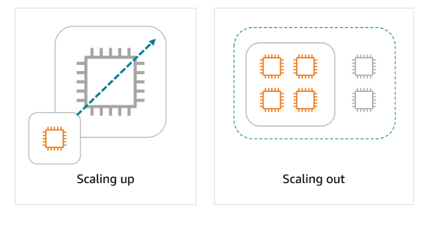

## Introduction to Amazon EC2

Compute refers to the processing power needed to run applications, manage data, and perform calculations. In the cloud, this power is available on-demand.

You can access it remotely without owning or maintaining physical hardware.

Essentially, compute in the cloud means creating virtual machines with a cloud provider to run applications and tasks over the internet.

## Amazon EC2

Amazon EC2 is more flexible, cost-effective, and faster than managing on-premises servers. It offers on-demand compute capacity that can be quickly launched, scaled, and terminated, with costs based only on active usage.

The flexibility of Amazon EC2 allows for faster development and deployment of applications. You can launch as many or as few virtual servers as needed and configure security, networking, and storage. You can also scale resources up or down based on usage, such as handling high traffic or compute-heavy tasks.

## Key takeaways: Comparing on-premises and cloud resources

### Challenges of on-premises resources

Imagine that you're responsible for designing your company's infrastructure to support new websites. With traditional on-premises resources, you must purchase hardware upfront, wait for delivery, and handle installation and configuration. This process is:

-  time-consuming
-  costly
-  inflexible 

because you're locked into a specific capacity that might not align with changing demands. 

### Benefits of using Cloud Resources

In contrast, with Amazon EC2, you can quickly launch, scale, and stop instances based on your needs without the delays and upfront costs associated with traditional on-premises resources.

 1. Pay only for the compute time used when an instance is running
 2. Scale up or down based on demand
 3. Stop using instances after a workload has completed
 4. Provision and launch amazon ec2 instance within minutes

 ## How Amazon EC2 works

With Amazon EC2, you can quickly launch, connect to, and use virtual instances in the cloud. Here's an overview of how the process works.

1. Launch an instance
   When launching an EC2 instance, you start by selecting an Amazon Machine Image (AMI), which defines the operating system and might include additional software. You also choose an instance type, which determines the underlying hardware resources, such as CPU, memory, and network performance.

2. Connect to the instance
   You can connect to an EC2 instance in various ways. Applications can interact with services running on the instance over the network.
   Users or administrators can connect using SSH for Linux instances or Remote Desktop Protocol (RDP) for Windows instances. Alternatively, AWS services like AWS Systems Manager offer a secure and simplified method for accessing instances.

3. Use the instance
   After you are connected to the instance, you can begin using it to run commands, install software, add storage, organize files, and perform other tasks.

## Multi Tenancy 

EC2 instances are virtual machines, or VMs. VMs share an underlying physical host machine with multiple other instances, which is a concept called multi-tenancy. In a multi-tenant environment, you need to make sure that each VM is isolated from each other but is still able to share resources provided by the host.

This job of resource sharing and isolation is being done by a piece of software called a hypervisor, which is running on the host machine. For EC2, AWS manages the underlying host, the hypervisor, and the isolation from instance to instance. So, even though you won't be managing this piece, it's important to have a basic grasp of the concept of multi-tenancy.

## Amazon EC2 Instance Types

Amazon EC2 offers a broad range of instance types, each tailored to meet specific use case requirements. These instances come with varying combinations of CPU, memory, storage, and networking capabilities, so you can choose the right mix of resources to optimize performance for your applications.

1. General purpose- General purpose instances provide a balanced mix of compute, memory, and networking resources. They are ideal for diverse workloads, like web services, code repositories, and when workload performance is uncertain.

2. Compute optimized. Compute optimized instances are ideal for compute-intensive tasks, such as gaming servers, high performance computing (HPC), machine learning, and scientific modeling.

3. Memory optimized. Memory optimized instances are used for memory-intensive tasks like processing large datasets, data analytics, and databases. They provide fast performance for memory-heavy workloads.

4. Accelerated computing. Accelerated computing instances use hardware accelerators, like graphics processing units (GPUs), to efficiently handle tasks, such as floating-point calculations, graphics processing, and machine learning.

5. Storage optimized. Storage optimized instances are designed for workloads that require high performance for locally stored data, such as large databases, data warehousing, and I/O-intensive applications.

Amazon EC2 instance type naming conventions[https://docs.aws.amazon.com/ec2/latest/instancetypes/instance-type-names.html]

## How to Provision AWS Resources

In AWS, tasks such as launching an EC2 instance, stopping an instance, or modifying instance settings are done through API requests. APIs provide predefined methods to interact with, manage, and configure AWS resources efficiently. In this lesson, you will learn about the three main ways to call AWS APIs.

### Interacting with AWS services

1. The AWS management console - a web interface  for managing AWS services, offering quick access to services, search functionality, and simplified workflows. With the mobile app, you monitor resources, view alarms, and check billing, supporting multiple logged-in identities at once. Good for: Users who prefer a visual, easy-to-use interface for managing and configuring AWS services

2. AWS CLI,  you manage multiple AWS services directly from the command line across Windows, macOS, and Linux. You can automate tasks through scripts, such as launching EC2 instances. Good for, Advanced users and developers who need to automate tasks, script actions, and manage AWS resources efficiently from the command line.

3. The AWS SDK, The AWS SDK simplifies integrating AWS services into your applications by providing APIs for various programming languages. AWS offers documentation and sample code for languages like C++, Java, and .NET to help you get started. Good for: Developers looking to integrate AWS services into their applications using language-specific APIs

## Compute and shared responsibility

An unmanaged service like Amazon EC2 requires you to perform all of the necessary security configuration and management tasks. When you deploy an EC2 instance, you are responsible for configuring security, managing the guest operating system (OS), applying updates, and setting up firewalls (security groups). You will learn more about managed and unmanaged services later.

## Launching an Amazon EC2 Instance

### Amazon Machine Images

AMIs are pre-built virtual machine images that have the basic components for what is needed to start an instance.

An AMI includes the operating system, storage setup, architecture type, permissions for launching, and any extra software that is already installed. You can use one AMI to launch several EC2 instances that all have the same setup.

Three ways to use AMIs

 - First, you can create your own by building a custom AMI with specific configurations and software tailored to your needs. 
 - Second, you can use pre-configured AWS AMIs, which are set up for common operating systems and software. 
 - Lastly, you can purchase AMIs from the AWS Marketplace, where third-party vendors offer specialized software designed for specific use cases.

### AMI repeatability
 
 AMIs provide repeatability through a consistent environment for every new instance. Because configurations are identical and deployments automated, development and testing environments are consistent. This helps when scaling, reduces errors, and streamlines managing large-scale environments.

### Amazon EC2 Pricing

1. On-Demand Instances: Pay only for the compute capacity you consume with no upfront payments or long-term commitments required.
2. Reserved Instances: Get a savings of up to 75 percent by committing to a 1-year or 3-year term for predictable workloads using specific instance families and AWS Regions.
3. Spot Instances: Bid on spare compute capacity at up to 90 percent off the On-Demand price, with the flexibility to be interrupted when AWS reclaims the instance.
4. Savings Plans: Save up to 72 percent across a variety of instance types and services by committing to a consistent usage level for 1 or 3 years.
5. Dedicated Hosts: Reserve an entire physical server for your exclusive use. This option offers full control and is ideal for workloads with strict security or licensing needs.
6. Dedicated Instances: Pay for instances running on hardware dedicated solely to your account. This option provides isolation from other AWS customers.

### Dedicated Instances vs Dedicated Hosts

Dedicated Hosts. You get an entire physical server. You can control instance placement, see socket/core details, and use your own software licenses (BYOL). Best for strict compliance and licensing needs.

Dedicated Instances. Your instances run on hardware dedicated to you, but AWS manages the physical server. You don’t control placement or see hardware details. Best when you need isolation without hardware-level control.

### More about cost optimization

To optimize costs and resource allocation, AWS offers a range of pricing options including Savings Plans, Amazon EC2 Capacity Reservations, and Reserved Instances (RIs). Each of these is tailored to meet different workload and capacity needs.

 -  Savings plans 
    Good for: Predictable workloads

    Savings Plans offer discounts compared to On-Demand rates in exchange for a commitment to use a specified amount of compute power (measured per hour) over a one-year or three-year period. They provide flexible pricing for Amazon EC2, AWS Fargate, AWS Lambda, and Amazon SageMaker AI usage, regardless of instance type or AWS Region. Payment options include All upfront, Partial upfront, or No upfront.

 - Capacity Reservations
   Good for: Critical workloads with strict capacity requirements

   With Amazon EC2 Capacity Reservations, you reserve compute capacity in a specific Availability Zone for critical workloads. Reservations are charged at the On-Demand rate, whether used or not. You only pay for the instances you run. This is ideal for strict capacity requirements for current or future business-critical workloads.

 -  Reserved Instance flexibility
    Good for: Steady-state workloads with predictable usage

    RIs offer up to 75 percent savings over On-Demand pricing by applying discounts across instance sizes and multiple Availability Zones within a Region. When you purchase a Reserved Instance (RI), AWS automatically applies the discount to other instance sizes within the same family based on the instance size footprint. It also applies the discount across multiple Availability Zones for enhanced resource distribution and fault tolerance.

## Scaling Amazon EC2

If you've ever tried to access a website that wouldn't load and kept timing out, it might have been overwhelmed by more requests than it could handle. In this lesson, you will explore how scalability helps you manage fluctuating demand by adjusting compute capacity.

## Scalability

Scalability is about a system’s potential to grow over time, whereas elasticity is about the dynamic, on-demand adjustment of resources.

Scalability refers to the ability of a system to handle an increased load by adding resources. You can scale up (vertical) by adding more power to existing machines, or you can scale out(horizontal) by adding more machines. Scalability focuses on long-term capacity planning to make sure that the system can grow and accommodate more users or workloads as needed.

### Elasticity

Elasticity is the ability to automatically scale resources up or down in response to real-time demand. A system can then rapidly adjust its resources, scaling out during periods of high demand and scaling in when the demand decreases. Elasticity provides cost efficiency and optimal resource usage at any given moment.

### Amazon EC2 Auto Scaling

Amazon EC2 Auto Scaling automatically adjusts the number of EC2 instances based on changes in application demand, providing better availability. It offers two approaches.

 - Dynamic scaling adjusts in real time to fluctuations in demand. 
 - Predictive scaling preemptively schedules the right number of instances based on anticipated demand.

With EC2 Auto Scaling, you maintain the desired amount of compute capacity for your application by dynamically adjusting the number of EC2 instances based on demand. You can create Auto Scaling groups, which are collections of EC2 instances that can scale in or out to meet your application’s needs.

An Auto Scaling group is configured with the following three key settings.

 1. Minimum Capacity. The minimum capacity defines the least number of EC2 instances required to keep the application running. This makes sure that the system never scales below this threshold. It's the number of EC2 instances that launch immediately after you have created the Auto Scaling group. 

 2. Desired capacity. The desired capacity is the ideal number of instances needed to handle the current workload, which Auto Scaling aims to maintain. If you do not specify the desired number of EC2 instances in an Auto Scaling group, the desired capacity defaults to your minimum capacity.

 3. The maximum capacity sets an upper limit on the number of instances that can be launched, preventing over-scaling and controlling costs. For example, you might configure the Auto Scaling group to scale out in response to increased demand.

 Because Amazon EC2 Auto Scaling uses EC2 instances, you pay for only the instances you use, when you use them. This gives you a cost-effective architecture that provides the best customer experience while reducing expenses.

 ## Directing Traffic with Elastic Load Balancing

Spreading workloads improves the performance of your applications by preventing any single resource from having to handle the full workload on its own. In this lesson, you will learn how ELB simplifies traffic distribution and management for AWS applications.

## Elastic Load Balancing

Elastic Load Balancing (ELB) automatically distributes incoming application traffic across multiple resources, such as EC2 instances, to optimize performance and reliability. A load balancer serves as the single point of contact for all incoming web traffic to an Auto Scaling group.

As the number of EC2 instances fluctuates in response to traffic demands, incoming requests are first directed to the load balancer. From there, the traffic is distributed evenly across the available instances.

Although ELB and Amazon EC2 Auto Scaling are distinct services, they work in tandem to enhance application performance and ensure high availability. Together, they enable applications running on Amazon EC2 to scale effectively while maintaining consistent performance.

### ELB benefits

1. Efficient traffic distribution: ELB evenly distributes traffic across EC2 instances, preventing overload on any single instance and optimizing resource utilization.
2. Automatic scaling: ELB scales with traffic and automatically adjusts to changes in demand for a seamless operation as backend instances are added or removed.
3. Simplified management: ELB decouples front-end and backend tiers and reduces manual synchronization. It also handles maintenance, updates, and failover to ease operational overhead.

### Routing methods

To optimize traffic distribution, ELB uses several routing methods: Round Robin, Least Connections, IP Hash, and Least Response Time. These routing strategies work together for efficient traffic management and optimal application performance.

1. Round Robin- Distributes traffic evenly across all available servers in a cyclic manner.
2. Least Connections. Routes traffic to the server with the fewest active connections, maintaining a balanced load.
3. IP Hash. Uses the client’s IP address to consistently route traffic to the same server.
4. Least Response Time. Directs traffic to the server with the fastest response time, minimizing latency.

### Example: Elastic Load Balancing

Let's look at an example to better understand how Elastic Load Balancing works in cloud computing. In the healthcare industry, particularly in hospitals and medical facilities that provide online appointment booking systems or patient portals, website traffic can vary greatly throughout the day.

1. Initial setup. Low-demand period: At the beginning of the day, only a few patients are accessing the system to book appointments or view medical records. The existing web servers are sufficient to handle the low traffic. This matches the demand, with no need for additional resources at this point.

2. Scaling up. High-demand period: As the day progresses, especially during peak hours, such as early mornings or just before the weekend, more patients access the portal to book appointments, view test results, or contact medical professionals. To handle this surge in demand, the healthcare system automatically scales up the number of servers to help ensure that the system remains responsive and available for all users.

3. Load balancing. A load balancer directs the incoming traffic to different web servers based on their current load. For instance, if one server starts receiving too many requests, the load balancer will route new requests to a less busy server. This makes sure that no single server becomes overwhelmed. The traffic is evenly distributed across available EC2 instances.

## Messaging and Queuing

### Decoupling services
In modern application development, reliability and resilience are important. One effective way to achieve this is by adopting a service-oriented approach.

### Monolithic applications

Applications consist of multiple components that work together to transmit data, fulfill requests, and keep the application running smoothly. In a traditional approach to application architecture, the components—such as database logic, web application servers, user interfaces, and business logic—are tightly coupled. This means that if one component fails, it can cause the failure of other components, potentially bringing down the entire application.

### Microservices architecture

To improve application availability and resilience, you can adopt a microservices architecture. In this approach, application components are loosely coupled, meaning that if one component fails, the others continue to function normally. The communication between components remains intact, and the failure of a single component does not impact the entire system. This design promotes greater flexibility and reliability in the application.

## Supporting scalable and reliable cloud communication

Amazon EventBridge, Amazon SNS, and Amazon SQS are AWS services that help different parts of an application communicate effectively in the cloud. These services support building event-driven and message-based systems. Together, they help create scalable, reliable applications that can handle high traffic and can enhance communication between components.

## EventBridge

EventBridge is a serverless service that helps connect different parts of an application using events, helping to build scalable, event-driven systems. With EventBridge, you route events from sources like custom apps, AWS services, and third-party software to other applications. EventBridge simplifies the process of receiving, filtering, transforming, and delivering events, so you can quickly build reliable applications.

Example: EventBridge

Customers use an online food delivery service to order meals from local restaurants through a mobile app. When a customer places an order, several steps need to happen simultaneously. 

1. Payment processing. The payment service must verify and process the customer's payment.
2. Restaurant notification. The restaurant receives a notification to start preparing the meal.
3. Inventory management. The inventory system checks if the ingredients for the order are available.
4. Delivery dispatch. A delivery driver is notified to pick up and deliver the meal.

How EventBridge helps: EventBridge can route events, like order placed or payment completed, to the relevant services (payment, restaurant, inventory, and delivery). It can handle high volumes of events during peak times, making sure each service works independently. Even if one service fails, EventBridge will store the event and process it as soon as the service is available again. EventBridge helps provide a smooth and reliable operation across the entire system.

## Amazon SQS

Amazon SQS is a message queuing service that facilitates reliable communication between software components. It can send, store, and receive messages at any scale, making sure messages are not lost and that other services don't need to be available for processing. In Amazon SQS, an application places messages into a queue, and a user or service retrieves the message, processes it, and then removes it from the queue.

Example: Amazon SQS

As customer support teams grow and the volume of issues increases, traditional workflows can struggle to keep up.

1. A customer support team consists of a support agent and a technical specialist. The support agent is responsible for receiving customer issues, and the technical specialist works on resolving them. This process works well as long as both the agent and specialist are available and coordinated.

2. However, what happens if the support agent creates a ticket but the technical specialist is busy working on another issue or unavailable? The agent would have to wait until the specialist is free to accept the new ticket, causing delays in resolving customer issues and extending wait times for customers. As the volume of customer issues increases, this process becomes inefficient.

3. To improve efficiency, they implement a queue system using Amazon SQS. The support agent adds customer issues to the queue, creating a backlog. Even if the specialist is busy, the agent can continue adding new issues. The specialist checks the queue, resolves issues, and updates the agent. This system provides a smooth workflow and helps handle higher volumes without delays or bottlenecks.

## Amazon SNS

Amazon SNS is a publish-subscribe service that publishers use to send messages to subscribers through SNS topics. In Amazon SNS, subscribers can include web servers, email addresses, Lambda functions, and various other endpoints.

Example: Amazon SNS

A company that sells a variety of products is currently sending a single email to all customers with updates on various topics, such as new products, special offers, and upcoming events. Although this method worked initially, customers want to receive only the updates they’re interested in. The current email update is causing customer dissatisfaction and lower engagement.

1. Segment the communication. The company decides to divide the communication into three separate topics, including one for new products, one for special offers, and one for events. Each topic will focus on a specific area of interest.

2. Let customers choose topics. Customers can subscribe to the topics they care about, such as the following: A customer might subscribe only to new product updates. Another customer might opt only for event notifications. A third customer might choose to subscribe to new product updates and special offers.

3. Send tailored notifications. With Amazon SNS, the company can send personalized notifications to subscribers based on their specific interests. Amazon SNS makes sure that these notifications are promptly delivered to the right audience, improving the efficiency and relevance of the communication.