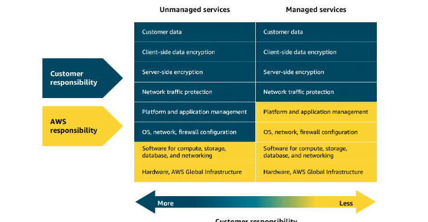
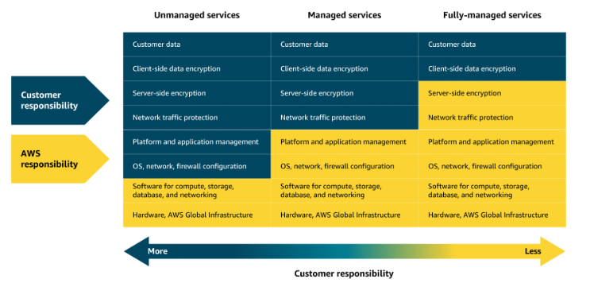

## Introduction to Serverless Computing

With serverless computing, you run applications without managing the underlying infrastructure. In the following lessons, you learn how to take full advantage of it with powerful compute services.

## Unmanaged and managed services

With unmanaged compute services like Amazon EC2, AWS takes care of the underlying physical infrastructure, but you're responsible for setting up, securing, and maintaining the operating system, network configurations, and applications on your instances.

Managed services, on the other hand, reduce the amount of infrastructure you need to manage. While AWS handles much of the operational overhead, you might still need to perform some provisioning or configuration depending on the service.

## Fully-managed services
Fully-managed services—like serverless ones—take abstraction even further, eliminating the need to provision or manage any servers at all. The underlying infrastructure is fully managed by AWS, so you can focus entirely on writing and deploying code. 

Later in this module, you will explore Lambda. Lambda is a serverless compute service where AWS handles the infrastructure, scaling, and availability, while you remain responsible for securing and managing your application code.

## AWS Lambda

Lambda is a serverless compute service that runs code in response to events without the need to provision or manage servers. It automatically manages the underlying infrastructure, scaling resources based on the volume of requests.

You are charged only for the compute time consumed, down to the millisecond. Lambda handles execution, scaling, and resource allocation. You can optimize performance by configuring the appropriate memory size for your function.

## How Lambda works

1. Upload code to Lambda. First, upload the code to Lambda, which uploads as a Lambda function.
2. Set code to trigger from an event source. Next, configure your code to be triggered by events, like AWS services, mobile apps, or HTTP requests.
3. Run code when triggered. Your code runs only when an event occurs, like a file upload or user action. Lambda automatically handles all the server management, scaling, and infrastructure. The Lambda runtime executes your function code using the event data passed to it. This way, your code runs reliably, securely, and efficiently—without you managing the servers or environment it runs in.
4. Pay only for the compute time used. You are charged only for the compute time consumed, down to the millisecond. The price depends on the amount of memory that you allocate to your function.

## Lambda use cases

Lambda is ideal for building responsive, event-driven applications across a wide range of industries.

1. Real time imagse processing for a social media application
   
   A social media company uses Lambda to process images uploaded by users. When a photo is uploaded, Lambda is triggered to resize the image, apply filters, and save it in an optimized format to storage. This event-driven, serverless approach makes sure that the application can handle high volumes of uploads without needing to manage infrastructure.
   
   Why Lambda: It automatically scales based on uploads and charges only for the time spent processing each image.

2. Personalized content delivery for a news aggregator
   A news aggregator uses Lambda to fetch and process news articles from multiple sources, then it tailors recommendations based on user preferences. When a user opens the application or performs a search, Lambda functions are triggered to retrieve data, run personalization logic, and return relevant content.
   Why Lambda: It automatically scales with user traffic and reduces costs by running code only when users interact.

3. Real-time event handling for an online game
   A gaming company uses Lambda to handle in-game events like player actions, game state changes, and real-time leader board updates. Each event (like scoring a point or unlocking an achievement) triggers a Lambda function that updates player data and game status.
   Why Lambda: It handles thousands of events, in real-time, with no need to manage servers. Costs scale with usage, which is ideal for peak gaming times.

## Containers and Orchestration on AWS

## Solving deployment challenges

Containers provide a reliable way to package your application’s code and dependencies into a single, portable unit, making them ideal for workflows that require high security, reliability, and scalability.

Containers and VMs

A container packages your application with everything it needs to run, so it works the same on any computer.

This helps to move, update, and manage. Containers are faster and lighter than virtual machines (VMs) because they share the host computer’s operating system. VMs use a hypervisor to run full, separate operating systems, which makes them less resource-efficient and have longer startup times.

## Deployment consistency with containers
When a developer’s environment differs from staging or production, deployments can fail and become difficult to debug. Containers solve this by keeping the application’s environment consistent everywhere, making deployments smoother and assisting troubleshooting.

## Scaling containers with orchestration

As containerized applications scale, managing them becomes more complex. A setup that began with a few containers on a single host can quickly grow into hundreds or thousands of containers across multiple hosts. At that scale, manually handling container lifecycle, monitoring, and general operations becomes unsustainable. This is where orchestration tools come in. They automate deployment, scaling, and management to keep everything running smoothly.

## AWS container services

AWS has a set of tools for managing containers that fits into three categories: orchestration, registry, and compute.

## Amazon ECS
Amazon Elastic Container Service (Amazon ECS) is a scalable container orchestration service for running and managing containers on AWS, like Docker containers. Docker is a software platform for building, testing, and deploying applications quickly.

Amazon ECS launch types

 - Amazon ECS with Amazon EC2 is ideal for small-to-medium businesses that need full control over infrastructure. Suitable for custom applications requiring specific hardware or networking configurations, with the flexibility of Amazon EC2 and the simplicity of Amazon ECS.

 - Amazon ECS with AWS Fargate is perfect for startups or small teams building web applications with variable traffic. It's a serverless option—no server management required—so teams can focus on development while Amazon ECS handles scaling and orchestration.

## Amazon EKS

Amazon Elastic Kubernetes Service (Amazon EKS) is a fully managed service for running Kubernetes on AWS. It simplifies deploying, managing, and scaling containerized applications using open-source Kubernetes, with ongoing support and updates from the broader community.

Amazon EKS launch types
 - Amazon EKS with Amazon EC2: This is best for enterprises needing full control over infrastructure. It offers deep customization of EC2 instances alongside Kubernetes scalability—ideal for complex, large-scale workloads.
 - Amazon EKS with AWS Fargate: This is great for teams wanting Kubernetes flexibility without managing servers. It combines Kubernetes power with serverless simplicity, helping to scale applications quickly across various use cases.

 ## Amazon ECR

Amazon Elastic Container Registry (Amazon ECR) is where you can store, manage, and deploy container images. It supports container images that follow the Open Container Initiative (OCI) standards. You can push, pull, and manage images in your Amazon ECR repositories using standard container tooling and command line interfaces (CLIs).

## Fargate

AWS Fargate is a serverless compute engine for containers. It works with both Amazon ECS and Amazon EKS. Fargate is a container hosting platform, unlike Amazon ECS and Amazon EKS, which are both container orchestration services.

When using Fargate, you do not need to provision or manage servers. Fargate manages your server infrastructure for you. You can focus more on innovating and developing your applications, and you pay only for the resources that are required to run your containers.

## Additional Compute Services

AWS offers purpose-built services for specific needs, such as streamlining web application deployment, managing batch workloads, providing virtual servers, and extending cloud infrastructure to on-premises data centers.

1. Elastic Beanstalk
   Elastic Beanstalk is a fully managed service that streamlines the deployment, management, and scaling of web applications. Developers can upload their code, and Elastic Beanstalk automatically handles the provisioning of infrastructure, scaling, load balancing, and application health monitoring. It supports various programming languages and frameworks, such as Java, .NET, Python, Node.js, Docker, and more. It provides full control over the underlying AWS resources while automating many operational tasks.
   
   Good for: Deploying and managing web applications, RESTful APIs, mobile backend services, and microservices architectures, with automated scaling and simplified infrastructure management 

2. AWS Batch
   AWS Batch is a fully managed service that you can use to run batch computing workloads on AWS. It automatically schedules, manages, and scales compute resources for batch jobs, optimizing resource allocation based on job requirements.
   Good for: Processing large-scale, parallel workloads in areas like scientific computing, financial risk analysis, media transcoding, big data processing, machine learning training, and genomics research

3. Lightsail
   Amazon Lightsail is a cloud service offering virtual private servers (VPSs), storage, databases, and networking at a predictable monthly price. It’s ideal for small businesses, basic workloads, and developers seeking a straightforward AWS experience without the complexity of the full AWS Management Console.
   Good for: Basic web applications, low-traffic websites, development and testing environments, small business websites, blogs, and learning cloud services

4. Outposts
   AWS Outposts is a fully managed hybrid cloud solution that extends AWS infrastructure and services to on-premises data centers. It provides a consistent experience between on premises and the AWS Cloud, offering compute, storage, and networking components.
   Good for: Low-latency applications, data processing in remote locations, migrating and modernizing legacy applications, and meeting regulatory compliance or data residency requirements