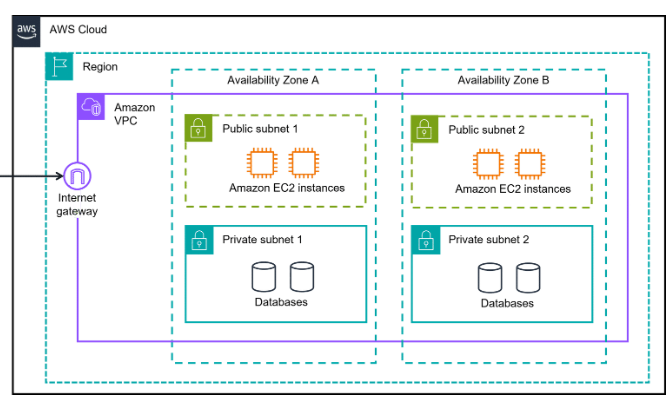
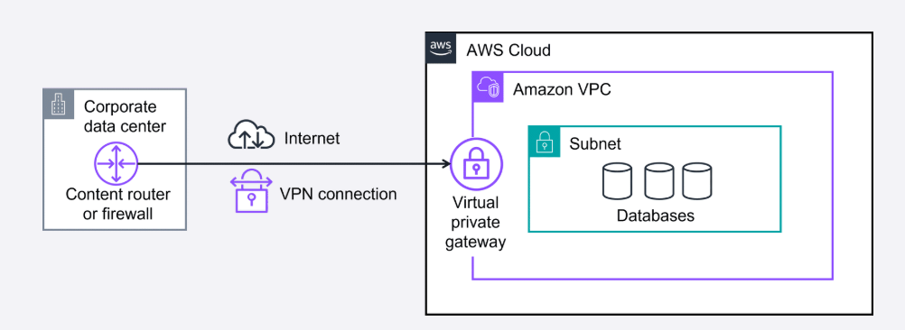
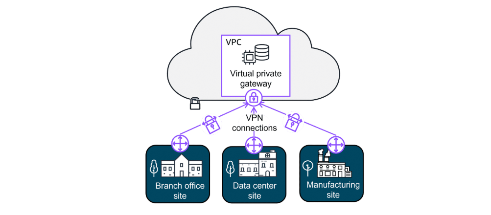
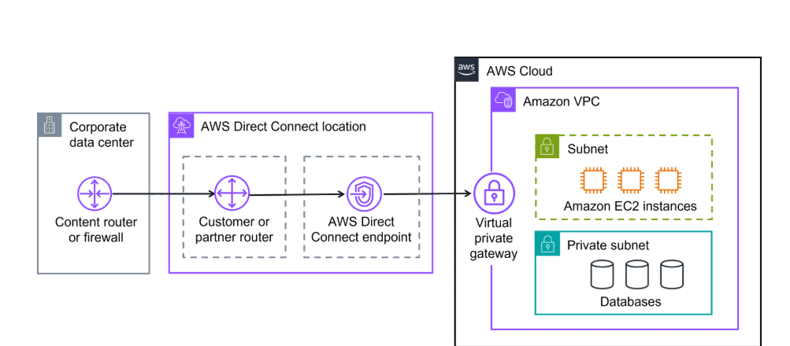
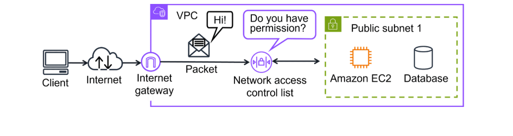
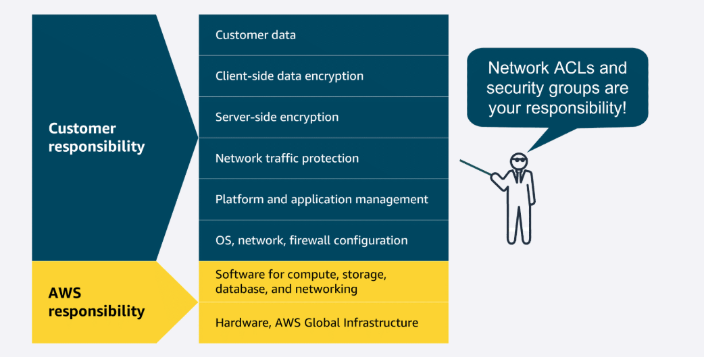
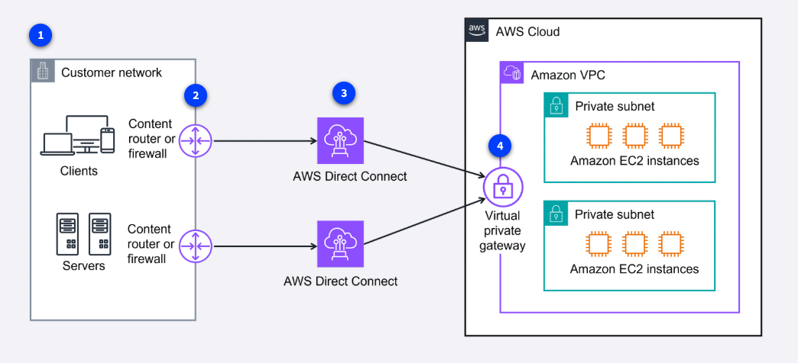
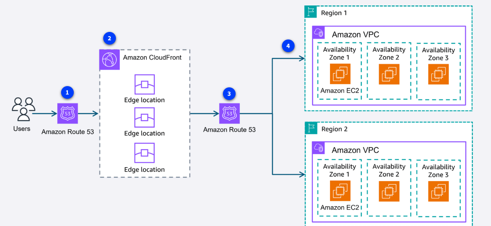

# Introduction to Networking

The term networking refers to interconnected devices that can exchange data and resources. Networking in the AWS Cloud consists of the infrastructure and services working together to host your applications, data, and any other resources you might need. 

## Networking components

### Amazon Virtual Private Cloud (Amazon VPC)

An Amazon VPC lets you provision a logically isolated section of the AWS Cloud where you can launch AWS resources in a virtual network that you define.

### Subnet

Subnets are used to organize your resources and can be made publicly or privately accessible. A private subnet is commonly used to contain resources like a database storing customer or transactional information. A public subnet is commonly used for resources like a customer-facing website.

## Networking components: Understanding connections through diagrams

A picture is worth a thousand words. With a quick glance, you can see if the network was built for redundancy, security, and even scalability. It can also serve as a blueprint so you don't forget important connections when building your solutions.

## AWS Cloud, Regions, Amazon VPC, and AZs

The AWS Cloud is the outermost box in most diagrams.

Region is the next box. AWS Regions are separate geographic areas. You choose your Region based on your users' geographic location for lower latency, compliance and data residency requirements, available services, and cost.

Amazon VPC is a solid box, and it represents your isolated, logically segmented network within AWS. A VPC helps you to control your network resources and security.

Availability Zones are shown as separate boxes across a region. AZs consist of one or more discrete data centers, each with redundant power, networking, and connectivity, and housed in separate facilities. Using multiple AZs can protect your applications from the failure of a single location in the Region.

Private subnets

Subnets are essentially segments of your VPC, allowing you to divide your VPC into smaller, manageable sections. A subnet is a range of IP addresses in your VPC.

Private subnets are designed to isolate resources that shouldn't be directly exposed to the public internet. In diagrams, they are illustrated with solid boxes.

Public subnets

Public subnets are designed to provide direct internet access to resources placed inside them. To allow access, they are connected with an internet gateway.

## Organizing AWS Cloud Resources

Imagine the millions of customers who use AWS services. Also imagine the millions of resources that these customers have created, such as Amazon EC2 instances. Without boundaries around all these resources, network traffic can flow between them unrestricted.

### Establishing boundaries around AWS resources

When organizing your resources in the AWS Cloud, you need to be able to group certain functions together and isolate them from the public, or make them available to the public.

### Amazon VPC

With Amazon VPC, you can provision an isolated section of the AWS Cloud. In this isolated section, you can launch resources in a virtual network that you define.

It provides three main benefits. 
 - It helps increase security because you can secure and monitor connections, screen traffic, and restrict instance access. 
 - Amazon VPC gives you full control over your resource placement, connectivity, and security. 
 - The convenience of using Amazon VPC means you will spend less time setting up, managing, and validating your virtual network when compared to on-premises network management.

### Subnets

Within an Amazon VPC, you can organize your resources into subsections or subnets. A subnet is a section of an Amazon VPC that can contain resources, such as Amazon EC2 instances. 

## Connecting your resources with an internet gateway

To allow public traffic from the internet to access your VPC, you attach an internet gateway to the VPC. An internet gateway is a connection between a VPC and the internet. 

You can think of an internet gateway as being similar to a doorway that customers use to enter the coffee shop. Without an internet gateway, no one can access the resources within your VPC.

### Virtual private gateways

What if you have a VPC that includes only private resources? The following example shows how a virtual private gateway works. 

You can think of the internet as the road between your home and the coffee shop. It is open and accessible to anyone. You want a way to protect the traffic you send on the internet from the public, internet service providers, and others who might be trying to track or intercept it. This is where a virtual private network (VPN) connection comes in.

VPN creates a connection that is more like a secure tunnel through the internet. Using encryption, it hides and protects everything you send and receive from outside eyes.

 A virtual private gateway is the component in the AWS Cloud that makes it possible for you to connect this protected traffic to enter the VPC. With a VPN connection, your data travels privately and safely, hidden from others using the same route.

With a virtual private gateway, you can establish a VPN connection between your VPC and a private network, such as an on-premises data center or internal corporate network. A virtual private gateway allows traffic into the VPC only if it is coming from an approved network.

### Amazon Virtual Private Cloud
Amazon VPC is used to establish boundaries around your AWS resources.

### Virtual private gateway
A virtual private gateway allows protected internet traffic to enter into the VPC.

### Virtual private network
A VPN encrypts your internet traffic, helping protect it from anyone who might try to intercept or monitor it.

## More Ways to Connect to the AWS Cloud

### Connecting to the AWS Cloud

With so many different types of networks, on-premises datacenters, and remote workers, companies need a wide range of ways to connect to the AWS Cloud. Four ways to connect to the AWS Cloud:
 - AWS Client VPN (Securely connect a remote workforce to AWS Cloud resources)
   A managed VPN service, provides secure access to AWS resources and on-premises networks from anywhere. It uses an OpenVPN-based client, and it works with global Regions by using the AWS global network.  It is a fully managed, elastic VPN service that automatically scales up or down based on user demand.

   Benefits: AWS Client VPN provides advanced authentication, remote access. It is elastic and fully managed.
   Use case: It can be used to quickly scale remote-worker access.

 - AWS Site-to-Site VPN (Securely connect sites to other sites)
   Site-to-Site VPN creates a secure connection between your data center or branch offices and your AWS Cloud resources.
   Benefits: Site-to-Site VPN provides high availability, secure and private sessions, and accelerates applications.
   Use cases: It can be used for application migration and secure communication between remote locations.
   

 - AWS PrivateLink (Securely connect resources, even in other VPCs)
   AWS PrivateLink is a highly available, scalable technology that you can use to privately connect your VPC to services and resources as if they were in your VPC. You do not need to use an internet gateway, NAT device, public IP address, Direct Connect connection, or AWS Site-to-Site VPN connection to allow communication with AWS services or resources from your private subnets. Instead, you control the specific API endpoints, sites, services, and resources that are reachable from your VPC.
   
   Benefits: AWS PrivateLink helps you secure your traffic and connect with simplified management rules.
   Use case: It is used for connecting your clients in your VPC to resources, other VPCs, and endpoints.
   
   Even though the preceding connections are highly available and scalable, traffic jams are possible because you’re using the same connection as other clients. That's why for some use cases, you might need a dedicated private connection with a lot of bandwidth.

 - AWS Direct Connect (Dedicated private connections for increased bandwidth)
   Direct Connect is a service that makes it possible for you to establish a dedicated private connection between your network and VPC in the AWS Cloud.
   Benefits: AWS Direct Connect reduces network costs and increases amount of bandwidth.
   

   More about Direct connect
   1. Latency sensitive applications
      Direct Connect bypasses the internet and provides a consistent, low-latency network experience. This makes it ideal for applications like video streaming and other real-time applications that require high performance.

   2. Large scale data migration or transfer
      Direct Connect helps ensure smooth and reliable data transfers at massive scale for real-time analysis, rapid data backup, or broadcast media processing.

   3. Hybrid cloud architectures
      You can use Direct Connect to link your AWS and on-premises networks to build applications that span environments without compromising performance.

### Additional gateway services

 - AWS Transit Gateway is used to connect your Amazon VPCs and on-premises networks through a central hub. As your cloud infrastructure expands globally, inter-Region peering connects transit gateways together using the AWS Global Infrastructure. 

 -  A NAT gateway is a NAT service. You can use a NAT gateway so that instances in a private subnet can connect to services outside your VPC but external services can't initiate a connection with those instances.

 -  Amazon API gateway. You learned about Application Programming Interface (API)s earlier. Quick refresher, an API defines how different software systems can interact and communicate with each other. The Amazon API Gateway is an AWS service for creating, publishing, maintaining, monitoring, and securing APIs at any scale. 

## Subnets, Security Groups, and Network Access Control Lists

Subnets. A section of a VPC for grouping resources based on security or operational needs.

In a VPC, you can define rules to allow resources in different subnets to communicate with each other. For example, you might have an application that uses Amazon EC2 instances in a public subnet communicating with databases that are located in a private subnet.

## Network traffic in a VPC

The movement of data packets traveling across a network

When a customer requests data from an application hosted in the AWS Cloud, this request is sent as a packet. A packet is a unit of data sent over the internet or a network.

It enters into a VPC through an internet gateway. Before a packet can enter into a subnet or exit from a subnet, it will run into several checks for permissions, one being a network ACL associated with the subnet the packet is being routed to. The permissions defined by the network ACLs indicate what is allowed or denied. It is based on who sent the packet and how the packet is trying to communicate with the resources in a subnet.

### Network ACLs

Virtual firewall controlling traffic

A network ACL is a virtual firewall that controls inbound and outbound traffic at the subnet level.

Each AWS account includes a default network ACL. When configuring your VPC, you can use your account’s default network ACL or create custom network ACLs. By default, your account’s default network ACL allows all inbound and outbound traffic, but you can modify it by adding your own rules.

For custom network ACLs, all inbound and outbound traffic is denied until you add rules to specify which traffic to allow. Additionally, all network ACLs have an explicit deny rule. This rule makes sure that if a packet doesn’t match any of the other rules on the list, the packet is denied.

Stateless packet filtering. Network ACLs perform stateless packet filtering. They remember nothing and check packets that cross the subnet border each way: inbound and outbound.

When a packet response for that request comes back to the subnet, the network ACL does not remember your previous request. The network ACL checks the packet response against its list of rules to determine whether to allow or deny.

## Security groups

Control inbound and outbound traffic at the resource level

After a packet has entered a subnet, it must have its permissions evaluated for resources within the subnet, such as Amazon EC2 instances. A security group is the VPC component that checks packet permissions for an Amazon EC2 instance. It is a virtual firewall that controls inbound and outbound traffic for specific AWS resources, like Amazon EC2 instances.

By default, a security group denies all inbound traffic and allows all outbound traffic.

With security groups, you can add custom rules to configure which traffic should be allowed. Any other traffic would then be denied. For example, custom rules can be given separately for inbound and outbound traffic. 

Note: If you have multiple Amazon EC2 instances within the same VPC, you can associate them with the same security group or use different security groups for each instance.

Stateful packet filtering

Security groups perform stateful packet filtering. They remember previous decisions made for incoming packets.

Consider the same example of sending a request out from an Amazon EC2 instance to the internet. When a packet response for that request returns to the instance, the security group remembers your previous request. The security group allows the response to proceed, regardless of inbound security group rules.

## Differences between Network ACLs and Security Groups

| Feature          | Security Groups                                   | Network ACLs                                              |
|------------------|---------------------------------------------------|-----------------------------------------------------------|
| Scope            | Instance level (attached to EC2 instances)        | Subnet level (associated with subnets)                    |
| State            | Stateful (remembers state)                        | Stateless (doesn't remember state)                        |
| Rule types       | Only allow type rules                             | Both allow and deny type rules                            |
| Return traffic   | Return traffic is automatically allowed if inbound traffic is allowed | Return traffic must be explicitly allowed in both directions |
| Uses             | Fine-grained control of traffic for individual EC2 instances | Broad control of traffic in and out of subnets             |

  

Remember the AWS Shared Responsibility Model? When it comes to securing the subnets and resources in your VPC with network ACLs and security groups, that is your responsibility.

## AWS VPC DEMO

[Demo video](https://skillbuilder.aws/renderer/?module_id=K457BUCF7F%3A001.000.000&product_id=8D79F3AVR7%3A002.000.000&registration_id=43c00644-2725-5f07-91a6-2056eca2e564&referrer=https%3A%2F%2Fskillbuilder.aws%2Flearn%2F94T2BEN85A%2Faws-cloud-practitioner-essentials%2F8D79F3AVR7&navigation=digital)

## Global Networking

### Edge networking services

Secure and speedy networking for user-facing application data

Edge networking is the process of bringing information storage and computing abilities closer to the devices that produce that information and the users who consume it.

Edge computing is important because organizations often need lower latency access to their data and content. By performing tasks or caching data locally or closer to users, organizations can deliver faster, more responsive experiences while maintaining better control over their infrastructure. 

## Translating domain names to IP addresses with DNS

Suppose that AnyCompany has a website hosted in the AWS Cloud. Customers enter the web address into their browser and they are able to access the website. This happens because of DNS resolution. DNS resolution involves a customer DNS resolver communicating with a company DNS server.

You can think of DNS as being the phone book of the internet. DNS resolution is the process of translating a domain name to an IP address.

1. Customer and laptop. When you enter the domain name into your browser, this request is sent to a customer DNS resolver.

2. Customer DNS resolver. The customer DNS resolver asks the company DNS server for the IP address that corresponds to AnyCompany’s website.

3. AnyCompany's DNS server. The AnyCompany DNS server responds by providing the IP address for AnyCompany’s website, 192.0.2.0.

## Amazon Route 53

Route 53 is a DNS that provides a reliable and cost-effective way to route end users to internet applications.

Route 53 directs end users to your resources with globally dispersed DNS servers and automatic scaling. It gives developers and businesses a reliable way to route end users to internet applications hosted in AWS.

It connects user requests to infrastructure running in AWS, such as Amazon EC2 instances and load balancers. It also routes users to infrastructure outside of AWS.

Another feature of Route 53 is the ability to manage the DNS records for domain names. You can register new domain names directly in Route 53. You can also transfer DNS records for existing domain names managed by other domain registrars. This makes it possible for you to manage all of your domain names within a single location.

Route 53 also works with the next AWS edge networking service, Amazon CloudFront.

## Amazon CloudFront

CloudFront is a content delivery network (CDN) service that delivers your content with faster loading times, cost savings, and reliability.

1. Streaming video service. A company that offers online workout videos uses CloudFront to make sure videos play smoothly without buffering, even during peak exercise times when thousands of users log in simultaneously.

2. Ecommerce website - An online store uses CloudFront to deliver product images and web pages quickly during busy shopping seasons. This faster experience keeps customers engaged and reduces abandoned shopping carts.

3. Mobile App - A travel app uses CloudFront to deliver map data and images to users' phones quickly to help travelers navigate new cities without frustrating delays.

The following example describes how Route 53 and CloudFront work together to deliver content to customers.

1. Customer request. A customer requests data from the application by going to AnyCompany’s website.
2. Amazon Route 53. Amazon Route 53 uses DNS resolution to identify AnyCompany.com’s corresponding IP address, 192.0.2.0. This information is sent back to the customer.
3. CloudFront. The customer’s request is sent to the nearest edge location through CloudFront. 
4. Application Load Balancer. Amazon CloudFront connects to the Application Load Balancer, which sends the incoming packet to an Amazon EC2 instance.

## AWS Global Accelerator

Global Accelerator is a service that uses the AWS global network to improve application availability, performance, and security. It uses intelligent traffic routing and fast failover if something goes wrong in one of your application locations.

Think of it like creating express lanes on the internet highway specifically for your application's traffic. Instead of your users' requests taking the regular, sometimes 
congested internet routes, Global Accelerator directs traffic through the AWS private global network—getting your users to your application faster and more reliably.

Use cases

1. Global gaming company. A gaming company uses Global Accelerator to reduce lag and provide smoother gameplay for players around the world. Players in Tokyo, New York, and London all experience similar, responsive gameplay because their connections are optimized.

2. Financial services application. A banking app uses Global Accelerator to ensure their customers always have fast, reliable access to their accounts. Even during peak times or when network conditions in one area are poor, customers can check balances and make transactions without frustrating delays.

## Global Architectures

## Cloud in real life: Exploring the examples
Direct Connect failover when you need much higher bandwidth with dedicated lines

You've seen a basic VPN and AWS Direct Connect setup in previous lessons. Here is the video example of a company with clients and servers that demand high bandwidth connections for large data transfers and critical application performance. They chose to access their AWS resources securely with multiple Direct Connect connections for failover.

1. Customer network. The customer network clients and servers need a secure, high-bandwidth connection for large data transfers and critical application performance.
2. Content router or firewall. The customer has a content router or firewall connecting their network to Direct Connect.
3. Multiple Direct Connect connections. In addition to fault tolerance, the customer wanted increased bandwidth. They can even combine multiple connections to achieve higher aggregate bandwidth.
4. Virtual private gateway. Using a virtual private gateway, the clients can securely access the private resources in the Amazon VPC.

## Delivering content to several different Regions globally

Here is an example of how a company with offices around the world can deliver content with low latency for a seamless experience across multiple Regions.

1. Users. The users access the company's website using a custom domain. The request is first sent to a Route 53 DNS record.
2. Routing policy. Route 53 uses a routing policy to determine which Region is closest to the user. Route 53 directs the user to the appropriate CloudFront edge location.
3. Direct to edge locations. Route 53 directs the user to the CloudFront edge location in the appropriate Region.
4. Content in multiple AZs. The content is fetched from the designated origin server in the chosen Region. Also note, the website was built with resources in multiple Availability Zones for high availability.