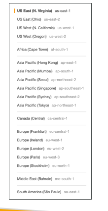
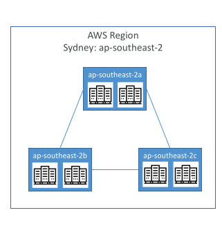

## AWS cloud use cases

1. AWS enables you to build sophisticated, scalable applications
2. Enterprise IT
3. Backup & Storage
4. Big Data analytics
5. Website hosting
6. Mobile & Social Apps
7. Gaming

## AWS Global Infrastructure

1. AWS Regions
2. AWS Availability Zones
3. AWS Data Centers
4. AWS Edge Locations / Points of Presence

[Global Infrsatructure](https://infrastructure.aws/)

## AWS Regions

• AWS has Regions all around the world

• Names can be us-east-1, eu-west-3…

• A region is a cluster of data centers

• Most AWS services are region-scoped



## How to choose an AWS Region?

• Compliance with data governance and legal requirements: data never leaves a region without your explicit permission

• Proximity to customers: reduced latency

• Available services within a Region: new services and new features aren’t available in every Region

• Pricing: pricing varies region to region and is transparent in the service pricing page

## AWS Availability Zones

Each region has many availability zones (usually 3, min is 3, max is 6). Example:
• ap-southeast-2a
• ap-southeast-2b
• ap-southeast-2c

• Each availability zone (AZ) is one or more discrete data centers with redundant power, networking, and connectivity. What does redundancy mean? Power: Multiple power sources, UPSs, and generators. Networking: Multiple network paths and devices. Connectivity: Multiple connections to other networks/AZs. Data centers: More than one facility can provide capacity.

• They’re separate from each other, so that they’re isolated from disasters

• They’re connected with high bandwidth, ultra-low latency networking



## AWS Points of Presence (Edge Locations)
• Amazon has 400+ Points of Presence (400+ Edge Locations & 10+ Regional Caches) in 90+ cities across 40+ countries

• Content is delivered to end users with lower latency

## Tour of the console

AWS has Global Services:

• Identity and Access Management (IAM)


• Route 53 (DNS service)

• CloudFront (Content Delivery Network)

• WAF (Web Application Firewall)

Most AWS services are Region-scoped:

• Amazon EC2 (Infrastructure as a Service)

• Elastic Beanstalk (Platform as a Service)

• Lambda (Function as a Service)

• Rekognition (Software as a Service)

Region Table: https://aws.amazon.com/about-aws/global-infrastructure/regional-product-services

## Command to configure access key to aws cli

```
aws configure
```

Test after configuring

```
aws iam list-users
```