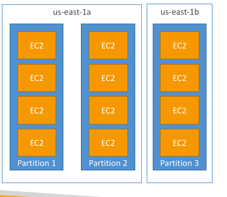
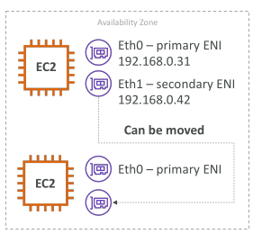
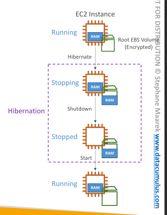

## Amazon EC2

• EC2 is one of the most popular of AWS’ offering
• EC2 = Elastic Compute Cloud = Infrastructure as a Service
• It mainly consists in the capability of :
    • Renting virtual machines (EC2)
    • Storing data on virtual drives (EBS)
    • Distributing load across machines (ELB)
    • Scaling the services using an auto-scaling group (ASG)
• Knowing EC2 is fundamental to understand how the Cloud works

## EC2 sizing & configuration options

• Operating System (OS): Linux, Windows or Mac OS
• How much compute power & cores (CPU)
• How much random-access memory (RAM)
• How much storage space:
    • Network-attached (EBS & EFS)
    • hardware (EC2 Instance Store)
• Network card: speed of the card, Public IP address
• Firewall rules: security group
• Bootstrap script (configure at first launch): EC2 User Data

## EC2 User Data

• It is possible to bootstrap our instances using an EC2 User data script.
• bootstrapping means launching commands when a machine starts
• That script is only run once at the instance first start
• EC2 user data is used to automate boot tasks such as:
• Installing updates
• Installing software
• Downloading common files from the internet
• Anything you can think of
• The EC2 User Data Script runs with the root user

## Hands-On: Launching an EC2 Instance running Linux
• We’ll be launching our first virtual server using the AWS Console
• We’ll get a first high-level approach to the various parameters
• We’ll see that our web server is launched using EC2 user data
• We’ll learn how to start / stop / terminate our instance.

## EC2 Instance Types - Overview

• You can use different types of EC2 instances that are optimised for different use cases (https://aws.amazon.com/ec2/instance-types/)
1. General purpose
2. Compute optimized
3. Memory optimized
4. Accelarated Computing
5. Storage optimized
6. HPC optimized
7. Instance features
8. Measuring instance
9. Performance

• AWS has the following naming convention:
     m5.2xlarge
• m: instance class
• 5: generation (AWS improves them over time)
• 2xlarge: size within the instance class

## EC2 Instance Types – General Purpose

• Great for a diversity of workloads such as web servers or code repositories
• Balance between:
  • Compute
  • Memory
  • Networking
• In the course, we will be using the t2.micro which is a General Purpose EC2
instance

## EC2 Instance Types – Compute Optimized

• Great for compute-intensive tasks that require high performance
processors:
  • Batch processing workloads
  • Media transcoding
  • High performance web servers
  • High performance computing (HPC)
  • Scientific modeling & machine learning
  • Dedicated gaming servers

[Computer optimized](../saa/compute_optimized.png)

##  EC2 Instance Types – Memory Optimized

• Fast performance for workloads that process large data sets in memory
• Use cases:
  • High performance, relational/non-relational databases
  • Distributed web scale cache stores
  • In-memory databases optimized for BI (business intelligence)
  • Applications performing real-time processing of big unstructured data

[Memory optimized](../saa/memory_optimized.png)

## EC2 Instance Types – Storage Optimized

• Great for storage-intensive tasks that require high, sequential read and write
access to large data sets on local storage
• Use cases:
  • High frequency online transaction processing (OLTP) systems
  • Relational & NoSQL databases
  • Cache for in-memory databases (for example, Redis)
  • Data warehousing applications
  • Distributed file systems

[Storage optimized](../saa/storage_optimized.png)


## Introduction to Security Groups

• Security Groups are the fundamental of network security in AWS
• They control how traffic is allowed into or out of our EC2 Instances.
• Security groups only contain rules
• Security groups rules can reference by IP or by security group

## Security Groups Deeper Dive

• Security groups are acting as a “firewall” on EC2 instances
• They regulate:
    • Access to Ports
    • Authorised IP ranges – IPv4 and IPv6
    • Control of inbound network (from other to the instance)
    • Control of outbound network (from the instance to other)

[Security groups](../saa/security_groups_dd.png)


## Security groups diagram

[Security groups diagram](../saa/sg_diagram.png)

## Security Groups Good to know

• Can be attached to multiple instances
• Locked down to a region / VPC combination
• Does live “outside” the EC2 – if traffic is blocked the EC2 instance won’t see it
• It’s good to maintain one separate security group for SSH access
• If your application is not accessible (time out), then it’s a security group issue
• If your application gives a “connection refused“ error, then it’s an application
error or it’s not launched
• All inbound traffic is blocked by default
• All outbound traffic is authorised by default

## Referencing other security groups Diagram

[Diagram](../saa/reference_sg.png)

## Classic Ports to know

• 22 = SSH (Secure Shell) - log into a Linux instance
• 21 = FTP (File Transfer Protocol) – upload files into a file share
• 22 = SFTP (Secure File Transfer Protocol) – upload files using SSH
• 80 = HTTP – access unsecured websites
• 443 = HTTPS – access secured websites
• 3389 = RDP (Remote Desktop Protocol) – log into a Windows instance
 
 ## SSH SUMMARY

 [SSH Summary](../saa/ssh_sumary.png)

 ## How to SSH into your EC2 Instance

• We’ll learn how to SSH into your EC2 instance using Linux / Mac
• SSH is one of the most important function. It allows you to control a remote machine, all using the command line
• We will see how we can configure OpenSSH ~/.ssh/config to facilitate the SSH into our EC2 instances

```
ssh -i EC2Tutorial.pem ec2-user@44.204.219.48
```

The reason we use ec2-user is because amazon ami has a user already set up for us

## EC2 instance roles

Never run aws configure on an ec2 instanc, any user could retrieve the details. Instead assign roles to the ec2 instance

## EC2 Instances Purchasing Options

• On-Demand Instances – short workload, predictable pricing, pay by second
• Reserved (1 & 3 years)
    • Reserved Instances – long workloads
    • Convertible Reserved Instances – long workloads with flexible instances
• Savings Plans (1 & 3 years) –commitment to an amount of usage, long workload
• Spot Instances – short workloads, cheap, can lose instances (less reliable)
• Dedicated Hosts – book an entire physical server, control instance placement
• Dedicated Instances – no other customers will share your hardware
• Capacity Reservations – reserve capacity in a specific AZ for any duration

## EC2 On Demand

• Pay for what you use:
    • Linux or Windows - billing per second, after the first minute
    • All other operating systems - billing per hour
• Has the highest cost but no upfront payment
• No long-term commitment
• Recommended for short-term and un-interrupted workloads, where you
can't predict how the application will behave

## EC2 Reserved Instances

• Up to 72% discount compared to On-demand
• You reserve a specific instance attributes (Instance Type, Region, Tenancy, OS)
• Reservation Period – 1 year (+discount) or 3 years (+++discount)
• Payment Options – No Upfront (+), Partial Upfront (++), All Upfront (+++)
• Reserved Instance’s Scope – Regional or Zonal (reserve capacity in an AZ)
• Recommended for steady-state usage applications (think database)
• You can buy and sell in the Reserved Instance Marketplace
• Convertible Reserved Instance
    • Can change the EC2 
    • Up to 66% discount

## EC2 Savings Plans

• Get a discount based on long-term usage (up to 72% - same as RIs)
• Commit to a certain type of usage ($10/hour for 1 or 3 years)
• Usage beyond EC2 Savings Plans is billed at the On-Demand price
• Locked to a specific instance family & AWS region (e.g., M5 in us-east-1)
• Flexible across:
    • Instance Size (e.g., m5.xlarge, m5.2xlarge)
    • OS (e.g., Linux, Windows)
    • Tenancy (Host, Dedicated, Default)

## EC2 Spot Instances

• Can get a discount of up to 90% compared to On-demand
• Instances that you can “lose” at any point of time if your max price is less than the
current spot price
• The MOST cost-efficient instances in AWS
• Useful for workloads that are resilient to failure
    • Batch jobs
    • Data analysis
    • Image processing
    • Any distributed workloads
    • Workloads with a flexible start and end time
• Not suitable for critical jobs or databases

## EC2 Dedicated Hosts

• A physical server with EC2 instance capacity fully dedicated to your use
• Allows you address compliance requirements and use your existing server-
bound software licenses (per-socket, per-core, pe—VM software licenses)
• Purchasing Options:
    • On-demand – pay per second for active Dedicated Host
    • Reserved - 1 or 3 years (No Upfront, Partial Upfront, All Upfront)
• The most expensive option
• Useful for software that have complicated licensing model (BYOL – Bring Your
Own License)
• Or for companies that have strong regulatory or compliance needs

## EC2 Dedicated Instances

• Instances run on hardware that’s dedicated to you
• May share hardware with other instances in same account
• No control over instance placement (can move hardware after Stop / Start)

 [EC2 Dedicated Instances](../saa/ec2dedicated_instances.png)

 ## EC2 Capacity Reservations

 • Reserve On-Demand instances capacity in a specific AZ for any duration
• You always have access to EC2 capacity when you need it
• No time commitment (create/cancel anytime), no billing discounts
• Combine with Regional Reserved Instances and Savings Plans to benefit from billing discounts
• You’re charged at On-Demand rate whether you run instances or not
• Suitable for short-term, uninterrupted workloads that needs to be in a specific AZ

## Which purchasing option is right for me?

• On demand: coming and staying in resort whenever we like, we pay the full price
• Reserved: like planning ahead and if we plan to stay for a long time, we may get a good discount.
• Savings Plans: pay a certain amount per hour for certain period and stay in any room type (e.g.,King, Suite, Sea View, …)
• Spot instances: the hotel allows people to bid for the empty rooms and the highest bidder keeps the rooms. You can get kicked out at any time
• Dedicated Hosts: We book an entire building of the resort
• Capacity Reservations: you book a room for a period with full price even you don’t stay in it

## Price Comparison Example – m4.large – us-east-1

| Price Type                             |                           Price (per hour) |
| -------------------------------------- | -----------------------------------------: |
| On-Demand                              |                                      $0.10 |
| Spot Instance (Spot Price)             |              $0.038–$0.039 (up to 61% off) |
| Reserved Instance (1 year)             | $0.062 (No Upfront) – $0.058 (All Upfront) |
| Reserved Instance (3 years)            | $0.043 (No Upfront) – $0.037 (All Upfront) |
| EC2 Savings Plan (1 year)              | $0.062 (No Upfront) – $0.058 (All Upfront) |
| Reserved Convertible Instance (1 year) | $0.071 (No Upfront) – $0.066 (All Upfront) |
| Dedicated Host                         |                            On-Demand Price |
| Dedicated Host Reservation             |                              Up to 70% off |
| Capacity Reservations                  |                            On-Demand Price |


## EC2 Spot Instance Requests

• Can get a discount of up to 90% compared to On-demand
• Define max spot price and get the instance while current spot price < max
    • The hourly spot price varies based on offer and capacity
    • If the current spot price > your max price you can choose to stop or terminate your instance with a 2 minutes grace period.

• Other strategy: Spot Block
  • "block" spot instance during a specified time frame (1 to 6 hours) without interruptions 
  • In rare situations the instance may be reclaimed


• Used for batch jobs, data analysis, or workloads that are resilient to failures.
• Not great for critical jobs or databases

[EC2 Spot Instances Pricing](../saa/EC2_SPOT_INSTANCES_PRICING.png)

## How to terminate Spot Instances?

[Terminating spot Instances](../saa/terminate_spot_instances.png)

You can only cancel Spot Instance requests that are open, active, or disabled.
Cancelling a Spot Request does not terminate instances
You must first cancel a Spot Request, and then terminate the associated Spot Instances

## Spot Fleets

• Spot Fleets = set of Spot Instances + (optional) On-Demand Instances
• The Spot Fleet will try to meet the target capacity with price constraints
    • Define possible launch pools: instance type (m5.large), OS, Availability Zone
    • Can have multiple launch pools, so that the fleet can choose
    • Spot Fleet stops launching instances when reaching capacity or max cost
• Strategies to allocate Spot Instances:
    • lowestPrice: from the pool with the lowest price (cost optimization, short workload)
    • diversified: distributed across all pools (great for availability, long workloads)
    • capacityOptimized: pool with the optimal capacity for the number of instances
    • priceCapacityOptimized (recommended): pools with highest capacity available, then select the pool with the lowest price (best choice for most workloads)
• Spot Fleets allow us to automatically request Spot Instances with the lowest price

## Placements Groups Partition



Instances are spread across partitions in multiple availability zones
Each partition representsa rack in aws. They're safe fom a rack failure

• Up to 7 partitions per AZ
• Can span across multiple AZs in the same region
• Up to 100s of EC2 instances
• The instances in a partition do not share racks with the instances in the other partitions
• A partition failure can affect many EC2 but won’t affect other partitions
• EC2 instances get access to the partition information as metadata
• Use cases: HDFS, HBase, Cassandra, Kafka Majorly big data apps

## Elastic network Interfaces

Logical component in a VPC that represents a virtual network card

• The ENI can have the following attributes:
• Primary private IPv4, one or more secondary IPv4
• One Elastic IP (IPv4) per private IPv4
• One Public IPv4
• One or more security groups
• A MAC address

• You can create ENI independently and attach them on the fly (move them) on EC2 instances for failover
• Bound to a specific availability zone (AZ)



We can move an ENI from one ec2 instance to another, by doing so we can do a quick and easy network failover

## EC2 Hibernate

• We know we can stop, terminate instances
• Stop – the data on disk (EBS) is kept intact in the next start
• Terminate – any EBS volumes (root) also set-up to be destroyed is lost


• On start, the following happens:
• First start: the OS boots & the EC2 User Data script is run
• Following starts: the OS boots up
• Then your application starts, caches get warmed up, and that can take time!

• Introducing EC2 Hibernate:
• The in-memory (RAM) state is preserved by dumping it to the ebs volume
• The instance boot is much faster!
(the OS is not stopped / restarted)
• Under the hood: the RAM state is written
to a file in the root EBS volume
• The root EBS volume must be encrypted


• Use cases:
• Long-running processing
• Saving the RAM state
• Services that take time to initialize



## EC2 Hibernate – Good to know

• Supported Instance Families – C3, C4, C5, I3, M3, M4, R3, R4, T2, T3, …
• Instance RAM Size – must be less than 150 GB.
• Instance Size – not supported for bare metal instances.
• AMI – Amazon Linux 2, Linux AMI, Ubuntu, RHEL, CentOS & Windows…
• Root Volume – must be EBS, encrypted, not instance store, and large
• Available for On-Demand, Reserved and Spot Instances
• An instance can NOT be hibernated more than 60 days