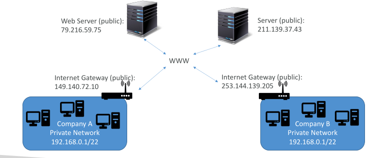
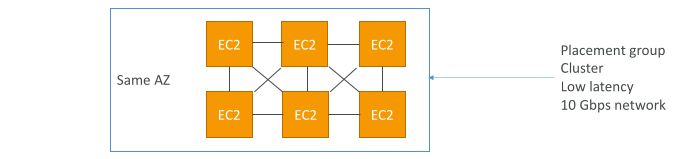
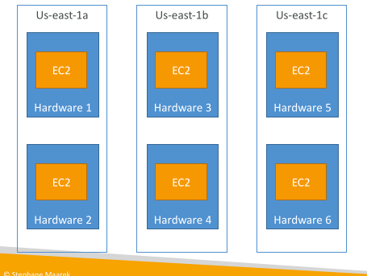

## Private vs Public IP (IPv4)

Networking has two sorts of IPs. IPv4 and IPv6:
 - IPv4: 1.160.10.240

 - IPv6: 3ffe:1900:4545:3:200:f8ff:fe21:67cf

In this course, we will only be using IPv4.

IPv4 is still the most common format used online.

IPv6 is newer and solves problems for the Internet of Things (IoT).

IPv4 allows for 3.7 billion different addresses in the public space

IPv4: [0-255].[0-255].[0-255].[0-255].

## Private vs Public IP (IPv4) Fundamental Differences

Public IP:
 - Public IP means the machine can be identified on the internet (WWW)
 - Must be unique across the whole web (not two machines can have the same public IP).
 - Can be geo-located easily

Private IP:
 - Private IP means the machine can only be identified on a private network only
 - The IP must be unique across the private network
 - BUT two different private networks (two companies) can have the same IPs.
 - Machines connect to WWW using a NAT + internet gateway (a proxy)
 - Only a specified range of IPs can be used as private IP

## Elastic IPs

When you stop and then start an EC2 instance, it can change its public IP.

If you need to have a fixed public IP for your instance, you need an Elastic IP

An Elastic IP is a public IPv4 IP you own as long as you don’t delete it

You can attach it to one instance at a time

With an Elastic IP address, you can mask the failure of an instance or software by rapidly remapping the address to another instance in your account.

You can only have 5 Elastic IP in your account (you can ask AWS to increase that).

Overall, try to avoid using Elastic IP:
 - They often reflect poor architectural decisions
 - Instead, use a random public IP and register a DNS name to it
 - Or, as we’ll see later, use a Load Balancer and don’t use a public IP

## Private vs Public IP (IPv4) In AWS EC2 – Hands On

By default, your EC2 machine comes with:
 - A private IP for the internal AWS Network
 - A public IP, for the WWW.

When we are doing SSH into our EC2 machines:
 - We can’t use a private IP, because we are not in the same network
 - We can only use the public IP.

If your machine is stopped and then started, the public IP can change

## Placement Groups

Sometimes you want control over the EC2 Instance placement strategy

That strategy can be defined using placement groups

When you create a placement group, you specify one of the following strategies for the group:
 - Cluster—clusters instances into a low-latency group in a single Availability Zone

Spread—spreads instances across underlying hardware (max 7 instances per group per AZ)

Partition—spreads instances across many different partitions (which rely on different sets of racks) within an AZ. Scales to 100s of EC2 instances per group (Hadoop, Cassandra, Kafka)

## Placement Groups Cluster

Means tha all of our ec2 instances are in the same rack, which means same hardware and in the same availability zone

Pros: Great network (10 Gbps bandwidth between instances with Enhanced Networking enabled - recommended)

Cons: If the AZ fails, all instances fails at the same time

Use case:
 - Big Data job that needs to complete fast
 - Application that needs extremely low latency and high network throughput

## Placement Groups Spread

We use it when we want to minimize the failure risk.

Each ec2 instance in a different hardware.

Pros:
 - Can span across Availability Zones (AZ)
 - Reduced risk is simultaneous failure
 - EC2 Instances are on different physical hardware

Cons:
 - Limited to 7 instances per AZper placement group

Use case:
 - Application that needs to maximize high availability
 - Critical Applications where each instance must be isolated from failure from each other