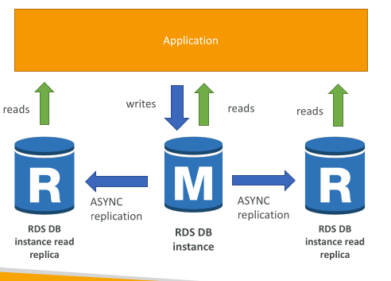
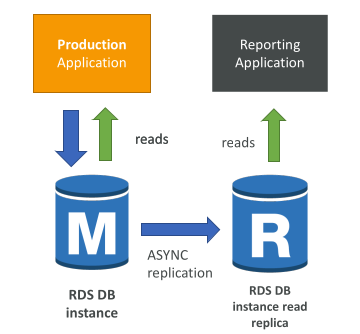
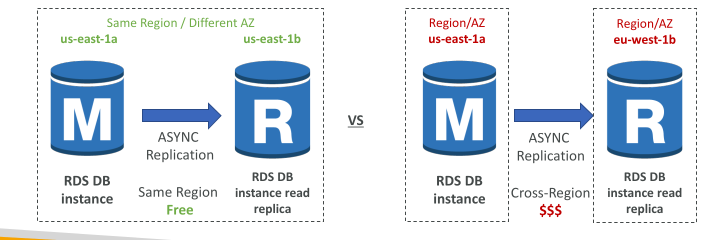
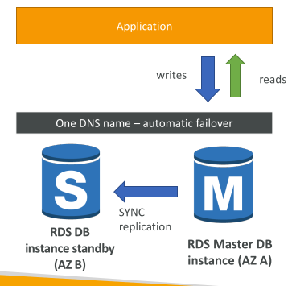
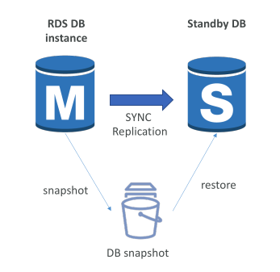
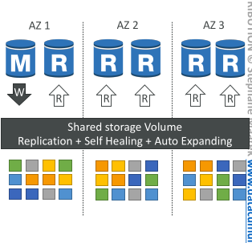
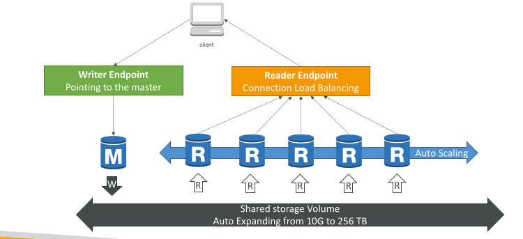
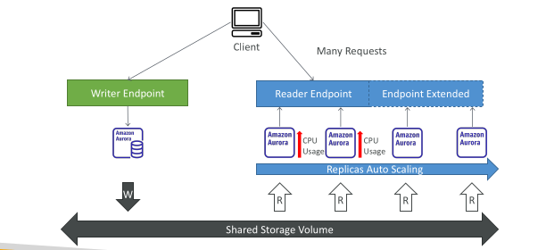
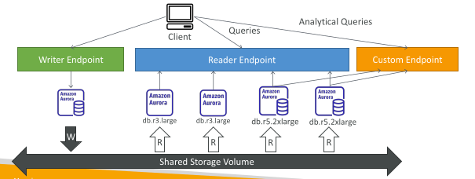

# RDS, Aurora & ElastiCache

## Amazon RDS Overview

* RDS stands for Relational Database Service
* It’s a managed DB service for DB that use SQL as a query language.
* It allows you to create databases in the cloud that are managed by AWS
* Postgres
* MySQL
* MariaDB
* Oracle
* Microsoft SQL Server
* IBM DB2
* Aurora (AWS Proprietary database)

## Advantage over using RDS versus deploying DB on EC2

* RDS is a managed service:

  * Automated provisioning, OS patching
  * Continuous backups and restore to specific timestamp (Point in Time Restore)!
  * Monitoring dashboards
  * Read replicas for improved read performance
  * Multi AZ setup for DR (Disaster Recovery)
  * Maintenance windows for upgrades
  * Scaling capability (vertical and horizontal)
  * Storage backed by EBS
  * BUT you can’t SSH into your instances

## RDS – Storage Auto Scaling (Exam imporant)

* Helps you increase storage on your RDS DB instance dynamically
* When RDS detects you are running out of free database storage, it scales automatically
* Avoid manually scaling your database storage
* You have to set Maximum Storage Threshold (maximum limit for DB storage)
* Automatically modify storage if:

  * Free storage is less than 10% of allocated storage
  * Low-storage lasts at least 5 minutes
  * 6 hours have passed since last modification
* Useful for applications with unpredictable workloads
* Supports all RDS database engines

## RDS Read Replicas for read scalability.

They help you yo scale your reads

* Up to 15 Read Replicas
* Within AZ, Cross AZ or Cross Region
* Replication is ASYNC, so reads are eventually consistent. There will be and asynchronous database replication between the main rds db instance and the replicas. It means fro example if your application reads from the read replica before they had the chance to replicate the data then you may get all data
* Replicas can be promoted to their own DB
* Applications must update the connection string to leverage read replicas

## RDS Read Replicas – Use Cases

* You have a production database that is taking on normal load
* You want to run a reporting application to run some analytics
* You create a Read Replica to run the new workload there
* The production application is unaffected
* Read replicas are used for SELECT (=read) only kind of statements (not INSERT, UPDATE, DELETE)

## RDS Read Replicas – Network Cost

* In AWS there’s a network cost when data goes from one AZ to another
* For RDS Read Replicas within the same region, you don’t pay that fee

## RDS Multi AZ (Disaster Recovery)

* SYNC replication
* One DNS name – automatic app failover to standby
* Increase availability
* Failover in case of loss of AZ, loss of network, instance or storage failure
* No manual intervention in apps
* Not used for scaling
* Note: The Read Replicas be setup as Multi AZ for Disaster Recovery (DR)

## RDS – From Single-AZ to Multi-AZ (Exam)

* Zero downtime operation (no need to stop the DB)
* Just click on “modify” for the database
* The following happens internally:

  * A snapshot is taken
  * A new DB is restored from the snapshot in a new AZ
  * Synchronization is established between the two databases

## RDS Custom

* Managed Oracle and Microsoft SQL Server Database with OS and database customization
* RDS: Automates setup, operation, and scaling of database in AWS
* Custom: access to the underlying database and OS so you can

  * Configure settings
  * Install patches
  * Enable native features
  * Access the underlying EC2 Instance using SSH or SSM Session Manager
* De-activate Automation Mode to perform your customization, better to take a DB snapshot before
* RDS vs. RDS Custom

  * RDS: entire database and the OS to be managed by AWS
  * RDS Custom: full admin access to the underlying OS and the database

## Amazon Aurora

Aurora is a proprietary technology from AWS (not open sourced)

* Postgres and MySQL are both supported as Aurora DB (that means your drivers will work as if Aurora was a Postgres or MySQL database)
* Aurora is “AWS cloud optimized” and claims 5x performance improvement over MySQL on RDS, over 3x the performance of Postgres on RDS
* Aurora storage automatically grows in increments of 10GB, up to 256 TB.
* Aurora can have up to 15 replicas and the replication process is faster than MySQL (sub 10 ms replica lag)
* Failover in Aurora is instantaneous. It’s HA (High Availability) native.
* Aurora costs more than RDS (20% more) – but is more efficient

## Aurora High Availability and Read Scaling

6 copies of your data across 3 AZ:

* 4 copies out of 6 needed for writes

* 3 copies out of 6 need for reads

* Self healing with peer-to-peer replication

* Storage is striped across 100s of volumes

* One Aurora Instance takes writes (master)

* Automated failover for master in less than 30 seconds

* Master + up to 15 Aurora Read Replicas serve reads

* Support for Cross Region Replication

Image below show orange data being replicated in different AZs

## Aurora DB Cluster (EXAM important)

Master is the only thing that will write to shared storage.

Because the master can change and fail over, aurora provides you a writer endpoint. It is a dns name always pointing to the master so even if your master fails your client talks to the endpoint and it is automatically redirected to the right instance.

You can have autscaling in the read replicas. To help your application keep track of the many read replica there is something called a reader endpoint. Helps with connection load balancing and connects automatically to the clients

## Features of Aurora

* Automatic fail-over
* Backup and Recovery
* Isolation and security
* Industry compliance
* Push-button scaling
* Automated Patching with Zero Downtime
* Advanced Monitoring
* Routine Maintenance
* Backtrack: restore data at any point of time without using backups

## Aurora Replicas - Auto Scaling

## Aurora – Custom Endpoints

* Define a subset of Aurora Instances as a Custom Endpoint
* Example: Run analytical queries on specific replicas
* The Reader Endpoint is generally not used after defining Custom Endpoints

## Aurora Serverless

* Automated database instantiation
