## Classic Solutions Architecture
• These solutions architectures are the best part of this course

• Let’s understand how all the technologies we’ve seen work together

• This is a section you need to be 100% comfortable with

• We’ll see the progression of a Solution’s architect mindset through many sample case studies:
 - WhatIsTheTime.Com
 - MyClothes.Com
 - MyWordPress.Com
 - Instantiating applications quickly

• Beanstalk

## Stateless Web App: WhatIsTheTime.com

• WhatIsTheTime.com allows people to know what time it is

• We don’t need a database

• We want to start small and can accept downtime

• We want to fully scale vertically and horizontally, no downtime

• Let’s go through the Solutions Architect journey for this app

• Let’s see how we can proceed!

## Stateless web app: What time is it? Starting simple

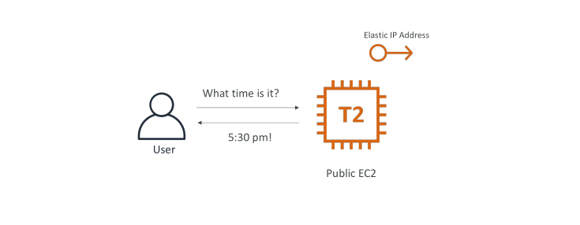

## Stateless web app: What time is it? Scaling vertically

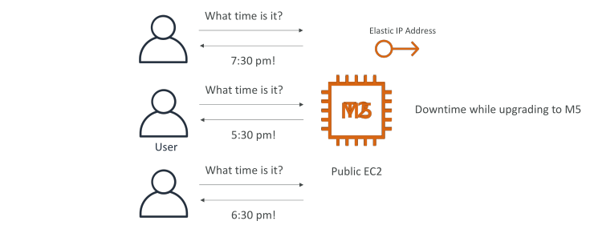

## Stateless web app: What time is it? Scaling horizontally

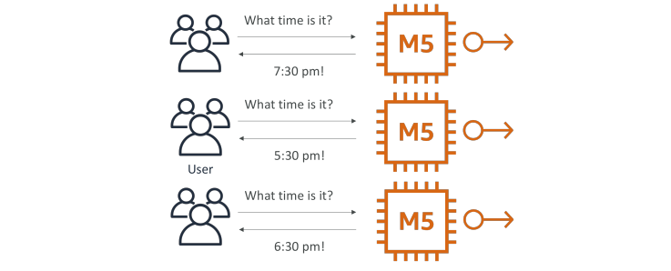

## Stateless web app: What time is it? Scaling horizontally

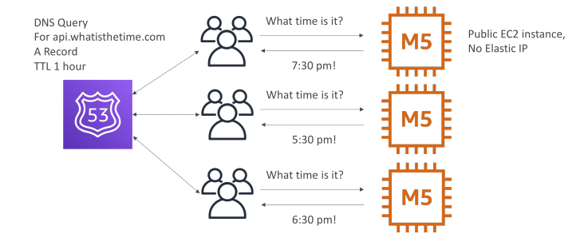

## Stateless web app: What time is it? Scaling horizontally, adding and removing instances

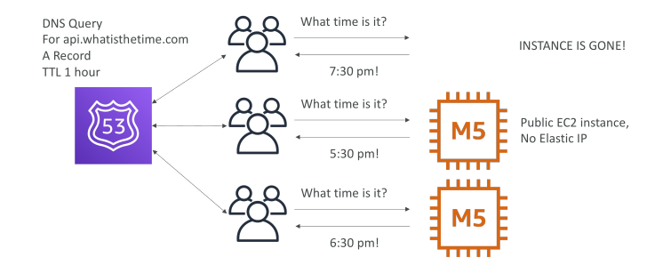

## Stateless web app: What time is it? Scaling horizontally, with a load balancer

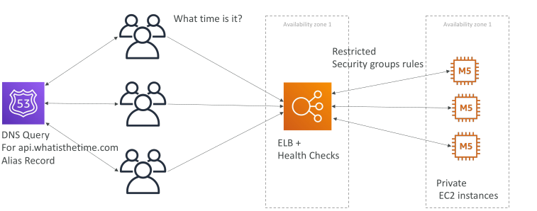

## Stateless web app: What time is it? Scaling horizontally, with an auto-scaling group

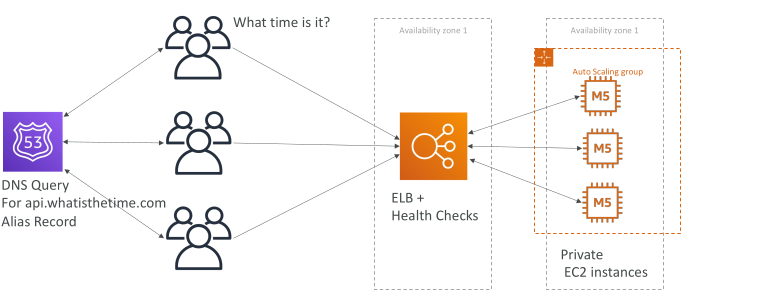

## Stateless web app: What time is it? Making our app multi-AZ

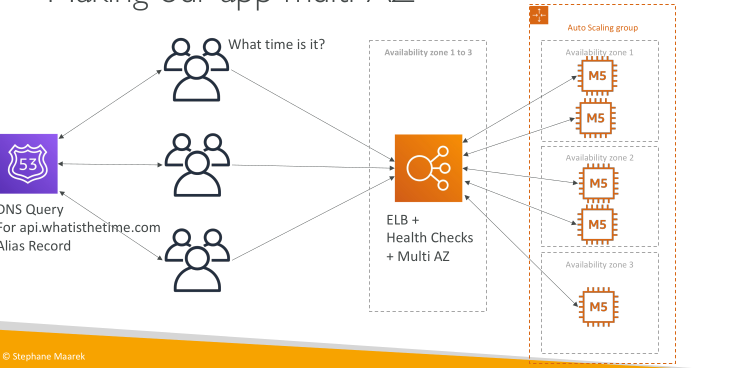

## Minimum 2 AZ => Let’s reserve capacity

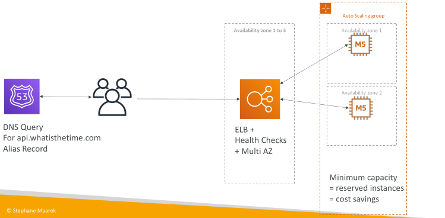

## In this lecture we’ve discussed…

• Public vs Private IP and EC2 instances

• Elastic IP vs Route 53 vs Load Balancers

• Route 53 TTL, A records and Alias Records

• Maintaining EC2 instances manually vs Auto Scaling Groups

• Multi AZ to survive disasters

• ELB Health Checks

• Security Group Rules

• Reservation of capacity for costing savings when possible

## Stateful Web App: MyClothes.com

• MyClothes.com allows people to buy clothes online.

• There’s a shopping cart

• Our website is having hundreds of users at the same time

• We need to scale, maintain horizontal scalability and keep our web application as stateless as possible

• Users should not lose their shopping cart

• Users should have their details (address, etc) in a database

• Let’s see how we can proceed!

## Stateful Web App: MyClothes.com

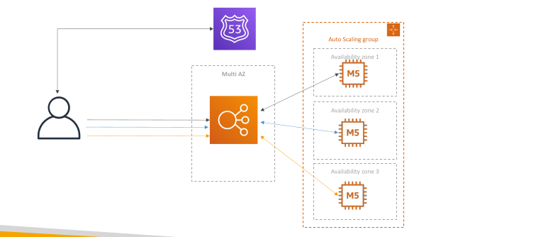

## Stateful Web App: MyClothes.com Introduce Stickiness (Session Affinity)

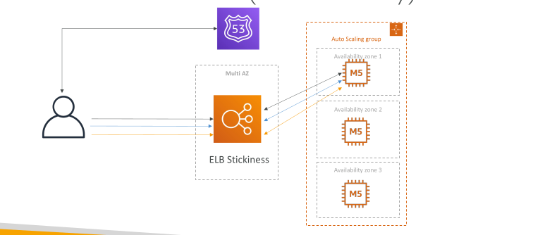

## Stateful Web App: MyClothes.com Introduce User Cookies

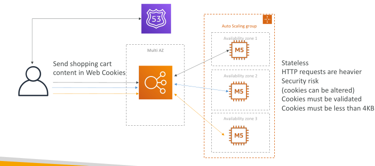

## Stateful Web App: MyClothes.com Introduce Server Session

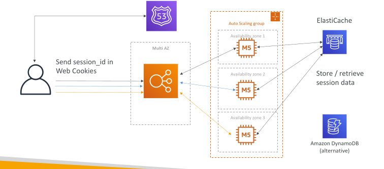

## Stateful Web App: MyClothes.com Storing User Data in a database

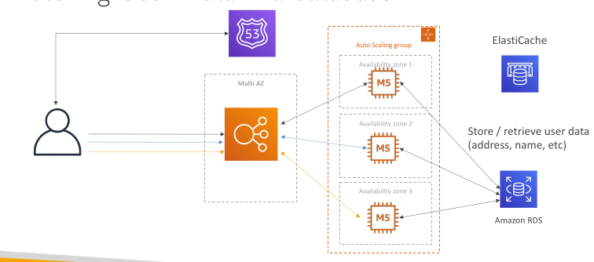

## Stateful Web App: MyClothes.com Scaling Reads
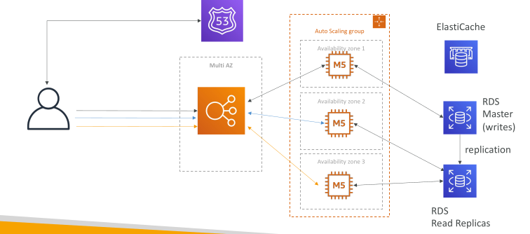

## Stateful Web App: MyClothes.com Scaling Reads (Alternative) – Lazy Loading

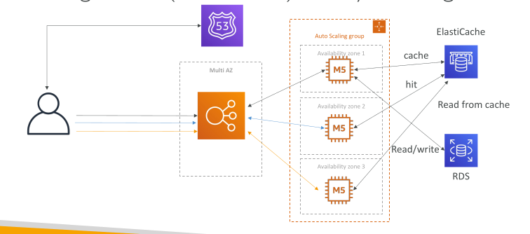

## Stateful Web App: MyClothes.com Multi AZ – Survive disasters

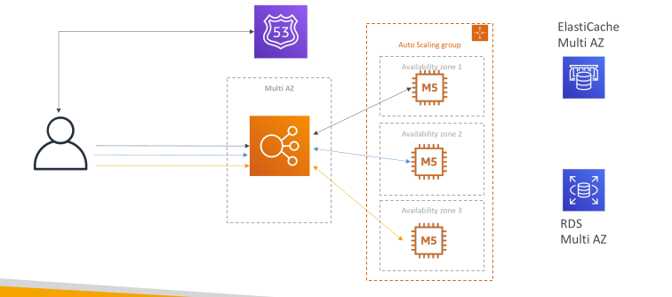

## Stateful Web App: MyClothes.com Security Groups
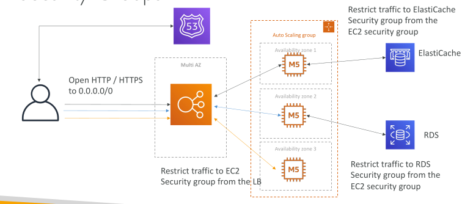

## In this lecture we’ve discussed… 3-tier architectures for web applications

• ELB sticky sessions

• Web clients for storing cookies and making our web app stateless

• ElastiCache
  - For storing sessions (alternative: DynamoDB)
  - For caching data from RDS
  - Multi AZ

• RDS
  - For storing user data
  - Read replicas for scaling reads
  - Multi AZ for disaster recovery

• Tight Security with security groups referencing each other

## Stateful Web App: MyWordPress.com

• We are trying to create a fully scalable WordPress website

• We want that website to access and correctly display picture uploads

• Our user data, and the blog content should be stored in a MySQL database.

• Let’s see how we can achieve this!

## Stateful Web App: MyWordPress.com RDS layer

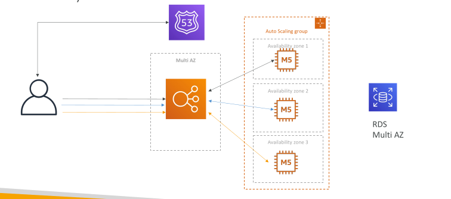

## Stateful Web App: MyWordPress.com Scaling with Aurora: Multi AZ & Read Replicas

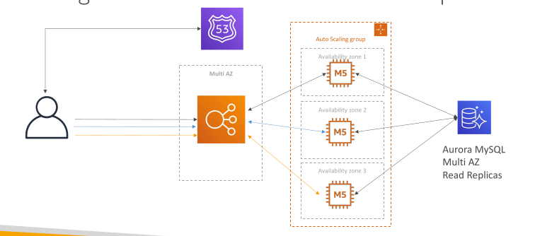

## Stateful Web App: MyWordPress.com Storing images with EBS

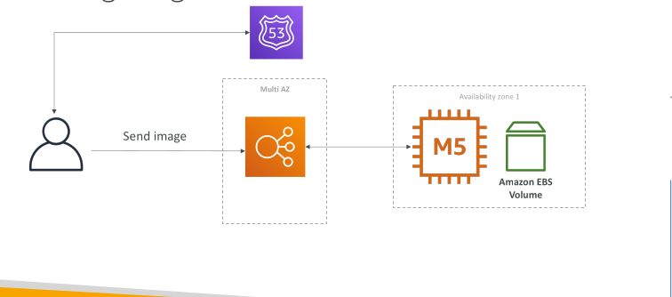

## Stateful Web App: MyWordPress.com Storing images with EBS

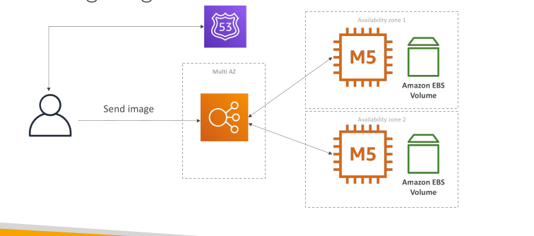

## Stateful Web App: MyWordPress.com Storing images with EFS

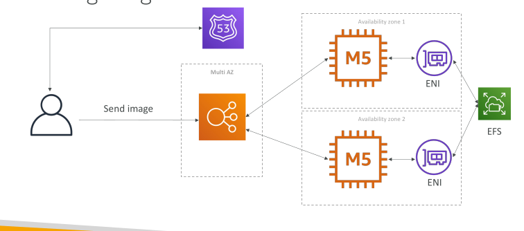

## In this lecture we’ve discussed…

• Aurora Database to have easy Multi-AZ and Read-Replicas

• Storing data in EBS (single instance application)

• Vs Storing data in EFS (distributed application)

## Instantiating Applications quickly

When launching a full stack (EC2, EBS, RDS), it can take time to:
  - Install applications
  - Insert initial (or recovery) data
  - Configure everything
  - Launch the application

• We can take advantage of the cloud to speed that up!

## Instantiating Applications quickly

EC2 Instances:
  - Use a Golden AMI: Install your applications, OS dependencies etc.. beforehand and launch your EC2 instance from the Golden AMI
  - Bootstrap using User Data: For dynamic configuration, use User Data scripts
  - Hybrid: mix Golden AMI and User Data (Elastic Beanstalk)

RDS Databases:
 - Restore from a snapshot: the database will have schemas and data ready!

EBS Volumes:
 - Restore from a snapshot: the disk will already be formatted and have data!

## Typical architecture: Web App 3-tier

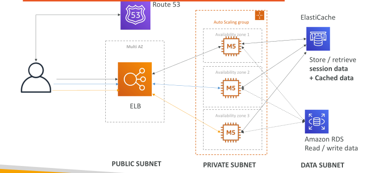

## Developer problems on AWS

• Managing infrastructure

• Deploying Code

• Configuring all the databases, load balancers, etc

• Scaling concerns

• Most web apps have the same architecture (ALB + ASG)

• All the developers want is for their code to run!

• Possibly, consistently across different applications and environments
