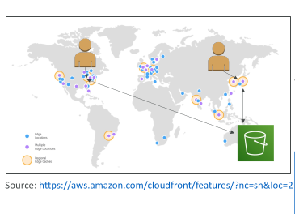
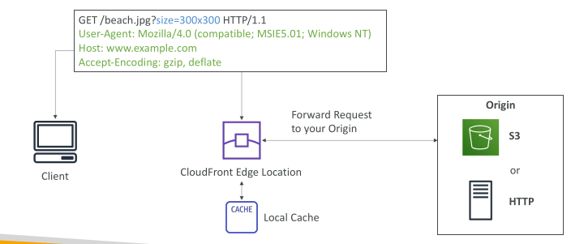
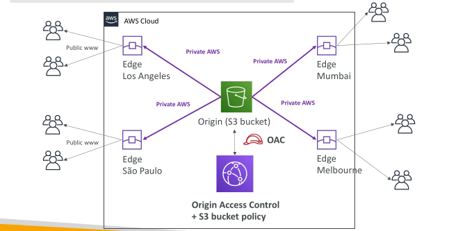
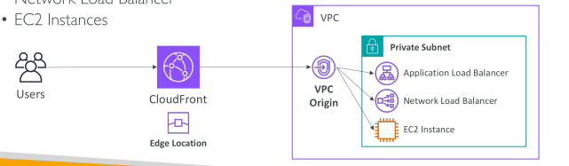
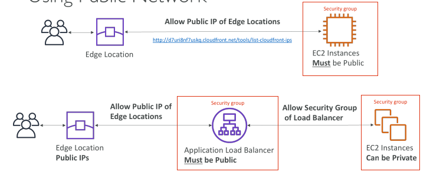
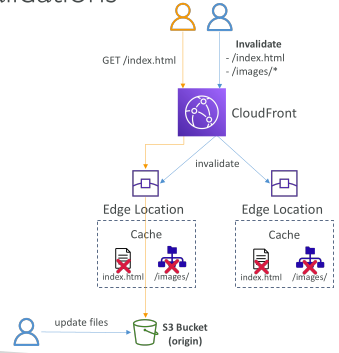
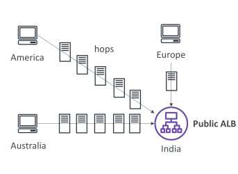
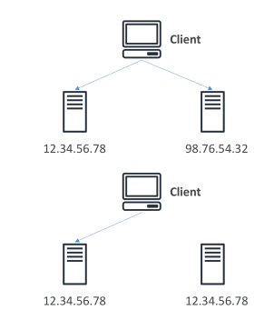
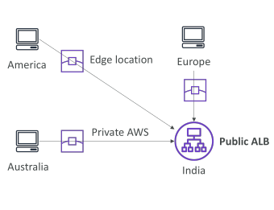

## S3 Access Logs

For audit purpose, you may want to log all access to S3 buckets

Any request made to S3, from any account, authorized or denied, will be logged into another S3 bucket

That data can be analyzed using data analysis tools…

The target logging bucket must be in the same AWS region

The log format is at: https://docs.aws.amazon.com/AmazonS3/latest/dev/LogFormat.html

.

## S3 Access Logs: Warning

• Do not set your logging bucket to be the monitored bucket

• It will create a logging loop, and your bucket will grow exponentially

## Amazon S3 – Pre-Signed URLs

Generate pre-signed URLs using the S3 Console, AWS CLI or SDK

URL Expiration
 - S3 Console – 1 min up to 720 mins (12 hours)
 - AWS CLI – configure expiration with --expires-in parameter in seconds
(default 3600 secs, max. 604800 secs ~ 168 hours)

Users given a pre-signed URL inherit the permissions of the user that generated the URL for GET / PUT

Examples:
 - Allow only logged-in users to download a premium video from your S3 bucket
 - Allow an ever-changing list of users to download files by generating URLs dynamically
 - Allow temporarily a user to upload a file to a precise location in your S3
bucket

## S3 Glacier Vault Lock - Exam important
Adopt a WORM (Write Once Read Many) model

Create a Vault Lock Policy

Lock the policy for future edits (can no longer be changed or deleted)

Helpful for compliance and data retention

## S3 Object Lock (versioning must be enabled) - Exam important

• Adopt a WORM (Write Once Read Many) model

• Block an object version deletion for a specified amount of time

Retention mode - Compliance:
 - Object versions can't be overwritten or deleted by any user, including the root user
 - Objects retention modes can't be changed, and retention periods can't be shortened

Retention mode - Governance:
 - Most users can't overwrite or delete an object version or alter its lock settings
 - Some users have special permissions to change the retention or delete the object

Retention Period: protect the object for a fixed period, it can be extended

Legal Hold:
 - protect the object indefinitely, independent from retention period
 - can be freely placed and removed using the s3:PutObjectLegalHold IAM permission

 ## S3 – Access Points

Access Points simplify security management for S3 Buckets
Each Access Point has:
 - its own DNS name (Internet Origin or VPC Origin)
 - an access point policy (similar to bucket policy) – manage security at scale

## S3 – Access Points – VPC Origin

• We can define the access point to be accessible only from within the VPC

• You must create a VPC Endpoint to access the Access Point (Gateway or Interface Endpoint)

• The VPC Endpoint Policy must allow access to the target bucket and Access Point

## S3 Object Lambda

Use AWS Lambda Functions to change the object before it is retrieved by the caller application

Only one S3 bucket is needed, on top of which we create S3 Access Point and S3 Object Lambda Access Points.

Use Cases:
- Redacting personally identifiable information for analytics or non- production environments.
- Converting across data formats, such as converting XML to JSON.
- Resizing and watermarking images on the fly using caller-specific details, such as the user who requested the object

## CloudFront & Global Accelerator

## Amazon CloudFront

• Content Delivery Network (CDN)

• Improves read performance, content is cached at the edge

• Improves users experience

• Hundreds of Points of Presence globally (edge locations, caches)

• DDoS protection (because worldwide), integration with Shield, AWS Web Application Firewall

## CloudFront – Origins

S3 bucket
 - For distributing files and caching them at the edge
 - For uploading files to S3 through CloudFront
 - Secured using Origin Access Control (OAC)

VPC Origin
 - For applications hosted in VPC private subnets
 - Private Application Load Balancer / Network Load Balancer / EC2 Instances

Custom Origin (HTTP)
 - S3 website (must first enable the bucket as a static S3 website)
 - Any public HTTP backend you want (example: Public ALB)

## CloudFront at a high level

## CloudFront – S3 as an Origin

## CloudFront vs S3 Cross Region Replication

CloudFront:
 - Global Edge network
 - Files are cached for a TTL (maybe a day)
 - Great for static content that must be available everywhere

S3 Cross Region Replication:
 - Must be setup for each region you want replication to happen
 - Files are updated in near real-time
 - Read only
   - Great for dynamic content that needs to be available at low-latency in few regions

## CloudFront – ALB or EC2 as an origin Using VPC Origins

Allows you to deliver content from your applications hosted in your VPC private subnets (no need to expose them on the Internet)
Deliver traffic to private:
 - Application Load Balancer
 - Network Load Balancer
 - EC2 Instances

## CloudFront – ALB or EC2 as an origin Using Public Network

## CloudFront Geo Restriction

You can restrict who can access your distribution
 - Allowlist: Allow your users to access your content only if they're in one of the countries on a list of approved countries.
 - Blocklist: Prevent your users from accessing your content if they're in one of the countries on a list of banned countries.

The “country” is determined using a 3rd party Geo-IP database

Use case: Copyright Laws to control access to content

## CloudFront – Cache Invalidations

• In case you update the back-end origin, CloudFront doesn’t know about it and will only get the refreshed content after the TTL has expired

• However, you can force an entire or partial cache refresh (thus bypassing the TTL) by performing a CloudFront Invalidation

• You can invalidate all files (*) or a special path (/images/*)

## Global users for our application

• You have deployed an application and have global users who want to access it directly.

• They go over the public internet, which can add a lot of latency due to many hops

• We wish to go as fast as possible through AWS network to minimize latency

## Unicast IP vs Anycast IP

Unicast IP: one server holds one IP address

Anycast IP: all servers hold the same IP address and the client is routed to the nearest one

## AWS Global Accelerator

• Leverage the AWS internal network to route to your application

• 2 Anycast IP are created for your application

• The Anycast IP send traffic directly to Edge Locations

• The Edge locations send the traffic to your application

## AWS Global Accelerator

Works with Elastic IP, EC2 instances, ALB, NLB, public or private

Consistent Performance
 - Intelligent routing to lowest latency and fast regional failover
 - No issue with client cache (because the IP doesn’t change)
 - Internal AWS network

Health Checks
 - Global Accelerator performs a health check of your applications
 - Helps make your application global (failover less than 1 minute for unhealthy)
 - Great for disaster recovery (thanks to the health checks)

Security
 - only 2 external IP need to be whitelisted
 - DDoS protection thanks to AWS Shield

## AWS Global Accelerator vs CloudFront

They both use the AWS global network and its edge locations around the world
Both services integrate with AWS Shield for DDoS protection.

CloudFront
 - Improves performance for both cacheable content (such as images and videos)
 - Dynamic content (such as API acceleration and dynamic site delivery)
 - Content is served at the edge

Global Accelerator
 - Improves performance for a wide range of applications over TCP or UDP
 - Proxying packets at the edge to applications running in one or more AWS Regions.
 - Good fit for non-HTTP use cases, such as gaming (UDP), IoT (MQTT), or Voice over IP
 - Good for HTTP use cases that require static IP addresses
 - Good for HTTP use cases that required deterministic, fast regional failover

 ## AWS Storage Extras

 ## AWS Snowball

Highly-secure, portable devices to collect and process data at the edge, and migrate data into and out of AWS

Helps migrate up to Petabytes of data

## Data Migrations with Snowball

| Data Size  | 100 Mbps |   1 Gbps |  10 Gbps |
| ---------- | -------: | -------: | -------: |
| **10 TB**  |  12 days | 30 hours |  3 hours |
| **100 TB** | 124 days |  12 days | 30 hours |
| **1 PB**   |  3 years | 124 days |  12 days |

Challenges:
 - Limited connectivity
 - Limited bandwidth
 - High network cost
 - Shared bandwidth (can’t maximize the line)
 - Connection stability

AWS Snowball: offline devices to perform data migrations

If it takes more than a week to transfer over the network, use Snowball devices!

## Diagrams

• Direct upload to S3:

• With Snowball:

## What is Edge Computing?

Process data while it’s being created on an edge location
 - A truck on the road, a ship on the sea, a mining station underground...

These locations may have limited internet and no access to computing power

We setup a Snowball Edge device to do edge computing
 - Snowball Edge Compute Optimized (dedicated for that use case) & Storage Optimized
 - Run EC2 Instances or Lambda functions at the edge

Use cases: preprocess data, machine learning, transcoding media

## Solution Architecture: Snowball into Glacier

• Snowball cannot import to Glacier directly

• You must use Amazon S3 first, in combination with an S3 lifecycle policy

## Tasks

1. Create another bucket that will be collecting logs for your first s3 bucket. In the permissions of the first bucket enable logging and link to the new bucket and check if the bucket policy is changed to allow logging

2. Create a pre signed url from an object in a bucket that is private like th event notification one. Copy it somewhere and open with another device. Set the presigned url to expire after 5 minutes