## Amazon S3 – Security

## Amazon S3 – Object Encryption

You can encrypt objects in S3 buckets using one of 4 methods

Server-Side Encryption (SSE)
 - Server-Side Encryption with Amazon S3-Managed Keys (SSE-S3) – Enabled by Default
   - Encrypts S3 objects using keys handled, managed, and owned by AWS
 - Server-Side Encryption with KMS Keys stored in AWS KMS (SSE-KMS)
   - Leverage AWS Key Management Service (AWS KMS) to manage encryption keys
 - Server-Side Encryption with Customer-Provided Keys (SSE-C)
   - When you want to manage your own encryption keys

Client-Side Encryption

It’s important to understand which ones are for which situation for the exam

## Amazon S3 Encryption – SSE-S3

• Encryption using keys handled, managed, and owned by AWS

• Object is encrypted server-side

• Encryption type is AES-256

• Must set header "x-amz-server-side-encryption": "AES256"

• Enabled by default for new buckets & new objects

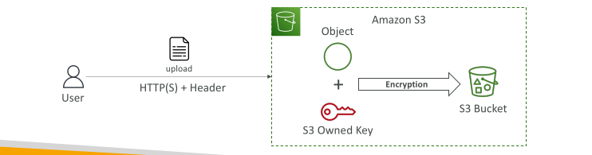

## Amazon S3 Encryption – SSE-KMS

• Encryption using keys handled and managed by AWS KMS (Key Management Service)

• KMS advantages: user control + audit key usage using CloudTrail

• Object is encrypted server side

• Must set header "x-amz-server-side-encryption": "aws:kms"

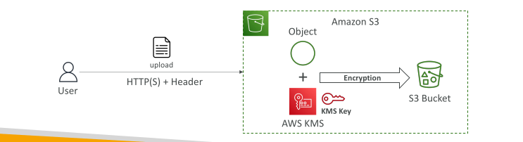

## SSE-KMS Limitation

• If you use SSE-KMS, you may be impacted by the KMS limits

• When you upload, it calls the GenerateDataKey KMS API

• When you download, it calls the Decrypt KMS API

• Count towards the KMS quota per second (5500, 10000, 30000 req/s based on region)

• You can request a quota increase using the Service Quotas Console

EXAM important - if you have a very high throughput s3 bucket and everything is encrypted using kms keys, you may go into a thread link kind of use case 

Example: During a viral event, thousands of users upload and download videos every second. Each upload triggers a GenerateDataKey call and each download triggers a Decrypt call to KMS, so the combined request rate quickly hits the regional KMS quota (e.g., 5,500 req/s). Once that limit is exceeded, KMS starts throttling, and S3 requests begin failing even though S3 itself has plenty of capacity. The fix is to request a quota increase through the Service Quotas Console (or, for the exam, recognize that SSE-S3 doesn't have this bottleneck).

GenerateDataKey: KMS creates a unique data key and returns it in two forms, plaintext and encrypted. S3 uses the plaintext key to encrypt your object, then discards it and stores the encrypted copy alongside the object.

Decrypt: When you download the object, S3 sends the stored encrypted data key to KMS, which decrypts it and returns the plaintext key so S3 can decrypt your object.

This is called envelope encryption: KMS protects the small data key, and the data key protects your actual file.

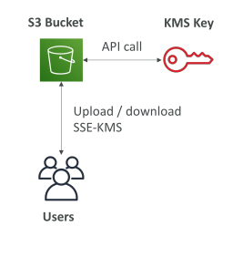

## Amazon S3 Encryption – SSE-C

• Server-Side Encryption using keys fully managed by the customer outside of AWS

• Amazon S3 does NOT store the encryption key you provide

• HTTPS must be used

• Encryption key must provided in HTTP headers, for every HTTP request made

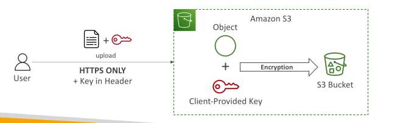

## Amazon S3 Encryption – Client-Side Encryption

• Use client libraries such as Amazon S3 Client-Side Encryption Library

• Clients must encrypt data themselves before sending to Amazon S3

• Clients must decrypt data themselves when retrieving from Amazon S3

• Customer fully manages the keys and encryption cycle

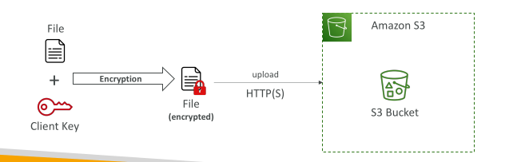

## Amazon S3 – Encryption in transit (SSL/TLS)

Encryption in flight is also called SSL/TLS

Amazon S3 exposes two endpoints:
 - HTTP Endpoint – non encrypted
 - HTTPS Endpoint – encryption in flight

HTTPS is recommended

HTTPS is mandatory for SSE-C

Most clients would use the HTTPS endpoint by default

## Amazon S3 – Force Encryption in Transit aws:SecureTransport

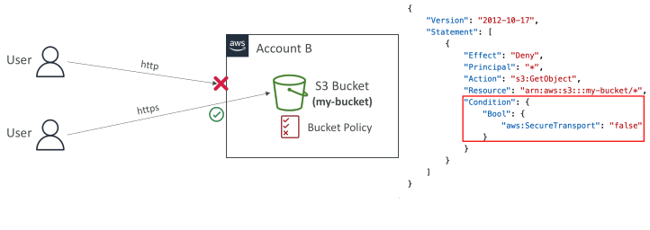

## Not in the note

Read About DSSE-KMS

## Amazon S3 – Default Encryption vs. Bucket Policies

• SSE-S3 encryption is automatically applied to new objects stored in S3 bucket

• Optionally, you can “force encryption” using a bucket policy and refuse any API call to PUT an S3 object without encryption headers (SSE-KMS or SSE-C)

• Note: Bucket Policies are evaluated before “Default Encryption”

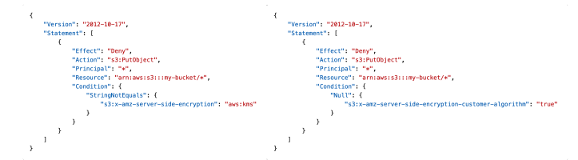

## What is CORS? - Exam important

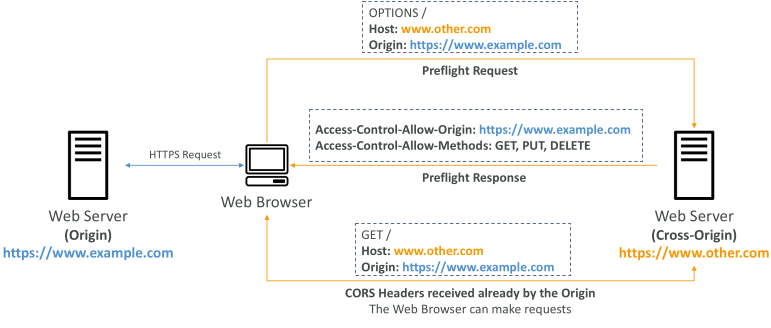

## Amazon S3 – CORS - Exam important

• If a client makes a cross-origin request on our S3 bucket, we need to enable the correct CORS headers

• It’s a popular exam question

• You can allow for a specific origin or for * (all origins)

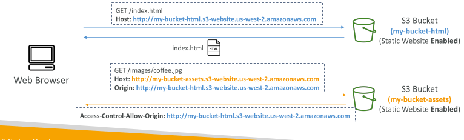

## Amazon S3 – MFA Delete

MFA (Multi-Factor Authentication) – force users to generate a code on a device (usually a mobile phone or hardware) before doing important operations on S3

MFA will be required to:
 - Permanently delete an object version
 - Suspend Versioning on the bucket 

MFA won’t be required to:
 - Enable Versioning
 - List deleted versions
 
To use MFA Delete, Versioning must be enabled on the bucket

Only the bucket owner (root account) can enable/disable MFA Delete

## S3 Access Logs

For audit purpose, you may want to log all access to S3 buckets

Any request made to S3, from any account, authorized or denied, will be logged into another S3 bucket

That data can be analyzed using data analysis tools…

The target logging bucket must be in the same AWS region

The log format is at: https://docs.aws.amazon.com/AmazonS3/latest/dev/LogFormat.html

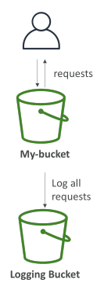.

## S3 Access Logs: Warning

• Do not set your logging bucket to be the monitored bucket

• It will create a logging loop, and your bucket will grow exponentially

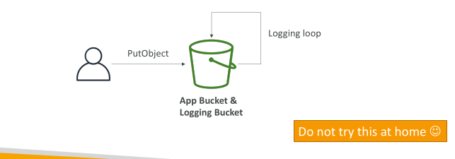

## Amazon S3 – Pre-Signed URLs

Generate pre-signed URLs using the S3 Console, AWS CLI or SDK

URL Expiration
 - S3 Console – 1 min up to 720 mins (12 hours)
 - AWS CLI – configure expiration with --expires-in parameter in seconds
(default 3600 secs, max. 604800 secs ~ 168 hours)

Users given a pre-signed URL inherit the permissions of the user that generated the URL for GET / PUT

Examples:
 - Allow only logged-in users to download a premium video from your S3 bucket
 - Allow an ever-changing list of users to download files by generating URLs dynamically
 - Allow temporarily a user to upload a file to a precise location in your S3
bucket

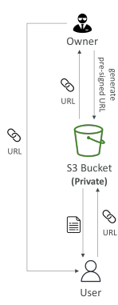

## S3 Glacier Vault Lock - Exam important
Adopt a WORM (Write Once Read Many) model

Create a Vault Lock Policy

Lock the policy for future edits (can no longer be changed or deleted)

Helpful for compliance and data retention

A financial firm must keep trade records for 7 years and prove no one can delete them early, not even the root user. They create a Glacier vault and attach a Vault Lock policy that denies glacier:DeleteArchive for any archive younger than 2,555 days (about 7 years). When they run initiate-vault-lock, the policy enters an InProgress state and returns a lock ID, giving them 24 hours to test it. Once satisfied, they run complete-vault-lock with that ID, and the policy becomes permanent: it can never be edited or removed. From then on, new archives can still be written and read any time (WORM: Write Once Read Many), but early deletion is blocked for everyone, which satisfies regulatory retention requirements.

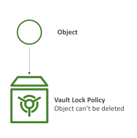

## S3 Object Lock (versioning must be enabled) - Exam important

• Adopt a WORM (Write Once Read Many) model

• Block an object version deletion for a specified amount of time

Retention mode - Compliance:
 - Object versions can't be overwritten or deleted by any user, including the root user
 - Objects retention modes can't be changed, and retention periods can't be shortened

Retention mode - Governance:
 - Most users can't overwrite or delete an object version or alter its lock settings
 - Some users have special permissions to change the retention or delete the object

Retention Period: protect the object for a fixed period, it can be extended

Legal Hold:
 - protect the object indefinitely, independent from retention period
 - can be freely placed and removed using the s3:PutObjectLegalHold IAM permission

 ## S3 – Access Points

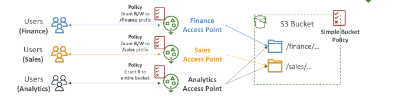

Access Points simplify security management for S3 Buckets
Each Access Point has:
 - its own DNS name (Internet Origin or VPC Origin)
 - an access point policy (similar to bucket policy) – manage security at scale

## S3 – Access Points – VPC Origin

• We can define the access point to be accessible only from within the VPC

• You must create a VPC Endpoint to access the Access Point (Gateway or Interface Endpoint)

• The VPC Endpoint Policy must allow access to the target bucket and Access Point

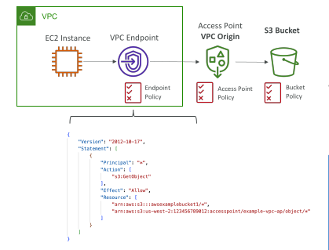

## S3 Object Lambda

Use AWS Lambda Functions to change the object before it is retrieved by the caller application

Only one S3 bucket is needed, on top of which we create S3 Access Point and S3 Object Lambda Access Points.

Use Cases:
- Redacting personally identifiable information for analytics or non- production environments.
- Converting across data formats, such as converting XML to JSON.
- Resizing and watermarking images on the fly using caller-specific details, such as the user who requested the object
