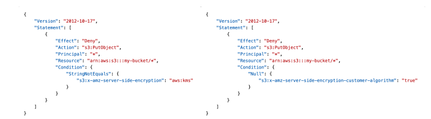

## Amazon S3 – Security

## Amazon S3 – Object Encryption

You can encrypt objects in S3 buckets using one of 4 methods

Server-Side Encryption (SSE)
 - Server-Side Encryption with Amazon S3-Managed Keys (SSE-S3) – Enabled by Default
   - Encrypts S3 objects using keys handled, managed, and owned by AWS
 - Server-Side Encryption with KMS Keys stored in AWS KMS (SSE-KMS)
   - Leverage AWS Key Management Service (AWS KMS) to manage encryption keys
 - Server-Side Encryption with Customer-Provided Keys (SSE-C)
   - When you want to manage your own encryption keys

Client-Side Encryption

It’s important to understand which ones are for which situation for the exam

## Amazon S3 Encryption – SSE-S3

• Encryption using keys handled, managed, and owned by AWS

• Object is encrypted server-side

• Encryption type is AES-256

• Must set header "x-amz-server-side-encryption": "AES256"

• Enabled by default for new buckets & new objects

## Amazon S3 Encryption – SSE-KMS

• Encryption using keys handled, managed, and owned by AWS

• Object is encrypted server-side

• Encryption type is AES-256

• Must set header "x-amz-server-side-encryption": "AES256"

• Enabled by default for new buckets & new objects

## Amazon S3 Encryption – SSE-KMS

• Encryption using keys handled and managed by AWS KMS (Key Management Service)

• KMS advantages: user control + audit key usage using CloudTrail

• Object is encrypted server side

• Must set header "x-amz-server-side-encryption": "aws:kms"

## SSE-KMS Limitation

• If you use SSE-KMS, you may be impacted by the KMS limits

• When you upload, it calls the GenerateDataKey KMS API

• When you download, it calls the Decrypt KMS API

• Count towards the KMS quota per second (5500, 10000, 30000 req/s based on region)

• You can request a quota increase using the Service Quotas Console

EXAM important - if you have a very high throughput s3 bucket and everything is encrypted using kms keys, you may go into a thread link kind of use case 

## Amazon S3 Encryption – SSE-C

• Server-Side Encryption using keys fully managed by the customer outside of AWS

• Amazon S3 does NOT store the encryption key you provide

• HTTPS must be used

• Encryption key must provided in HTTP headers, for every HTTP request made

## Amazon S3 Encryption – Client-Side Encryption

• Use client libraries such as Amazon S3 Client-Side Encryption Library

• Clients must encrypt data themselves before sending to Amazon S3

• Clients must decrypt data themselves when retrieving from Amazon S3

• Customer fully manages the keys and encryption cycle

## Amazon S3 – Encryption in transit (SSL/TLS)

Encryption in flight is also called SSL/TLS

Amazon S3 exposes two endpoints:
 - HTTP Endpoint – non encrypted
 - HTTPS Endpoint – encryption in flight

HTTPS is recommended

HTTPS is mandatory for SSE-C

Most clients would use the HTTPS endpoint by default

## Amazon S3 – Force Encryption in Transit aws:SecureTransport

## Not in the note

Read About DSSE-KMS

## Amazon S3 – Default Encryption vs. Bucket Policies

• SSE-S3 encryption is automatically applied to new objects stored in S3 bucket

• Optionally, you can “force encryption” using a bucket policy and refuse any API call to PUT an S3 object without encryption headers (SSE-KMS or SSE-C)

• Note: Bucket Policies are evaluated before “Default Encryption”

## What is CORS? - Exam important

## Amazon S3 – CORS - Exam important

• If a client makes a cross-origin request on our S3 bucket, we need to enable the correct CORS headers

• It’s a popular exam question

• You can allow for a specific origin or for * (all origins)

## Amazon S3 – MFA Delete

MFA (Multi-Factor Authentication) – force users to generate a code on a device (usually a mobile phone or hardware) before doing important operations on S3

MFA will be required to:
 - Permanently delete an object version
 - Suspend Versioning on the bucket 

MFA won’t be required to:
 - Enable Versioning
 - List deleted versions
 
To use MFA Delete, Versioning must be enabled on the bucket

Only the bucket owner (root account) can enable/disable MFA Delete