 ## AWS Storage Extras

 ## AWS Snowball

Highly-secure, portable devices to collect and process data at the edge, and migrate data into and out of AWS

Helps migrate up to Petabytes of data

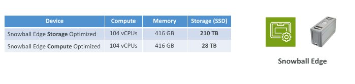

## Data Migrations with Snowball

| Data Size  | 100 Mbps |   1 Gbps |  10 Gbps |
| ---------- | -------: | -------: | -------: |
| **10 TB**  |  12 days | 30 hours |  3 hours |
| **100 TB** | 124 days |  12 days | 30 hours |
| **1 PB**   |  3 years | 124 days |  12 days |

Challenges:
 - Limited connectivity
 - Limited bandwidth
 - High network cost
 - Shared bandwidth (can’t maximize the line)
 - Connection stability

AWS Snowball: offline devices to perform data migrations

If it takes more than a week to transfer over the network, use Snowball devices!

## Diagrams

• Direct upload to S3:

• With Snowball:

## What is Edge Computing?

Process data while it’s being created on an edge location
 - A truck on the road, a ship on the sea, a mining station underground...

These locations may have limited internet and no access to computing power

We setup a Snowball Edge device to do edge computing
 - Snowball Edge Compute Optimized (dedicated for that use case) & Storage Optimized
 - Run EC2 Instances or Lambda functions at the edge

Use cases: preprocess data, machine learning, transcoding media

## Solution Architecture: Snowball into Glacier

• Snowball cannot import to Glacier directly

• You must use Amazon S3 first, in combination with an S3 lifecycle policy

## Tasks

1. Create another bucket that will be collecting logs for your first s3 bucket. In the permissions of the first bucket enable logging and link to the new bucket and check if the bucket policy is changed to allow logging

2. Create a pre signed url from an object in a bucket that is private like th event notification one. Copy it somewhere and open with another device. Set the presigned url to expire after 5 minutes

## Amazon FSx – Overview

• Launch 3rd party high-performance file systems on AWS
• Fully managed service

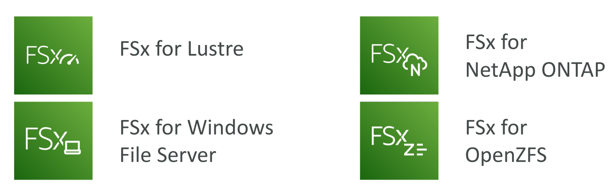

## Amazon FSx for Windows (File Server)

FSx for Windows is a fully managed Windows file system share drive

Supports SMB protocol & Windows NTFS

Microsoft Active Directory integration, ACLs, user quotas

Can be mounted on Linux EC2 instances

Supports Microsoft's Distributed File System (DFS) Namespaces (group files across multiple FS)

Scale up to 10s of GB/s, millions of IOPS, 100s PB of data
Storage Options:
 - SSD – latency sensitive workloads (databases, media processing, data analytics, …)
 - HDD – broad spectrum of workloads (home directory, CMS, …)

Can be accessed from your on-premises infrastructure (VPN or Direct Connect)

Can be configured to be Multi-AZ (high availability)

Data is backed-up daily to S3

## Amazon FSx for Lustre - Exam important

Lustre is a type of parallel distributed file system, for large-scale computing

The name Lustre is derived from “Linux” and “cluster

Machine Learning, High Performance Computing (HPC)

Video Processing, Financial Modeling, Electronic Design Automation

Scales up to 100s GB/s, millions of IOPS, sub-ms latencies

Storage Options:
 - SSD – low-latency, IOPS intensive workloads, small & random file operations
 - HDD – throughput-intensive workloads, large & sequential file operations

Seamless integration with S3 - Exam important
 - Can “read S3” as a file system (through FSx)
 - Can write the output of the computations back to S3 (through FSx)

Can be used from on-premises servers (VPN or Direct Connect)

## FSx Lustre - File System Deployment Options

Scratch File System
 - Temporary storage
 - Data is not replicated (doesn’t persist if file server fails)
 - High burst (6x faster, 200MBps per TiB)
 - Usage: short-term processing, optimize costs

Persistent File System
 - Long-term storage
 - Data is replicated within same AZ
 - Replace failed files within minutes
 - Usage: long-term processing, sensitive data

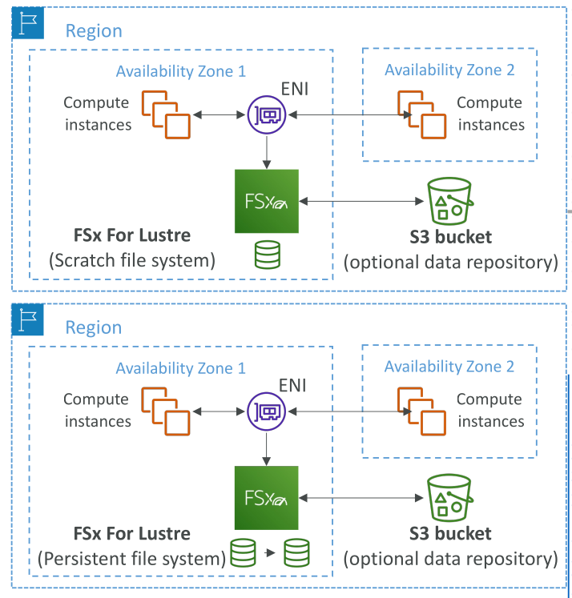

## Amazon FSx for NetApp ONTAP

NetApp ONTAP is NetApp's storage operating system for managing data across on-premises arrays, hybrid setups, and the cloud.

Managed NetApp ONTAP on AWS

File System compatible with NFS, SMB, iSCSI protocol

Move workloads running on ONTAP or NAS to AWS

Works with:
 - Linux
 - Windows
 - MacOS
 - VMware Cloud on AWS
 - Amazon Workspaces & AppStream 2.0
 - Amazon EC2, ECS and EKS

Storage shrinks or grows automatically

Snapshots, replication, low-cost, compression and data de-duplication

Point-in-time instantaneous cloning (helpful for testing new workloads)

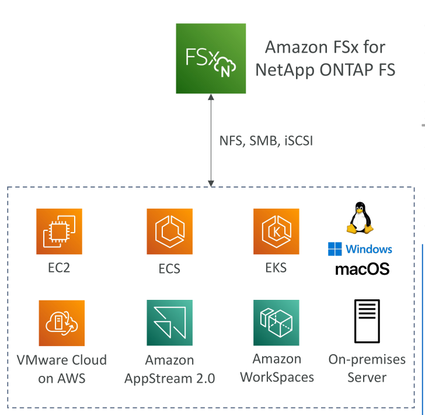

## Amazon FSx for OpenZFS

OpenZFS is an open-source file system and volume manager that combines the two into one layer, originally developed at Sun Microsystems.

Managed OpenZFS file system on AWS

File System compatible with NFS (v3, v4, v4.1, v4.2)

Move workloads running on ZFS to AWS

Works with:
 - Linux
 - Windows
 - MacOS
 - VMware Cloud on AWS
 - Amazon Workspaces & AppStream 2.0
 - Amazon EC2, ECS and EKS

Up to 1,000,000 IOPS with < 0.5ms latency

Snapshots, compression and low-cost

Point-in-time instantaneous cloning (helpful for testing new workloads)

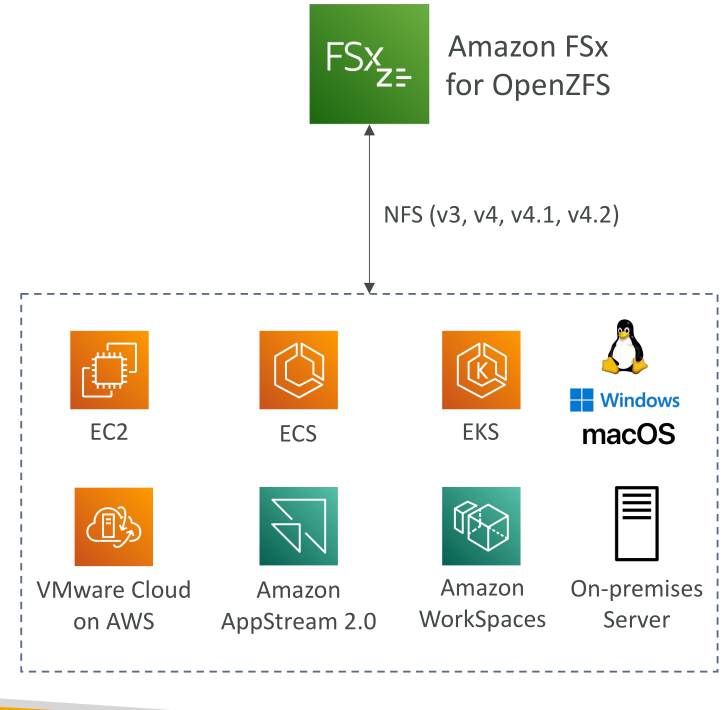

## Hybrid Cloud for Storage

AWS is pushing for ”hybrid cloud”
 - Part of your infrastructure is on the cloud
 - Part of your infrastructure is on-premises

This can be due to
 - Long cloud migrations
 - Security requirements
 - Compliance requirements
 - IT strategy

S3 is a proprietary storage technology (unlike EFS / NFS), so how do you expose the S3 data on-premises?

AWS Storage Gateway!

## AWS Storage Cloud Native Options

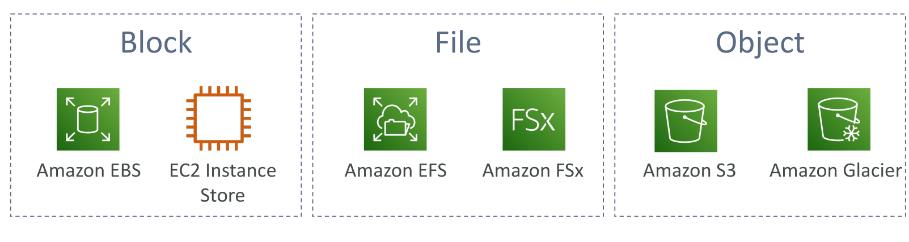

## AWS Storage Gateway

Bridge between on-premises data and cloud data

Use cases:
 - disaster recovery
 - backup & restore
 - tiered storage
 - on-premises cache & low-latency files access

Types of Storage Gateway:
 - S3 File Gateway
 - Volume Gateway
 - Tape Gateway

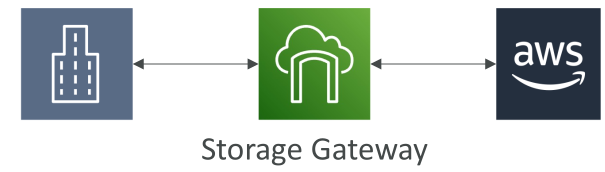

## Amazon S3 File Gateway

Configured S3 buckets are accessible using the NFS and SMB protocol

Most recently used data is cached in the file gateway

Supports S3 Standard, S3 Standard IA, S3 One Zone A, S3 Intelligent Tiering

Transition to S3 Glacier using a Lifecycle Policy

Bucket access using IAM roles for each File Gateway

SMB Protocol has integration with Active Directory (AD) for user authentication

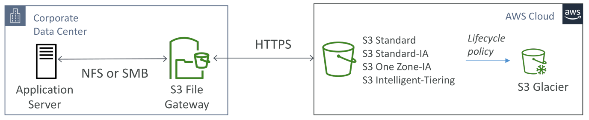

## Volume Gateway - Exam important

Block storage using iSCSI protocol backed by S3

Backed by EBS snapshots which can help restore on-premises volumes!

Cached volumes: low latency access to most recent data

Stored volumes: entire dataset is on premise, scheduled backups to S3

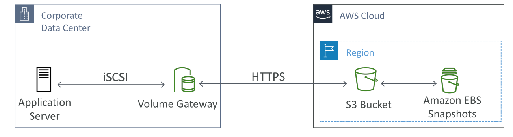

## Tape Gateway

Some companies have backup processes using physical tapes (!)

With Tape Gateway, companies use the same processes but, in the cloud

Virtual Tape Library (VTL) backed by Amazon S3 and Glacier

Back up data using existing tape-based processes (and iSCSI interface)

Works with leading backup software vendors

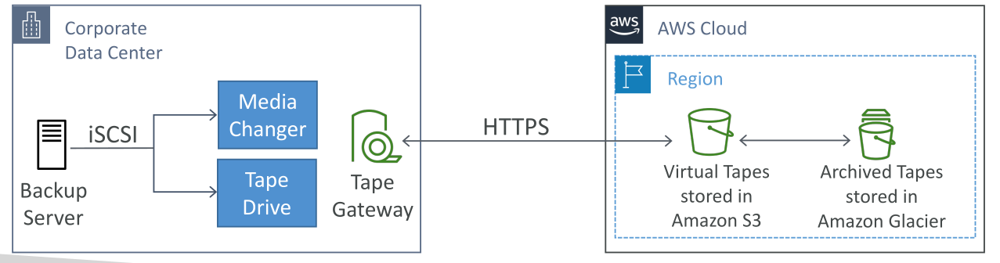

## AWS Storage Gateway

## AWS Transfer Family

A fully-managed service for file transfers into and out of Amazon S3 or Amazon EFS using the FTP protocol

Supported Protocols
 - AWS Transfer for FTP (File Transfer Protocol (FTP))
 - AWS Transfer for FTPS (File Transfer Protocol over SSL (FTPS))
 - AWS Transfer for SFTP (Secure File Transfer Protocol (SFTP))

Managed infrastructure, Scalable, Reliable, Highly Available (multi-AZ)

Pay per provisioned endpoint per hour + data transfers in GB

Store and manage users’ credentials within the service

Integrate with existing authentication systems (Microsoft Active Directory, LDAP, Okta, Amazon Cognito, custom)

Usage: sharing files, public datasets, CRM, ERP, …

## AWS Transfer Family

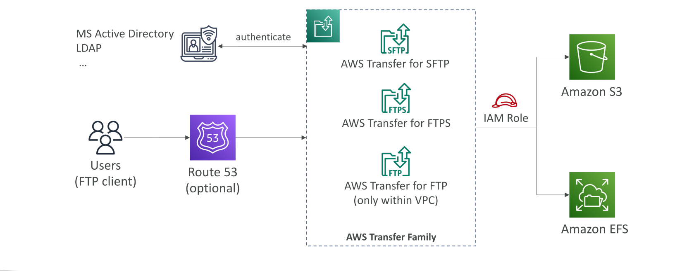

## AWS DataSync - EXAM Important

Move large amount of data to and from
 - On-premises / other cloud to AWS (NFS, SMB, HDFS, S3 API…) – needs agent
 - AWS to AWS (different storage services) – no agent needed

Can synchronize to:
 - Amazon S3 (any storage classes – including Glacier)
 - Amazon EFS
 - Amazon FSx (Windows, Lustre, NetApp, OpenZFS...)

Replication tasks can be scheduled hourly, daily, weekly

File permissions and metadata are preserved (NFS POSIX, SMB…) (EXAM IMPORTANT)

One agent task can use 10 Gbps, can setup a bandwidth limit

## AWS DataSync NFS / SMB to AWS (S3, EFS, FSx…)

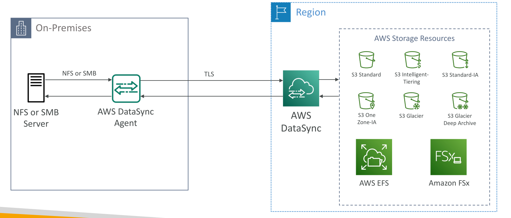

Sometimes at the exam we willtell you that we want to use DataSync, but we don't have the network capacity to do so. A solutionis to use the aws snowcone device specifically because it comes with a datasync agent preinstalled in it. So you can run snowcone on premises, then it willpull your data, run the datasync agents then it will be shipped back into ouraws region the sync your data to the storage resources of AWS 

## AWS DataSync Transfer between AWS storage services - EXAM important

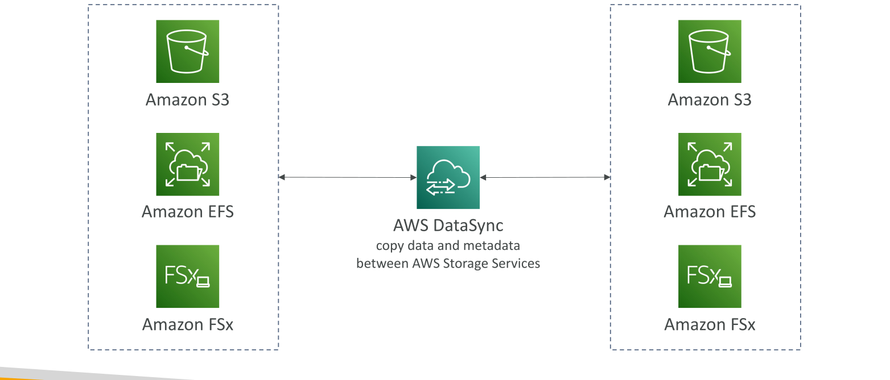

Also during syncing the metadata will be kept consistent between the services - Exam important

## Storage Comparison

S3: Object Storage

S3 Glacier: Object Archival

EBS volumes: Network storage for one EC2 instance at a time

Instance Storage: Physical storage for your EC2 instance (high IOPS)

EFS: Network File System for Linux instances, POSIX filesystem

FSx for Windows: Network File System for Windows servers

FSx for Lustre: High Performance Computing Linux file system

FSx for NetApp ONTAP: High OS Compatibility

FSx for OpenZFS: Managed ZFS file system

Storage Gateway: S3 & FSx File Gateway, Volume Gateway (cache & stored), Tape Gateway

Transfer Family: FTP, FTPS, SFTP interface on top of Amazon S3 or Amazon EFS

DataSync: Schedule data sync from on-premises to AWS, or AWS to AWS

Snowcone / Snowball / Snowmobile: to move large amount of data to the cloud, physically

Database: for specific workloads, usually with indexing and querying
